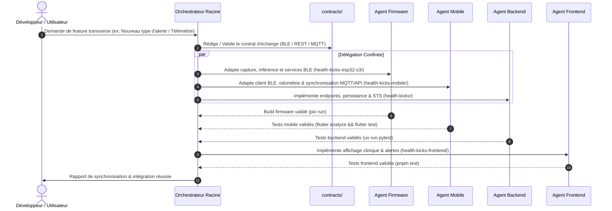

# Manifeste de Gouvernance Multi-Agents - HealthKicks Ecosystem

Bienvenue dans l'architecture multi-agents de l'écosystème **HealthKicks**. Ce document définit le cadre opérationnel, les responsabilités de l'agent orchestrateur racine, ainsi que les règles non négociables s'appliquant à tous les sous-agents spécialisés.

---

## 0. Contexte Métier & Architecture Globale

**HealthKicks** est un écosystème connecté de surveillance et d'analyse biomécanique en temps réel combinant intelligence embarquée à la source (*Firmware ESP32-S3*), passerelle mobile de terrain (*Mobile Flutter*), centralisation analytique (*Backend FastAPI*) et restitution clinique (*Frontend Angular*).

#### Pipeline de données
```text
[ Chaussure Connectée ESP32-S3 ]
         │ (BLE GATT LESC Chiffré / Fast Burst)
         ▼
[ health-kicks-mobile ] ──(REST / MQTT WebSockets SigV4)──┬──► [ health-kicks ] (API FastAPI / PostgreSQL / DynamoDB)
  (Flutter / Dart UI)                                     │           │
                                                          │           │ (REST OpenAPI / WebSockets)
                                                          ▼           ▼
                                                 [ health-kicks-frontend ] (Angular 22 UI)
```

### Périmètre des sous-projets indépendants
* **`health-kicks-esp32-s3/` (Firmware)** : Firmware embarqué FreeRTOS / PlatformIO (ESP32-S3), acquisition MPU-6050 19 Hz, inférence locale d'activité et de chute multiclasse en C++, serveur BLE GATT LESC sécurisé, contrôle haptique PWM et bootloader OTA avec rollback automatique.
* **`health-kicks-mobile/` (Mobile)** : Application mobile Flutter / Dart, acquisition directe des données capteurs via client BLE GATT, déclenchement de commandes haptiques, odométrie différentielle SQLite, synchronisation REST et passerelle MQTT AWS IoT Core (WebSockets SigV4).
* **`health-kicks/` (Backend)** : API REST FastAPI, persistance relationnelle PostgreSQL (Aurora) et séries temporelles DynamoDB, gestion des comptes/profils, RBAC, négociation de jetons AWS STS et pipeline ML d'entraînement / génération de modèles C.
* **`health-kicks-frontend/` (Frontend)** : Application web Angular 22 (Signals, Standalone), tableaux de bord de suivi clinique, visualisation des signaux IMU en direct et requalification Studio.

### Références documentaires partagées
* `docs/architecture/system_overview.md`
* `docs/architecture/invariants.md`
* `contracts/ble_gatt_specs.md`
* `contracts/README.md`

---

## 1. Rôle de l'Orchestrateur Racine

L'**Orchestrateur Racine** supervise l'écosystème dans sa globalité. Il a pour mandat :
1. De maintenir l'intégrité de l'arborescence, des sous-modules Git et de la configuration du workspace multi-racines.
2. De déléguer les tâches d'implémentation aux sous-agents spécialisés selon leur domaine d'expertise.
3. D'arbitrer les évolutions de contrats dans le répertoire `contracts/` selon le protocole Spec-First.
4. De garantir la cohérence inter-projets et le respect des invariants d'architecture (`docs/architecture/invariants.md`).

---

## 2. Les Trois Règles d'Or (Non Négociables)

### Règle d'Or 1 : Approche Contract-Driven & Spec-First
* Tout changement impactant la communication entre deux sous-projets (BLE GATT, REST API, payload MQTT, format de fichier de modèle ML, types partagés) **doit obligatoirement débuter par la mise à jour ou la validation du contrat dans `contracts/`**.
* Aucun agent spécialisé ne peut unilatéralement modifier une signature d'API ou un payload sans accord de contrat validé par l'orchestrateur.

### Règle d'Or 2 : Confinement Strict du Périmètre de Modification
* Chaque sous-agent est confiné dans le sous-dossier de son projet :
  * `firmware-dev` : modifications autorisées **uniquement** dans `health-kicks-esp32-s3/`.
  * `mobile-dev` : modifications autorisées **uniquement** dans `health-kicks-mobile/`.
  * `backend-dev` : modifications autorisées **uniquement** dans `health-kicks/`.
  * `frontend-dev` : modifications autorisées **uniquement** dans `health-kicks-frontend/`.
* **Interdiction formelle** d'éditer le code source d'un sous-projet voisin ou les fichiers racine sans délégation explicite de l'orchestrateur.
* L'accès au répertoire `contracts/` et `docs/` est autorisé **en lecture seule** pour les agents spécialisés (les modifications de contrat sont pilotées ou arbitrées par l'orchestrateur).

### Règle d'Or 3 : Validation Systématique des Tests Locaux Avant Tout Commit
* Aucun sous-agent ne peut déclarer une tâche terminée ou commiter des modifications si les suites de tests unitaires et d'intégration de son périmètre ne sont pas 100% au vert :
  * `health-kicks-esp32-s3` : `uv tool run --from platformio pio run`
  * `health-kicks-mobile` : `flutter analyze && flutter test`
  * `health-kicks` : `uv run pytest` (ou `python -m pytest`)
  * `health-kicks-frontend` : `pnpm test` (ou `pnpm test:ci` / `ng test --watch=false`)
* Tout échec de test bloque immédiatement le workflow et impose une correction prioritaire.

### Règle d'Or 4 : Commits Granulaires Systématiques à Chaque Étape Significative
* Dès qu'une sous-tâche, refactorisation ou fonctionnalité est validée et que les tests associés sont 100% au vert, l'agent **doit impérativement créer un commit Git atomique** avec un message Conventionnel précis (`feat(...)`, `refactor(...)`, `fix(...)`, `test(...)`, `chore(...)`).
* Ne jamais accumuler plusieurs étapes ou composants indépendants dans un seul commit monolithique.
* Les commits doivent être effectués dans le sous-dépôt du projet concerné (puis le pointeur de sous-module mis à jour à la racine). Ne jamais exécuter `git push` sans demande explicite de l'utilisateur.

---

## 3. Cartographie des Sous-Agents (Emplacement Officiel Antigravity)

Les sous-agents personnalisés sont déclarés sous `.agents/agents/<nom>.md` selon le format standard Antigravity (`subagent: true`, `mainAgent: false`) :

| Agent | Rôle | Répertoire Assigné | Commande de Validation | Fichier de Spécification |
| :--- | :--- | :--- | :--- | :--- |
| **`firmware-dev`** | Firmware Developer | `health-kicks-esp32-s3/` | `uv tool run --from platformio pio run` | `.agents/agents/firmware-dev.md` |
| **`mobile-dev`** | Mobile Developer | `health-kicks-mobile/` | `flutter analyze && flutter test` | `.agents/agents/mobile-dev.md` |
| **`backend-dev`** | Backend Developer | `health-kicks/` | `uv run pytest` | `.agents/agents/backend-dev.md` |
| **`frontend-dev`** | Frontend Developer | `health-kicks-frontend/` | `pnpm test` | `.agents/agents/frontend-dev.md` |

---

## 4. Matrice d'Interaction et Protocole de Synchronisation


