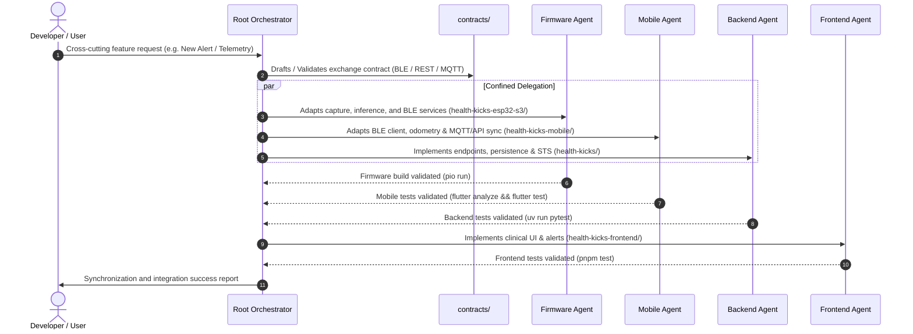

# Multi-Agent Governance Manifesto - HealthKicks Ecosystem

Welcome to the multi-agent architecture of the **HealthKicks** ecosystem. This document defines the operational framework, responsibilities of the root orchestrator agent, and the non-negotiable rules applying to all specialized subagents.

---

## 0. Business Context & Global Architecture

**HealthKicks** is a real-time connected biomechanical monitoring and analysis ecosystem combining edge embedded intelligence (*ESP32-S3 Firmware*), field mobile gateway (*Flutter Mobile*), centralized analytics (*FastAPI / PostgreSQL / DynamoDB Backend*), and clinical visualization (*Angular 22 Frontend*).

#### Data Pipeline
```text
[ Connected Footwear ESP32-S3 ]
         │ (LESC Encrypted BLE GATT / Fast Burst)
         ▼
[ health-kicks-mobile ] ──(REST / MQTT WebSockets SigV4)──┬──► [ health-kicks ] (FastAPI API / PostgreSQL / DynamoDB)
  (Flutter / Dart UI)                                     │           │
                                                          │           │ (REST OpenAPI / WebSockets)
                                                          ▼           ▼
                                                 [ health-kicks-frontend ] (Angular 22 UI)
```

### Scope of Independent Subprojects
* **`health-kicks-esp32-s3/` (Firmware)**: FreeRTOS / PlatformIO embedded firmware (ESP32-S3), 19 Hz MPU-6050 acquisition, local C++ multiclass activity and fall inference, secure LESC BLE GATT server, PWM haptics, and OTA bootloader with automated rollback.
* **`health-kicks-mobile/` (Mobile)**: Flutter / Dart companion application, direct sensor acquisition via BLE GATT client, haptic commands, SQLite differential odometry, REST synchronization, and AWS IoT Core MQTT gateway (WebSockets SigV4).
* **`health-kicks/` (Backend)**: FastAPI REST API, relational persistence via PostgreSQL (Aurora) and time-series via DynamoDB, account/profile management, RBAC, AWS STS token broker, and MLOps training / C model transpilation pipelines.
* **`health-kicks-frontend/` (Frontend)**: Angular 22 web application (Signals, Standalone), clinical monitoring dashboards, live IMU signal visualization, and Studio relabeling.

### Shared Documentation References
* `docs/architecture/system_overview.md`
* `docs/architecture/invariants.md`
* `contracts/ble_gatt_specs.md`
* `contracts/README.md`

---

## 1. Role of the Root Orchestrator

The **Root Orchestrator** supervises the ecosystem globally. Its mandate is to:
1. Maintain the integrity of directory trees, Git submodules, and multi-root workspace configuration.
2. Delegate implementation tasks to specialized subagents according to their domain expertise.
3. Arbitrate contract evolutions in `contracts/` following the Spec-First protocol.
4. Guarantee cross-project consistency and adherence to architecture invariants (`docs/architecture/invariants.md`).

---

## 2. The Six Golden Rules (Non-Negotiable)

### Golden Rule 1: Contract-Driven & Spec-First Approach
* Any change affecting communication between two subprojects (BLE GATT, REST API, MQTT payload, ML model file format, shared types) **must begin by updating and validating the contract in `contracts/`**.
* No specialized agent may unilaterally alter an API signature or payload without prior contract agreement approved by the orchestrator.

### Golden Rule 2: Strict Scope Confinement
* Each subagent is confined to its project subfolder:
  * `firmware-dev`: write access permitted **strictly** within `health-kicks-esp32-s3/`.
  * `mobile-dev`: write access permitted **strictly** within `health-kicks-mobile/`.
  * `backend-dev`: write access permitted **strictly** within `health-kicks/`.
  * `frontend-dev`: write access permitted **strictly** within `health-kicks-frontend/`.
* **Strict prohibition** against editing source code of neighboring subprojects or root files without explicit delegation from the orchestrator.
* Access to `contracts/` and `docs/` is permitted in **read-only** mode for specialized subagents (contract changes are steered or arbitrated by the orchestrator).

### Golden Rule 3: Systematic Local Test & Lint Validation Before Any Commit
* No subagent may declare a task complete or commit changes unless all linters, compilation/build checks, and test suites within its scope are 100% green with zero errors:
  * `health-kicks-esp32-s3`: `uv tool run --from platformio pio run`
  * `health-kicks-mobile`: `flutter analyze && flutter test`
  * `health-kicks`: `uv run ruff check . && uv run pytest` (or `python -m pytest`)
  * `health-kicks-frontend`: `pnpm lint && pnpm exec ng build --configuration production && pnpm test`
* Any lint, build, or test failure blocks the workflow immediately and requires priority remediation.

### Golden Rule 4: Granular Atomic Commits at Every Significant Milestone
* As soon as a subtask, refactoring, or feature is validated and associated tests are 100% green, the agent **must create an atomic Git commit** with an accurate Conventional message (`feat(...)`, `refactor(...)`, `fix(...)`, `test(...)`, `chore(...)`).
* Never accumulate multiple unrelated steps or components into a single monolithic commit.
* Commits must be performed in the corresponding submodule repository (then the submodule pointer updated at the root). Never execute `git push` without explicit user request.

### Golden Rule 5: Systematic Code Comments in English
* **All code comments, docstrings, technical annotations, and TODOs** across all codebases (`health-kicks`, `health-kicks-frontend`, `health-kicks-mobile`, `health-kicks-esp32-s3`, `contracts`) **must be written in English exclusively**.
* Chat communication with the user follows the user's preferred language (French or English), but source code and integrated technical documentation remain strictly in English for global maintainability.

### Golden Rule 6: Clean Code Standards (Small Functions, Intention-Revealing Names, DRY)
* **Intention-Revealing & Pronounceable Names**: Functions, methods, variables, and parameters must clearly express *what* they do and their business domain meaning. Avoid vague, overloaded verbs or meaningless abbreviations (e.g. prefer `calculateCadenceSpm()` over `process()`, `resolveTargetDeviceIds()` over `handleData()`).
* **Small Functions & Single Responsibility Principle**: Functions must do one thing and do it completely. Keep functions concise (aiming for 10–30 lines where practical). Extract nested workflows, deep conditionals, coordinate math, or payload conversions into focused private helpers or specialized domain services.
* **DRY Principle (Don't Repeat Yourself)**: Every piece of knowledge or logic must have a single, unambiguous representation within the system. Never duplicate validation algorithms, date/time normalization, data transforms, or formatting logic across multiple controllers, routes, or widgets; centralize them in shared utilities, models, or service layers.

---

## 3. Subagent Mapping (Official Antigravity Location)

Custom subagents are declared under `.agents/agents/<name>.md` following standard Antigravity format (`subagent: true`, `mainAgent: false`):

| Agent | Role | Assigned Directory | Validation Command | Specification File |
| :--- | :--- | :--- | :--- | :--- |
| **`firmware-dev`** | Firmware Developer | `health-kicks-esp32-s3/` | `uv tool run --from platformio pio run` | `.agents/agents/firmware-dev.md` |
| **`mobile-dev`** | Mobile Developer | `health-kicks-mobile/` | `flutter analyze && flutter test` | `.agents/agents/mobile-dev.md` |
| **`backend-dev`** | Backend Developer | `health-kicks/` | `uv run ruff check . && uv run pytest` | `.agents/agents/backend-dev.md` |
| **`frontend-dev`** | Frontend Developer | `health-kicks-frontend/` | `pnpm lint && pnpm exec ng build --configuration production && pnpm test` | `.agents/agents/frontend-dev.md` |

---

## 4. Interaction Matrix and Synchronization Protocol


