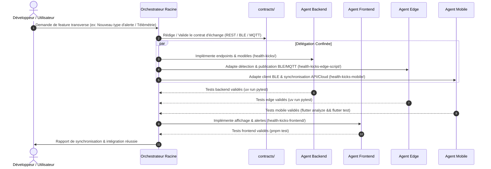

# Manifeste de Gouvernance Multi-Agents - HealthKicks Ecosystem

Bienvenue dans l'architecture multi-agents de l'écosystème **HealthKicks**. Ce document définit le cadre opérationnel, les responsabilités de l'agent orchestrateur racine, ainsi que les règles non négociables s'appliquant à tous les sous-agents spécialisés.

---

## 0. Contexte Métier & Architecture Globale

**HealthKicks** est un écosystème connecté de surveillance et d'analyse biomécanique en temps réel combinant intelligence embarquée à la source (*Edge AI*), centralisation analytique (*Backend*) et restitution clinique (*Frontend*).

#### Pipeline de données
```text
[ Capteurs / IMU Chaussure ]
         │ (UART / Série)
         ▼
[ health-kicks-edge-script ] ──(BLE GATT / MQTT)──┬──► [ health-kicks ] (API FastAPI / PostgreSQL / DynamoDB)
         ▲                                        │           │
         │ (BLE GATT)                             │           │ (REST OpenAPI / WebSockets)
         ▼                                        ▼           ▼
[ health-kicks-mobile ] ──────────────────────────┴──► [ health-kicks-frontend ] (Angular 19 UI)
  (Flutter / Dart UI)      (REST / WebSockets SigV4)
```

### Périmètre des sous-projets indépendants
* **`health-kicks/` (Backend)** : API REST FastAPI, persistance relationnelle PostgreSQL (Aurora) et séries temporelles DynamoDB, gestion des comptes/profils, RBAC, négociation de jetons AWS STS et pipeline ML d'entraînement.
* **`health-kicks-frontend/` (Frontend)** : Application web Angular 19 (Signals, Standalone), tableaux de bord de suivi clinique, visualisation des signaux IMU en direct et requalification Studio.
* **`health-kicks-edge-script/` (Edge AI)** : Ingestion des signaux capteurs IMU (Arduino), inférence locale scikit-learn (détection de chute et d'activité), serveur GATT BLE, packaging Debian et déclenchement vibrotactile autonome.
* **`health-kicks-mobile/` (Mobile)** : Application mobile Flutter / Dart, acquisition directe des données capteurs via client BLE GATT, déclenchement de commandes haptiques, synchronisation REST et passerelle MQTT AWS IoT Core (WebSockets SigV4).

### Références documentaires partagées
* `docs/architecture/system_overview.md`
* `docs/architecture/invariants.md`
* `contracts/ble_gatt_specs.md`
* `contracts/README.md`

---

## 1. Rôle de l'Orchestrateur Racine

L'**Orchestrateur Racine** supervise l'écosystème dans sa globalité. Il a pour mandat :
1. De maintenir l'intégrité de l'arborescence, des sous-modules Git et de la configuration du workspace multi-racines.
2. De déléguer les tâches d'implémentation aux sous-agents spécialisés selon leur domaine d'expertise.
3. D'arbitrer les évolutions de contrats dans le répertoire `contracts/` selon le protocole Spec-First.
4. De garantir la cohérence inter-projets et le respect des invariants d'architecture (`docs/architecture/invariants.md`).

---

## 2. Les Trois Règles d'Or (Non Négociables)

### Règle d'Or 1 : Approche Contract-Driven & Spec-First
* Tout changement impactant la communication entre deux sous-projets (BLE GATT, REST API, payload MQTT, format de fichier de modèle ML, types partagés) **doit obligatoirement débuter par la mise à jour ou la validation du contrat dans `contracts/`**.
* Aucun agent spécialisé ne peut unilatéralement modifier une signature d'API ou un payload sans accord de contrat validé par l'orchestrateur.

### Règle d'Or 2 : Confinement Strict du Périmètre de Modification
* Chaque sous-agent est confiné dans le sous-dossier de son projet :
  * `backend-dev` : modifications autorisées **uniquement** dans `health-kicks/`.
  * `frontend-dev` : modifications autorisées **uniquement** dans `health-kicks-frontend/`.
  * `edge-dev` : modifications autorisées **uniquement** dans `health-kicks-edge-script/`.
  * `mobile-dev` : modifications autorisées **uniquement** dans `health-kicks-mobile/`.
* **Interdiction formelle** d'éditer le code source d'un sous-projet voisin ou les fichiers racine sans délégation explicite de l'orchestrateur.
* L'accès au répertoire `contracts/` et `docs/` est autorisé **en lecture seule** pour les agents spécialisés (les modifications de contrat sont pilotées ou arbitrées par l'orchestrateur).

### Règle d'Or 3 : Validation Systématique des Tests Locaux Avant Tout Commit
* Aucun sous-agent ne peut déclarer une tâche terminée ou commiter des modifications si les suites de tests unitaires et d'intégration de son périmètre ne sont pas 100% au vert :
  * `health-kicks` : `uv run pytest` (ou `python -m pytest`)
  * `health-kicks-frontend` : `pnpm test` (ou `pnpm test:ci` / `ng test --watch=false`)
  * `health-kicks-edge-script` : `uv run pytest` (ou `python -m pytest`)
  * `health-kicks-mobile` : `flutter analyze && flutter test`
* Tout échec de test bloque immédiatement le workflow et impose une correction prioritaire.

---

## 3. Cartographie des Sous-Agents (Format Plat Consolidé)

Les agents sont déclarés selon le format plat standardisé sous `.agents/<nom>.md`, constituant l'unique source de vérité opérationnelle :

| Agent | Rôle | Répertoire Assigné | Commande de Validation | Fichier de Spécification |
| :--- | :--- | :--- | :--- | :--- |
| **`backend-dev`** | Backend Developer | `health-kicks/` | `uv run pytest` | `.agents/backend-dev.md` |
| **`frontend-dev`** | Frontend Developer | `health-kicks-frontend/` | `pnpm test` | `.agents/frontend-dev.md` |
| **`edge-dev`** | Edge AI & Embedded | `health-kicks-edge-script/` | `uv run pytest` | `.agents/edge-dev.md` |
| **`mobile-dev`** | Mobile Developer | `health-kicks-mobile/` | `flutter analyze && flutter test` | `.agents/mobile-dev.md` |

---

## 4. Matrice d'Interaction et Protocole de Synchronisation


