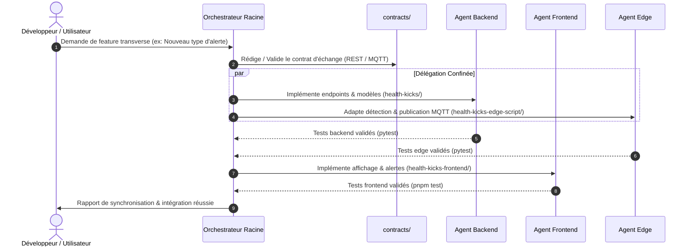

# Manifeste de Gouvernance Multi-Agents - HealthKicks Ecosystem

Bienvenue dans l'architecture multi-agents de l'écosystème **HealthKicks**. Ce document définit le cadre opérationnel, les responsabilités de l'agent orchestrateur racine, ainsi que les règles non négociables s'appliquant à tous les sous-agents spécialisés.

---

## 0. Contexte Métier & Architecture Globale

**HealthKicks** est un écosystème de surveillance et d'analyse de santé et d'activité connectée combinant traitement à la source (*Edge AI*), centralisation analytique (*Backend*) et visualisation en temps réel (*Frontend*).

### Pipeline de données
```text
[ Capteurs / Flux local ]
         │
         ▼
[ health-kicks-edge-script ] ──(Inférence ML / Télémétrie MQTT/REST)──┐
                                                                      ▼
                                                            [ health-kicks ] (API / DB)
                                                                      │
                                                           (REST / SSE / WebSocket)
                                                                      ▼
                                                         [ health-kicks-frontend ] (UI)
```

### Périmètre des composants
* **`health-kicks-edge-script/`** : Ingestion des signaux capteurs, inférence locale des modèles ML (détection d'anomalies, biométrie) et émission des télémétries.
* **`health-kicks/`** : API REST, persistance des séries temporelles, gestion des comptes/profils, agrégation et règles métier.
* **`health-kicks-frontend/`** : Tableaux de bord de suivi, visualisation des courbes en direct, gestion des alertes et configuration utilisateur.

### Références documentaires
Pour les détails exhaustifs d'implémentation et de schéma, consultez systématiquement :
* `docs/architecture/overview.md`
* `docs/architecture/invariants.md`

---

## 1. Rôle de l'Orchestrateur Racine

L'**Orchestrateur Racine** supervise l'écosystème dans sa globalité. Il a pour mandat :
1. De maintenir l'intégrité de l'arborescence, des sous-modules Git et de la configuration du workspace.
2. De déléguer les tâches d'implémentation aux sous-agents spécialisés selon leur domaine d'expertise.
3. D'arbitrer les évolutions de contrats dans le répertoire `contracts/`.
4. De garantir la cohérence inter-projets et le respect des invariants d'architecture (`docs/architecture/invariants.md`).

---

## 2. Les Trois Règles d'Or (Non Négociables)

### Règle d'Or 1 : Approche Contract-Driven & Spec-First
* Tout changement impactant la communication entre deux sous-projets (REST API, payload MQTT, format de fichier de modèle ML, types partagés) **doit obligatoirement débuter par la mise à jour ou la validation du contrat dans `contracts/`**.
* Aucun agent spécialisé ne peut unilatéralement modifier une signature d'API ou un payload sans accord de contrat validé par l'orchestrateur.

### Règle d'Or 2 : Confinement Strict du Périmètre de Modification
* Chaque sous-agent est confiné dans le sous-dossier de son projet :
  * `backend-dev` : modifications autorisées **uniquement** dans `health-kicks/`.
  * `frontend-dev` : modifications autorisées **uniquement** dans `health-kicks-frontend/`.
  * `edge-dev` : modifications autorisées **uniquement** dans `health-kicks-edge-script/`.
* **Interdiction formelle** d'éditer le code source d'un sous-projet voisin ou les fichiers racine sans délégation explicite de l'orchestrateur.
* L'accès au répertoire `contracts/` et `docs/` est autorisé **en lecture seule** pour les agents spécialisés (les modifications de contrat sont pilotées ou arbitrées par l'orchestrateur).

### Règle d'Or 3 : Validation Systématique des Tests Locaux Avant Tout Commit
* Aucun sous-agent ne peut déclarer une tâche terminée ou commiter des modifications si les suites de tests unitaires et d'intégration de son périmètre ne sont pas 100% au vert :
  * `health-kicks` : `uv run pytest`
  * `health-kicks-frontend` : `pnpm test` (ou `ng test --watch=false`)
  * `health-kicks-edge-script` : `uv run pytest`
* Tout échec de test bloque immédiatement le workflow et impose une correction prioritaire.

---

## 3. Cartographie des Sous-Agents

| Agent | Répertoire Assigné | Fichier de Spécification |
| :--- | :--- | :--- |
| **Backend Developer** | `health-kicks/` | `.agents/agents/backend-dev/agent.md` |
| **Frontend Developer** | `health-kicks-frontend/` | `.agents/agents/frontend-dev/agent.md` |
| **Edge Developer** | `health-kicks-edge-script/` | `.agents/agents/edge-dev/agent.md` |

---

## 4. Matrice d'Interaction et Protocole de Synchronisation


