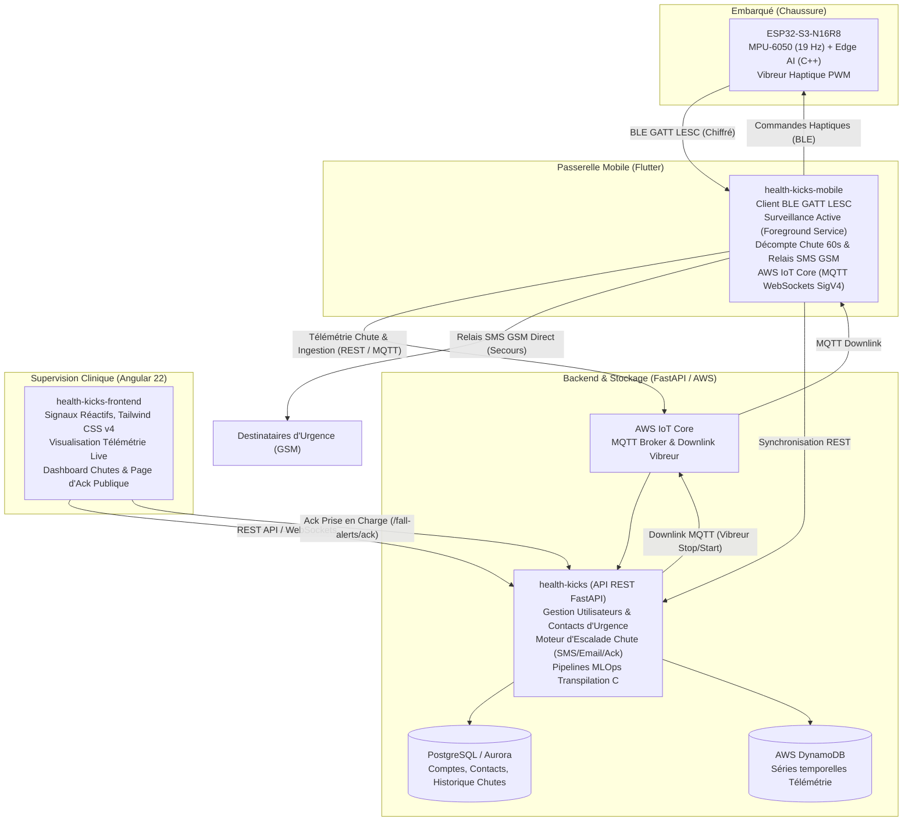

# HealthKicks Ecosystem

Plateforme connectée de surveillance biomécanique, d'analyse de la marche et de détection de chute en temps réel.

L'écosystème **HealthKicks** allie l'intelligence artificielle embarquée à la source (*Firmware ESP32-S3*), une passerelle mobile de terrain et d'urgence (*Mobile Flutter*), un backend analytique haute performance (*FastAPI / PostgreSQL / DynamoDB*) et une interface clinique et de télé-surveillance (*Frontend Angular 22*).

---

## 1. Architecture Globale & Flux de Données



---

## 2. Cartographie des Dépôts & Sous-Modules

L'écosystème est organisé en un workspace multi-racines avec sous-modules Git indépendants :

| Répertoire / Sous-Module | Domaine & Rôle | Stack Technologique | Validation & Tests |
| :--- | :--- | :--- | :--- |
| [**`health-kicks-esp32-s3/`**](./health-kicks-esp32-s3/) | **Firmware Embarqué** : Inférence d'activité 19 Hz, détection de chute multiclasse embarquée, serveur BLE GATT LESC, PWM haptique, bootloader OTA. | C++20, FreeRTOS, PlatformIO, Arduino-ESP32, NimBLE | `pio run` |
| [**`health-kicks-mobile/`**](./health-kicks-mobile/) | **Application Mobile** : Client BLE GATT, Surveillance Active en arrière-plan, écran d'alerte de chute 60s, localisation GPS, relais SMS local, AWS IoT Core SigV4. | Flutter 3.38+, Dart 3.10+, flutter_reactive_ble, telephony | `flutter test` |
| [**`health-kicks/`**](./health-kicks/) | **Backend Analytique & API** : Moteur d'escalade d'urgence, gestion RBAC et contacts d'alerte, API REST OpenAPI, pipelines MLOps (Random Forest -> transpilation C). | Python 3.12+, FastAPI, SQLAlchemy, Alembic, uv, AWS SDK | `uv run pytest` |
| [**`health-kicks-frontend/`**](./health-kicks-frontend/) | **Interface Web Clinique** : Visualisation cinématique en direct, gestion des alertes de chute, interface publique de prise en charge d'urgence. | Angular 22, TypeScript 5.9, Tailwind CSS v4, Vitest 5 | `pnpm test` |
| [**`contracts/`**](./contracts/) | **Contrats d'Échange Partagés** : Spécifications BLE GATT LESC, OpenAPI, canaux MQTT, payloads d'événements et de télémétrie. | Markdown, JSON Schema, OpenAPI | Revue Spec-First |
| [**`docs/`**](./docs/) | **Documentation Système** : Invariants architecturaux, architecture globale, guides d'infrastructure et d'intégration AWS IoT. | Markdown, Mermaid | Cohérence globale |

---

## 3. Méthodologie & Règles de Gouvernance Spec-First

1. **Spec-First & Contract-Driven** : Toute évolution d'interface entre sous-systèmes (BLE GATT, API REST, MQTT, formats de modèles) débute impérativement par une mise à jour validée dans le répertoire [`contracts/`](./contracts/).
2. **Confinement Strict** : Chaque sous-projet dispose de son propre cycle de vie, de ses dépendances et de sa suite de tests. Les modifications de code sont strictement circonscrites au dossier du sous-système concerné.
3. **Tests 100% au Vert** : Aucun commit ni synchronisation de sous-module n'est effectué sans exécution et validation complète des suites de tests locales.
4. **Commits Atomiques et Conventionnels** : Les évolutions sont validées par étapes granulaires (`feat`, `fix`, `test`, `docs`, `refactor`).

---

## 4. Démarrage Rapide

### Prérequis Globaux
- [Git](https://git-scm.com/)
- [Docker](https://www.docker.com/) & Docker Compose
- [uv](https://github.com/astral-sh/uv) (pour l'environnement Python backend)
- [Node.js](https://nodejs.org/) & [pnpm](https://pnpm.io/) (pour le frontend)
- [Flutter SDK](https://flutter.dev/) (pour l'application mobile)
- [PlatformIO Core](https://platformio.org/) (pour le firmware ESP32-S3)

### Cloner l'Écosystème
```bash
git clone --recurse-submodules https://github.com/votre-orga/healthkicks-ecosystem.git
cd healthkicks-ecosystem
```

Si le dépôt a déjà été cloné sans sous-modules :
```bash
git submodule update --init --recursive
```

---

## 5. Exécution avec Docker Compose

L'écosystème propose un environnement conteneurisé prêt à l'emploi avec PostgreSQL 16, LocalStack (DynamoDB, S3, IoT) et Eclipse Mosquitto.

### A. Démarrer l'infrastructure de données et le backend
```bash
docker compose up -d
```
Services disponibles :
- **Backend FastAPI** : http://localhost:8000 (Documentation interactive : http://localhost:8000/docs)
- **PostgreSQL** : `localhost:5432` (Base : `healthkicks`, User : `postgres`)
- **LocalStack** : `localhost:4566`
- **Mosquitto MQTT** : `localhost:1883` (WebSockets : `localhost:9001`)

### B. Démarrer la stack complète (avec Frontend Angular 22)
```bash
docker compose --profile full up -d
```
- **Frontend Angular 22** : http://localhost:4200

---

## 6. Développement Local par Composant

### Backend FastAPI (`health-kicks/`)
```bash
cd health-kicks
uv sync
uv run alembic upgrade head
uv run pytest
uv run uvicorn healthkicks.main:app --reload --port 8000
```

### Frontend Angular 22 (`health-kicks-frontend/`)
```bash
cd health-kicks-frontend
pnpm install
pnpm test
pnpm start
```

### Application Mobile Flutter (`health-kicks-mobile/`)
```bash
cd health-kicks-mobile
flutter pub get
flutter analyze
flutter test
flutter run
```

### Firmware ESP32-S3 (`health-kicks-esp32-s3/`)
```bash
cd health-kicks-esp32-s3
pio run
pio run --target upload
pio run --target monitor
```

---

## 7. Documentation Complémentaire

- [Spécifications BLE GATT LESC](./contracts/ble_gatt_specs.md)
- [Contrats d'Échange & API REST](./contracts/README.md)
- [Architecture & Invariants Système](./docs/architecture/invariants.md)
- [Architecture Globale & Flux](./docs/architecture/system_overview.md)
- [Intégration AWS IoT & Lambdas](./docs/aws-iot-lambdas.md)
