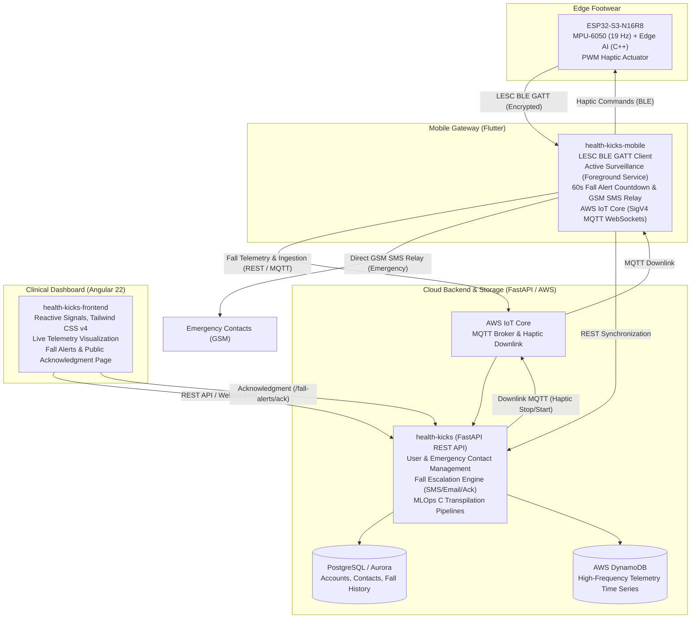

# HealthKicks Ecosystem

Connected platform for real-time biomechanical gait monitoring, activity analysis, and autonomous fall detection.

The **HealthKicks** ecosystem combines edge artificial intelligence at the sensor source (*ESP32-S3 Firmware*), an emergency field mobile companion gateway (*Flutter Mobile*), a high-performance analytical cloud backend (*FastAPI / PostgreSQL / DynamoDB*), and a clinical tele-surveillance web interface (*Angular 22 Frontend*).

---

## 1. System Architecture & Data Flow



---

## 2. Repositories & Submodules Mapping

The ecosystem is structured as a multi-root workspace with independent Git submodules:

| Directory / Submodule | Domain & Role | Tech Stack | Validation & Tests |
| :--- | :--- | :--- | :--- |
| [**`health-kicks-esp32-s3/`**](./health-kicks-esp32-s3/) | **Embedded Firmware**: 19 Hz activity inference, embedded multiclass fall detection, LESC BLE GATT server, PWM haptics, OTA bootloader. | C++20, FreeRTOS, PlatformIO, Arduino-ESP32, NimBLE | `pio run` |
| [**`health-kicks-mobile/`**](./health-kicks-mobile/) | **Mobile Application**: BLE GATT client, background Active Surveillance, 60s fall alert screen, GPS geolocation, local SMS relay, SigV4 AWS IoT Core. | Flutter 3.38+, Dart 3.10+, flutter_reactive_ble, telephony | `flutter test` |
| [**`health-kicks/`**](./health-kicks/) | **Analytical Backend & API**: Emergency escalation engine, RBAC & alert contact management, OpenAPI REST API, MLOps pipelines (Random Forest -> C transpilation). | Python 3.12+, FastAPI, SQLAlchemy, Alembic, uv, AWS SDK | `uv run pytest` |
| [**`health-kicks-frontend/`**](./health-kicks-frontend/) | **Clinical Web Interface**: Real-time kinematic visualization, fall alert tracking, public emergency acknowledgment interface. | Angular 22, TypeScript 5.9, Tailwind CSS v4, Vitest 5 | `pnpm test` |
| [**`contracts/`**](./contracts/) | **Shared Exchange Contracts**: LESC BLE GATT specs, OpenAPI, MQTT channels, event and telemetry schemas. | Markdown, JSON Schema, OpenAPI | Spec-First Review |
| [**`docs/`**](./docs/) | **System Documentation**: Architectural invariants, overall system design, infrastructure and AWS IoT integration guides. | Markdown, Mermaid | Global Consistency |

---

## 3. Spec-First Methodology & Governance Rules

1. **Spec-First & Contract-Driven**: Any interface evolution across subsystems (BLE GATT, REST API, MQTT, model formats) begins strictly with a validated contract update in [`contracts/`](./contracts/).
2. **Strict Confinement**: Each subproject maintains its own lifecycle, dependencies, and test suite. Source code edits are confined to the targeted subsystem directory.
3. **100% Green Tests**: No commit or submodule pointer update is performed without passing all local unit and integration test suites.
4. **Granular Atomic Commits**: Changes are validated and committed step-by-step using Conventional Commits (`feat`, `fix`, `test`, `docs`, `refactor`).

---

## 4. Quick Start

### Global Prerequisites
- [Git](https://git-scm.com/)
- [Docker](https://www.docker.com/) & Docker Compose
- [uv](https://github.com/astral-sh/uv) (for backend Python environment)
- [Node.js](https://nodejs.org/) & [pnpm](https://pnpm.io/) (for frontend)
- [Flutter SDK](https://flutter.dev/) (for mobile application)
- [PlatformIO Core](https://platformio.org/) (for ESP32-S3 firmware)

### Clone Ecosystem
```bash
git clone --recurse-submodules https://github.com/daverck/healthkicks-ecosystem.git
cd healthkicks-ecosystem
```

If cloned without submodules:
```bash
git submodule update --init --recursive
```

---

## 5. Running with Docker Compose

The ecosystem provides a containerized development environment with PostgreSQL 16, LocalStack (DynamoDB, S3, IoT), and Eclipse Mosquitto.

### A. Start Data Infrastructure & Backend
```bash
docker compose up -d
```
Available Services:
- **FastAPI Backend**: http://localhost:8000 (Interactive docs: http://localhost:8000/docs)
- **PostgreSQL**: `localhost:5432` (Database: `healthkicks`, User: `postgres`)
- **LocalStack**: `localhost:4566`
- **Mosquitto MQTT**: `localhost:1883` (WebSockets: `localhost:9001`)

### B. Start Complete Stack (Including Angular 22 Frontend)
```bash
docker compose --profile full up -d
```
- **Angular 22 Frontend**: http://localhost:4200

---

## 6. Local Component Development

### FastAPI Backend (`health-kicks/`)
```bash
cd health-kicks
uv sync
uv run alembic upgrade head
uv run pytest
uv run uvicorn healthkicks.main:app --reload --port 8000
```

### Angular 22 Frontend (`health-kicks-frontend/`)
```bash
cd health-kicks-frontend
pnpm install
pnpm test
pnpm start
```

### Flutter Mobile App (`health-kicks-mobile/`)
```bash
cd health-kicks-mobile
flutter pub get
flutter analyze
flutter test
flutter run
```

### ESP32-S3 Firmware (`health-kicks-esp32-s3/`)
```bash
cd health-kicks-esp32-s3
pio run
pio run --target upload
pio run --target monitor
```

---

## 7. Additional Documentation

- [LESC BLE GATT Specifications](./contracts/ble_gatt_specs.md)
- [Exchange Contracts & REST API Overview](./contracts/README.md)
- [Architecture & System Invariants](./docs/architecture/invariants.md)
- [Overall System Overview & Flows](./docs/architecture/system_overview.md)
- [AWS IoT & Lambda Integration](./docs/aws-iot-lambdas.md)
