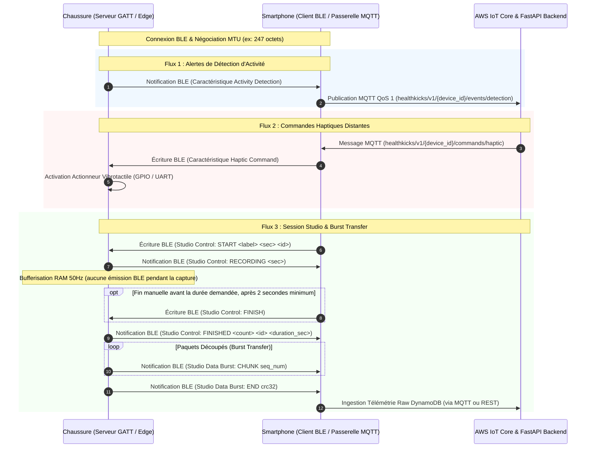

# Spécification du Profil BLE GATT - HealthKicks Footwear Service

Ce document constitue la **spécification contractuelle officielle** pour la communication Bluetooth Low Energy (BLE) entre la chaussure connectée **HealthKicks** (serveur GATT hébergé sur Raspberry Pi / ESP32-S3) et le smartphone (client GATT / passerelle BLE-to-MQTT vers AWS IoT Core).

---

## 1. Architecture & Rôle des Acteurs



---

## 2. Identifiants UUID du Service et des Caractéristiques

Le service utilise des UUIDs 128-bit dérivés de la base HealthKicks `7a5a0000-c529-4d64-8848-18e5904de22a` :

| Élément                        | UUID 128-bit                                      | Propriétés                        | Description                                                       |
| :----------------------------- | :------------------------------------------------ | :-------------------------------- | :---------------------------------------------------------------- |
| **HealthKicks Service**        | `7a5a0001-c529-4d64-8848-18e5904de22a`            | Primary Service                   | Service principal de la chaussure connectée                       |
| **Activity Detection**         | `7a5a0002-c529-4d64-8848-18e5904de22a`            | `READ`, `NOTIFY`                  | Événements d'activité et alertes de chute                         |
| **Haptic Command**             | `7a5a0003-c529-4d64-8848-18e5904de22a`            | `WRITE`, `WRITE WITHOUT RESPONSE` | Commande de vibration vibrotactile                                |
| **Device & Studio Control**    | `7a5a0004-c529-4d64-8848-18e5904de22a`            | `WRITE`, `NOTIFY`                 | Contrôle d'état, étalonnage assiette, réglages et protocole Studio |
| **Studio Data Burst**          | `7a5a0005-c529-4d64-8848-18e5904de22a`            | `NOTIFY`                          | Déversement binaire haute vitesse des trames IMU                  |
| **Step Counter**               | `7a5a0006-c529-4d64-8848-18e5904de22a`            | `READ`, `NOTIFY`                  | Compteur de pas déterministe, ventilation par activité et cadence |
| **OTA Update Service**         | `7a5a0010-c529-4d64-8848-18e5904de22a`            | Secondary Service                 | Service dédié à la mise à jour firmware Over-The-Air              |
| **OTA Control**                | `7a5a0011-c529-4d64-8848-18e5904de22a`            | `WRITE`, `NOTIFY`                 | Contrôle du cycle de flash OTA (start, end, abort, status)        |
| **OTA Data**                   | `7a5a0012-c529-4d64-8848-18e5904de22a`            | `WRITE`, `WRITE WITHOUT RESPONSE` | Transfert haute vitesse par chunks du binaire firmware (.bin)     |
| **Device Information Service** | `0000180a-0000-1000-8000-00805f9b34fb` (`0x180A`) | Standard Service                  | Service standard Bluetooth SIG d'identification matérielle        |
| **Firmware Revision String**   | `00002a26-0000-1000-8000-00805f9b34fb` (`0x2A26`) | `READ`                            | Version sémantique du firmware installé (ex: `v1.2.1-esp32s3`)    |
| **Software Revision String**   | `00002a28-0000-1000-8000-00805f9b34fb` (`0x2A28`) | `READ`                            | Date/heure de compilation ou de release du binaire embarqué       |

---

## 3. Spécification Détaillée des Caractéristiques

### A. Caractéristique 1 : Activity Detection (`7a5a0002-...`)

- **Propriétés** : `READ`, `NOTIFY`
- **Rôle** : Transmettre au smartphone les changements d'état d'activité et les alertes critiques de chute calculées par le moteur ML embarqué.
- **Règle d'anti-rebond (Debounce)** : Une fois une chute détectée (`fall_*`), un délai de cooldown de **5.0 secondes** est imposé avant toute nouvelle notification de chute.

#### Format Binaire Compact (7 octets)

Endianness : **Big-Endian** (réseau standard).

| Offset | Champ        | Type   | Plage / Valeurs  | Description                                                                                  |
| :----- | :----------- | :----- | :--------------- | :------------------------------------------------------------------------------------------- |
| 0      | `state_code` | uint8  | Table ci-dessous | Code de l'état ou de l'événement détecté                                                     |
| 1      | `confidence` | uint8  | `0` – `100`      | Niveau de confiance du modèle en %                                                           |
| 2..5   | `timestamp`  | uint32 | Epoch Unix (sec) | Horodatage UTC de détection                                                                  |
| 6      | `flags`      | uint8  | Bitfield         | Bit 0 : Détection critique (chute)<br>Bit 1 : Déclenchement haptique local autonome effectué<br>Bit 2 : Alerte différée / historisée hors-ligne (NVS) |

#### Table des `state_code` :

- `0x00` : `idle` (immobile / assis)
- `0x01` : `walk` (marche normale)
- `0x02` : `run` (course / foulée rapide)
- `0x03` : `stairs_up` (montée d'escaliers)
- `0x04` : `stairs_down` (descente d'escaliers)
- `0x05` : `sit_down` (transition assise / s'asseoir)
- `0x06` : `stand_up` (transition debout / se lever d'une chaise)
- `0x07` : `lying_supine` (posture couchée sur le dos / décubitus dorsal)
- `0x08` : `lying_prone` (posture couchée sur le ventre / décubitus ventral)
- `0x09` : `lying_lateral` (posture couchée sur le côté / décubitus latéral)
- `0x0A` : `jump` (saut / impulsion verticale)
- `0x10` : `fall_forward` (chute avant)
- `0x11` : `fall_backward` (chute arrière)
- `0x12` : `fall_lateral` (chute latérale)
- `0x13` : `fall_recovery` (relevage après chute)
- `0x1E` : `stumble_recover` (trébuchement rattrapé)
- `0x1F` : `fall_generic` (chute non spécifiée)
- `0x20` : `inactivity_alert` (rappel d'inactivité prolongée / sédentarité)

#### Capacité Actuelle (256 Classes) & Feuille de Route d'Évolution

- **Capacité Actuelle (`uint8`)** : Le champ `state_code` est encodé sur 1 octet (`uint8`), ce qui permet d'adresser jusqu'à **256 classes distinctes** (`0x00` à `0xFF`). Avec 13 classes allouées actuellement, le système dispose d'une marge de **243 identifiants disponibles (> 94% de réserve)**.
- **Évolution Future si > 256 Classes** :
  - **Option A (Extension `uint16`)** : Si le catalogue de mouvements ou d'exercices dépasse 256 classes, le champ `state_code` peut être étendu à 2 octets (`uint16`, 65 536 classes). Le payload passerait de 7 à 8 octets, restant **largement en deçà du plafond de 20 octets** de la payload ATT MTU standard (23 octets) sans provoquer aucune fragmentation radio BLE.
  - **Option B (Structuration Hiérarchique sur 2 octets)** : Découpage en `category_id` (1 octet : 0x01 Locomotion, 0x02 Postures, 0x03 Chutes, 0x04 Pathologies/Boiteries, 0x05 Sports...) + `sub_activity_id` (1 octet au sein de la catégorie), garantissant un routage et un filtrage macro instantanés côté smartphone et Cloud.

---

### B. Caractéristique 2 : Haptic Command (`7a5a0003-...`)

- **Propriétés** : `WRITE`, `WRITE WITHOUT RESPONSE`
- **Rôle** : Piloter immédiatement le vibreur présent dans la semelle de la chaussure ou configurer les paramètres haptiques/inactivité.

#### 1. Commandes Haptiques Directes (4 octets)

Endianness : **Big-Endian**.

| Offset | Champ         | Type   | Plage / Valeurs                                                                                                               | Description                                       |
| :----- | :------------ | :----- | :---------------------------------------------------------------------------------------------------------------------------- | :------------------------------------------------ |
| 0      | `pattern_id`  | uint8  | `0` = impulsion continue<br>`1` = double pulse<br>`2` = pulsation d'alerte<br>`0x05` = déclenchement calibration assiette IMU | Profil vibratoire ou commande de contrôle         |
| 1      | `intensity`   | uint8  | `0` – `255`                                                                                                                   | Puissance PWM (`0` = stop, `255` = puissance max) |
| 2..3   | `duration_ms` | uint16 | `50` – `10000`                                                                                                                | Durée totale de la stimulation en millisecondes   |

_Exemple_ : `[0x00, 0xC8, 0x01, 0xF4]` $\rightarrow$ Impulsion continue, intensité 200/255, durée 500 ms.
_Exemple calibration_ : `[0x05, 0x00, 0x00, 0x00]` $\rightarrow$ Déclenchement immédiat de la calibration d'assiette IMU (4s d'immobilité).

#### 2. Configuration du Rappel d'Inactivité Prolongée (Opcode `0x06` - 6 octets)

Endianness : **Big-Endian**.

| Offset | Champ                      | Type   | Plage / Valeurs                                     | Description                                      |
| :----- | :------------------------- | :----- | :-------------------------------------------------- | :----------------------------------------------- |
| 0      | `opcode`                   | uint8  | `0x06`                                              | Commande de configuration du rappel d'inactivité |
| 1      | `is_enabled`               | uint8  | `0` = désactivé, `1` = activé                       | Activation / désactivation de la surveillance    |
| 2..3   | `inactivity_threshold_sec` | uint16 | `600` – `7200` (10 à 120 min, déf: `3000` / 50 min) | Durée continue sans pas avant l'alerte           |
| 4..5   | `cooldown_duration_sec`    | uint16 | `300` – `1800` (5 à 30 min, déf: `600` / 10 min)    | Délai de répétition / cooldown après une alerte  |

---

### C. Caractéristique 3 : Device & Studio Control (`7a5a0004-...`)

- **Propriétés** : `WRITE`, `NOTIFY`
- **Rôle** : Centraliser l'ensemble du pilotage applicatif, le cycle de vie des captures Studio, l'étalonnage d'assiette IMU et les configurations fonctionnelles de la chaussure en format textuel ASCII UTF-8.

#### 1. Commandes Écrites par le Smartphone (`WRITE`)

Format textuel ASCII encodé en UTF-8 :

1. **Démarrage d'enregistrement** :

   ```text
   START <label> <duration_sec> <session_id>
   ```
   - _Exemple_ : `START walk 5.0 7b8e9f01-2345-6789-abcd-ef0123456789`
   - Contraintes : `duration_sec` entre `2.0` et `30.0` secondes.

2. **Annulation** :

   ```text
   CANCEL
   ```

3. **Fin anticipée d'un enregistrement** :

   ```text
   FINISH
   ```
   - Valide uniquement après au moins 2 secondes d'échantillonnage ; la chaussure émet alors `FINISHED` et transmet le burst IMU.

4. **Déclenchement de Calibration d'Assiette IMU** :

   ```text
   CALIBRATE
   ```

5. **Configuration du Rappel d'Inactivité** :
   ```text
   SET_INACTIVITY <enabled:0|1> <threshold_sec> <cooldown_sec>
   ```
   - _Exemple_ : `SET_INACTIVITY 1 3000 600`

6. **Configuration du Seuil d'Impact de Chute** :
   ```text
   SET_FALL_IMPACT <impact_ms2>
   ```
   - _Paramètre_ : `impact_ms2` (flottant en $\text{m/s}^2$, plage autorisée : `10.0` à `25.0` $\text{m/s}^2$).
   - _Valeur par défaut_ : `16.2` $\text{m/s}^2$ ($\approx 1.65\,g$).
   - _Exemple_ : `SET_FALL_IMPACT 16.2`

7. **Activation / Désactivation du Mode Human-in-the-Loop (HITL)** :
   ```text
   SET_HITL <enabled:0|1>
   ```
   - _Paramètre_ : `0` pour désactiver, `1` pour activer.
   - _Valeur par défaut_ : `0` (désactivé).
   - _Exemple_ : `SET_HITL 1`
   - _Comportement_ :
     - La chaussure maintient en permanence un buffer circulaire de 76 trames brutes IMU à 19 Hz (~4,0 secondes).
     - À chaque notification d'activité sur `0002` (changement d'état d'activité ou détection de chute) à l'instant $T$, la chaussure continue d'enregistrer pendant 1,5 seconde (28 trames post-événement).
     - À $T + 1.5\,\text{s}$, la chaussure notifie `FINISHED 76 hitl-<timestamp> 4.0` sur `0004` puis transmet la salve de 76 trames IMU (~2,5 s avant et ~1,5 s après la détection) sur la caractéristique Studio Data Burst `0005`.

#### 2. Notifications Émises par la Chaussure (`NOTIFY`)

Format textuel ASCII encodé en UTF-8 :

| Notification                           | Déclencheur                    | Description                                                         |
| :------------------------------------- | :----------------------------- | :------------------------------------------------------------------ |
| `COUNTDOWN <pulse>/<total>`            | Début de session               | Impulsion haptique de préparation sensorielle (ex: `COUNTDOWN 1/3`) |
| `RECORDING <duration_sec>`             | Fin du compte à rebours        | La capture démarre en RAM à 50 Hz                                   |
| `FINISHED <sample_count> <session_id> <duration_sec>` | Fenêtre expirée ou commande `FINISH` | Capture terminée, prête pour le déversement burst ; durée réelle transmise |
| `CALIBRATING <duration_sec>`           | Commande `CALIBRATE` ou `0x05` | Début de l'échantillonnage d'immobilité pour réaligner l'assiette   |
| `CALIBRATION_OK`                       | 4.0s immobiles atteintes       | Calibration réussie, matrice de rotation persistée en NVS           |
| `CALIBRATION_ERROR <reason>`           | Mouvement / instabilité        | Échec de calibration (ex: `CALIBRATION_ERROR motion_detected`)      |
| `FALL_IMPACT_OK <impact_ms2>`          | Commande `SET_FALL_IMPACT`     | Seuil de choc validé, appliqué au moteur Edge AI et persisté en NVS |
| `FALL_IMPACT_ERROR <reason>`           | Commande `SET_FALL_IMPACT`     | Rejet de la commande (ex: valeur hors limite, format invalide)      |
| `HITL_OK <0|1>`                        | Commande `SET_HITL`            | Mode HITL activé (1) ou désactivé (0) avec succès                   |
| `HITL_ERROR <reason>`                  | Commande `SET_HITL`            | Rejet de la commande (ex: argument invalide)                        |
| `CANCELLED`                            | Commande reçue                 | Session interrompue                                                 |
| `ERROR <reason>`                       | Anomalie matérielle/RAM ou refus | Erreur (ex: `ERROR buffer_overflow`, `ERROR busy`, `ERROR not_calibrated`) |

---

### D. Caractéristique 4 : Studio Data Burst (`7a5a0005-...`)

- **Propriétés** : `NOTIFY`
- **Rôle** : Transférer l'ensemble des trames IMU acquises pendant la session Studio à vitesse maximale vers le smartphone.

#### Protocole de Tramage par Paquets (Burst Transfer)

Dès que `FINISHED` est notifié sur Studio Control, le serveur GATT commence l'émission des paquets de données sur cette caractéristique.

#### Structure de l'En-Tête de Paquet (4 octets)

| Offset | Champ         | Type   | Description                                                             |
| :----- | :------------ | :----- | :---------------------------------------------------------------------- |
| 0      | `packet_type` | uint8  | `0x01` = START_OF_BURST<br>`0x02` = DATA_CHUNK<br>`0x03` = END_OF_BURST<br>`0x04` = DELTA_CHUNK (Compression Delta sans perte)<br>`0x05` = RLE_CHUNK (Run-Length Encoding statique sans perte) |
| 1..2   | `seq_num`     | uint16 | Numéro de séquence séquentiel (0, 1, 2...)                              |
| 3      | `payload_len` | uint8  | Nombre d'octets de charge utile contenue dans ce paquet                 |

#### Structure d'un Paquet `DELTA_CHUNK` (`packet_type = 0x04`)

Permet de doubler le débit lors de variations continues.
- `header` (4 octets) : `[0x04, seq_num_hi, seq_num_lo, payload_len]`
- `total_frames` (1 octet uint8) : Nombre total de trames contenues dans le paquet ($1 + \text{delta\_count}$).
- `keyframe` (14 octets) : Première trame IMU absolue complète (14 octets standard).
- `deltas` ($K \times 7$ octets) : Pour chaque trame suivante ($k \in [1, \text{delta\_count}]$) :
  - `diff_ms` (1 octet uint8) : Écart de temps avec la trame précédente ($\le 255$ ms).
  - `diff_ax, diff_ay, diff_az` (3 octets int8) : Écarts d'accélération ($-127$ à $+127$ milli-$g$).
  - `diff_gx, diff_gy, diff_gz` (3 octets int8) : Écarts de vitesse angulaire ($-127$ à $+127$ dixièmes de deg/s).

#### Structure d'un Paquet `RLE_CHUNK` (`packet_type = 0x05`)

Compresse massivement les séquences stationnaires / statiques (immobilité, posture assise, repos) où les signaux IMU sont identiques ou quasi-constants.
Taille de charge utile fixe : **16 octets** (soit un paquet BLE de 20 octets) pouvant représenter jusqu'à **255 trames consécutives** (gain jusqu'à $\times 178$ sur la bande passante radio).

- `header` (4 octets) : `[0x05, seq_num_hi, seq_num_lo, 0x10]` (`payload_len` = 16)
- `run_count` (1 octet uint8, offset 4) : Nombre de trames successives répétées ($2 \le N \le 255$).
- `start_delta_ms` (2 octets uint16 big-endian, offset 5..6) : Horodatage relatif de la première trame.
- `step_ms` (1 octet uint8, offset 7) : Pas de temps constant entre chaque trame (ex: 20 ms à 50 Hz).
- $a_x, a_y, a_z$ (6 octets int16 big-endian, offset 8..13) : Accélérations constantes (milli-$g$).
- $g_x, g_y, g_z$ (6 octets int16 big-endian, offset 14..19) : Vitesses angulaires constantes (dixièmes de deg/s).

*Reconstruction côté client* : Pour chaque index $i \in [0, \text{run\_count} - 1]$ :
$$\text{delta\_ms}_i = \text{start\_delta\_ms} + i \times \text{step\_ms}$$
avec des grandeurs physiques $(a_x, a_y, a_z, g_x, g_y, g_z)$ identiques.

#### Structure d'une Trame IMU Découpée (14 octets)

Chaque échantillon sensoriel à 50 Hz est encodé sous forme de 14 octets entiers signés pour optimiser la compacité :

| Offset Relatif | Grandeur   | Type   | Facteur d'Échelle | Unité Physique                              | Standard ISB (Wu & Cavanagh, 1995)                      |
| :------------- | :--------- | :----- | :---------------- | :------------------------------------------ | :------------------------------------------------------ |
| 0..1           | `delta_ms` | uint16 | 1                 | Millisecondes écoulées depuis début session | Temps relatif                                           |
| 2..3           | $a_x$      | int16  | $\times 1000$     | milli-$g$ ($1 g = 1000$)                    | **Antéro-postérieur** (Avant / Propulsion)              |
| 4..5           | $a_y$      | int16  | $\times 1000$     | milli-$g$ ($1 g = 1000$)                    | **Médio-latéral** (Gauche / Appuis)                     |
| 6..7           | $a_z$      | int16  | $\times 1000$     | milli-$g$ ($1 g = 1000$)                    | **Longitudinal / Vertical** (Haut / $+1.0\,g$ au repos) |
| 8..9           | $g_x$      | int16  | $\times 10$       | dixièmes de deg/s ($1^\circ/s = 10$)        | **Roulis** (Inversion / Éversion)                       |
| 10..11         | $g_y$      | int16  | $\times 10$       | dixièmes de deg/s ($1^\circ/s = 10$)        | **Tangage** (Flexion dorsale / plantaire)               |
| 12..13         | $g_z$      | int16  | $\times 10$       | dixièmes de deg/s ($1^\circ/s = 10$)        | **Lacet** (Rotation interne / externe)                  |

#### Paquet Spécial `END_OF_BURST` (`packet_type = 0x03`)

Taille fixe : 12 octets :

- `header` (4 octets) : `[0x03, seq_num_hi, seq_num_lo, 0x00]`
- `total_samples` (4 octets uint32 big-endian) : Nombre total d'échantillons envoyés.
- `crc32` (4 octets uint32 big-endian) : Somme de contrôle CRC32 calculée sur l'ensemble des octets utiles de trames IMU transmises.

#### Dimensionnement & Négociation ATT MTU

- **MTU standard (23 octets, payload 20 octets)** : 1 trame par paquet (14 octets utiles + 4 octets header = 18 octets).
- **MTU négociée (247 octets, payload 244 octets)** : Jusqu'à **17 trames IMU par paquet** ($17 \times 14 + 4 = 242$ octets).
- **Performance** : Pour une session Studio de 5,0 secondes à 50 Hz (250 échantillons $\approx 3,5$ Ko de données brutes) :
  - Nombre de paquets BLE : $\approx 15$ paquets.
  - Durée de transmission : **inférieure à 250 millisecondes** à un intervalle de connexion BLE standard (15 ms).

---

### E. Caractéristique 5 : Step Counter / Pedometer (`7a5a0006-...`)

- **Propriétés** : `READ`, `NOTIFY`
- **Rôle** : Transmettre en temps réel le cumul des pas détectés par l'algorithme déterministe embarqué, leur ventilation par type d'activité (gating ML) et la cadence instantanée.

#### Format Binaire Compact (15 octets)

Endianness : **Big-Endian** (réseau standard).

| Offset   | Champ                | Type   | Plage / Valeurs       | Description                                                                     |
| :------- | :------------------- | :----- | :-------------------- | :------------------------------------------------------------------------------ |
| `0..3`   | `total_steps`        | uint32 | `0` – `4 294 967 295` | Nombre total de pas valides cumulés depuis le démarrage ou le dernier reset     |
| `4..5`   | `walk_steps`         | uint16 | `0` – `65 535`        | Pas validés sous l'état d'activité Marche (`0x01`)                              |
| `6..7`   | `run_steps`          | uint16 | `0` – `65 535`        | Pas validés sous l'état d'activité Course (`0x02`)                              |
| `8..9`   | `stairs_steps`       | uint16 | `0` – `65 535`        | Pas validés sous l'état d'activité Escaliers (`0x03`)                           |
| `10..11` | `unclassified_steps` | uint16 | `0` – `65 535`        | Pas validés sous d'autres activités non-exclues                                 |
| `12`     | `cadence_spm`        | uint8  | `0` – `255`           | Cadence instantanée en pas/minute (calculée sur fenêtre glissante de 5 s)       |
| `13..14` | `current_gct_ms`     | uint16 | `0` – `65 535`        | Temps de contact au sol moyen récent (GCT) en ms (moyenne lissée EMA sur 5 pas) |

#### Règle d'Émission des Notifications

- Notification immédiate lors de chaque détection d'un nouveau pas validé (si un client BLE y a souscrit avec le descripteur CCCD `BLE2902`).
- Notification périodique (battement de cœur à 1 Hz) pour rafraîchir la cadence et garantir la synchronisation même en phase d'arrêt.

---

### F. Service OTA Firmware Update (`7a5a0010-...`)

Le service OTA permet de mettre à jour le firmware de l'ESP32-S3 sans fil, via une architecture dual-slot (`ota_0`, `ota_1`) gérée par le sous-système natif ESP-IDF OTA.

#### 1. Caractéristique OTA Control (`7a5a0011-...`)

- **Propriétés** : `WRITE`, `NOTIFY`
- **Rôle** : Piloter le protocole de mise à jour, valider l'état du flashage et basculer la partition active.

##### Commandes émises par l'application cliente (`WRITE`) :

- `0x01` (`OTA_BEGIN`) : Début du transfert OTA. Suivi immédiatement de 4 octets Big-Endian représentant la taille totale du binaire `.bin` en octets :
  `[0x01, size_b3, size_b2, size_b1, size_b0]` (5 octets au total).
- `0x02` (`OTA_END`) : Clôture du transfert. Demande la validation d'intégrité, le contrôle cryptographique SHA-256 et la bascule du slot de boot :
  - Format obligatoire (33 octets) : `[0x02, sha256_0, ..., sha256_31]` (opcode `0x02` suivi des 32 octets du condensat SHA-256 binaire du fichier `.bin`).
  - Tout paquet `OTA_END` de taille inférieure à 33 octets est **immédiatement rejeté** avec `OTA_ERROR` (`0x07` : `OTA_ERR_CHECKSUM_MISMATCH`) et annulation (`Update.abort()`).
  - De plus, le tout premier bloc reçu sur `OTA Data` doit obligatoirement débuter par l'octet magique d'image ESP-IDF `0xE9` (sinon rejet immédiat avec `0x05` : `OTA_ERR_VALIDATION_FAILED`).
- `0x03` (`OTA_ABORT`) : Annulation d'urgence. Abandonne la transaction OTA courante, efface les handles de flash et réactive les services nominaux (IMU/Edge AI) :
  `[0x03]` (1 octet).

##### Réponses & Notifications émises par l'ESP32 (`NOTIFY`) :

- `0x10` (`OTA_READY`) : L'ESP32 est prêt à recevoir les blocs de données sur `OTA Data` :
  `[0x10]`.
- `0x11` (`OTA_CHUNK_ACK`) : Accusé de réception périodique ou optionnel :
  `[0x11, bytes_written_b3, bytes_written_b2, bytes_written_b1, bytes_written_b0]`.
- `0x12` (`OTA_SUCCESS`) : Image validée avec succès, partition active basculée. Redémarrage automatique programmé sous 500 ms :
  `[0x12]`.
- `0xFF` (`OTA_ERROR`) : Notification d'échec suivie du code d'erreur (2 octets) :
  `[0xFF, error_code]`
  Codes d'erreur :
  - `0x01` : `OTA_ERR_PARTITION_NOT_FOUND` (aucune partition OTA inactive disponible).
  - `0x02` : `OTA_ERR_BEGIN_FAILED` (échec d'initialisation du descripteur `esp_ota_begin`).
  - `0x03` : `OTA_ERR_WRITE_FAILED` (échec d'écriture dans la mémoire flash `esp_ota_write`).
  - `0x04` : `OTA_ERR_SIZE_MISMATCH` (le volume d'octets écrits ne correspond pas à la taille déclarée).
  - `0x05` : `OTA_ERR_VALIDATION_FAILED` (image binaire invalide, octet magique `0xE9` absent ou signature/CRC incorrect au `esp_ota_end`).
  - `0x06` : `OTA_ERR_SET_BOOT_FAILED` (impossible de désigner la partition cible comme bootable).
  - `0x07` : `OTA_ERR_CHECKSUM_MISMATCH` (condensat SHA-256 absent ou non conforme à l'empreinte transmise).

#### 2. Caractéristique OTA Data (`7a5a0012-...`)

- **Propriétés** : `WRITE`, `WRITE WITHOUT RESPONSE`
- **Rôle** : Acheminement en flux continu des paquets bruts constituant le binaire firmware `.bin`.
- **Dimensionnement du payload** : La taille maximale d'un chunk est fixée à `ATT_MTU - 3` octets (ex: 244 octets pour une MTU de 247).
- **Paramètres de débit** : Le mobile demande une MTU de 247 et utilise jusqu'à 244 octets par écriture, selon la MTU effectivement négociée. Pendant le transfert, le serveur demande un intervalle de connexion de 15 à 20 ms, puis restaure l'intervalle nominal de 100 à 125 ms à la fin ou à l'annulation.
- **Régulation de flux (Pacing)** : Le mobile attend la fin de chaque écriture `WRITE WITHOUT RESPONSE` mais n'ajoute pas de délai fixe entre les paquets. La stack BLE conserve la régulation du transport ; un délai configurable peut être réintroduit pour les appareils qui satureraient leurs buffers.
- **Priorité Système** : Dès l'émission de `OTA_BEGIN`, l'échantillonnage IMU et les inférences Edge AI sont suspendus afin d'allouer l'intégralité du temps CPU et de la bande passante Flash à l'écriture OTA.

#### 3. Sécurité BLE GATT (LE Secure Connections & Appairage par Bouton Physique) & Sûreté Anti-Bricking

- **Chiffrement BLE LE Secure Connections & Verrouillage d'Appairage par Bouton Physique (`GPIO 14`)** :
  - Le serveur NimBLE initialise le Security Manager avec `Bonding = true`, `MITM = false`, `SC (Secure Connections) = true` et `IOCap = BLE_HS_IO_NO_INPUT_OUTPUT`.
  - **Mode Nominal (Verrouillé aux appareils déjà appairés)** :
    - Lorsqu'au moins un smartphone est déjà appairé en mémoire NVS (`NimBLEDevice::getNumBonds() > 0`) et que la fenêtre d'appairage est fermée, **seul un smartphone déjà appairé (`NimBLEDevice::isBonded`)** est autorisé à se connecter et à interagir avec la chaussure.
    - Tout téléphone inconnu tentant de se connecter ou de s'appairer sans appui préalable sur le bouton physique est **immédiatement rejeté et déconnecté**, et les clés existantes ne sont jamais effacées.
  - **Mode Appairage sur Action Physique (`GPIO 14` - Fenêtre de 60 secondes)** :
    - Un appui court sur le bouton physique de la chaussure (`GPIO 14`) ouvre une **fenêtre d'appairage de 60 secondes** (`openPairingWindow(60000)`).
    - Uniquement pendant ces 60 secondes (ou lors du tout premier démarrage si `getNumBonds() == 0`), la chaussure accepte d'appairer un nouveau smartphone (`startSecurity`) ou de renouveler une clé de bonding obsolète (`deleteBond` puis ré-appairage).
- **État Initial de Démarrage & Rollback Automatique** :
  - À l'issue d'une mise à jour OTA réussie, le bootloader ESP-IDF configure la partition cible dans l'état `ESP_OTA_IMG_PENDING_VERIFY`.
  - Dès l'amorçage dans `setup()`, le firmware interroge `esp_ota_get_state_partition()`.
  - S'il détecte l'état `ESP_OTA_IMG_PENDING_VERIFY`, il exécute un diagnostic matériel (vérification I2C MPU-6050 `WHO_AM_I`, intégrité mémoire et serveur BLE).
  - Si l'ESP32 plante, part en panique ou si l'IMU échoue avant la fin des 15 secondes, le bootloader ESP-IDF effectue un rollback automatique vers l'ancien slot opérationnel (`ota_0` $\leftrightarrow$ `ota_1`).
  - Si l'ESP32 maintient une exécution nominale pendant 15 secondes consécutives avec acquisition IMU et pile BLE initialisée, il valide définitivement la version en ROM via `esp_ota_mark_app_valid_cancel_rollback()`.

---

### G. Service Standard Device Information (DIS `0x180A`)

Le service Device Information Service standard Bluetooth SIG permet au client mobile d'inspecter l'identité matérielle et la version du firmware actuellement actif sur l'ESP32 sans recourir à des protocoles propriétaires.

#### 1. Firmware Revision String (`0x2A26`)

- **Propriétés** : `READ`
- **Format** : Chaîne ASCII UTF-8 (ex: `"v1.2.1-esp32s3"`).

#### 2. Software Revision String (`0x2A28`)

- **Propriétés** : `READ`
- **Format** : Chaîne ASCII UTF-8 contenant la date/heure de compilation du binaire ou son timestamp UTC ISO (ex: `"2026-10-11T10:24:36Z"` ou `__DATE__ " " __TIME__`).
- **Usage Mobile** : Permet à l'application mobile de comparer instantanément la date du firmware installé avec la date de publication d'une release Cloud (`release_date`) avant tout téléchargement.

---

### H. Gestion Dynamique de l'Intervalle de Connexion BLE (Dynamic Connection Interval)

Afin de maximiser l'autonomie sur batterie en usage quotidien tout en garantissant un débit instantané optimal lors des sessions de calibration Studio, la chaussure implémente une négociation adaptative des paramètres de connexion BLE (`GAP Connection Parameters Update`) :

#### 1. Mode Nominal (Veille Active & Podométrie Continue)
- **Intervalle Min** : 100 ms (`min_conn_interval = 80` unités de 1.25 ms).
- **Intervalle Max** : 125 ms (`max_conn_interval = 100` unités de 1.25 ms).
- **Latence Esclave** : 0 événement (`latency = 0`).
- **Supervision Timeout** : 4000 ms (`supervision_timeout = 400` unités de 10 ms).
- **Bénéfice** : Réduit les réveils radio périodiques, maintenant la consommation de veille active à moins de 15 mA tout en assurant une latence imperceptible pour le comptage de pas (19 Hz) et les alertes d'activité ou de chute.

#### 2. Mode Burst Haute Vitesse (Session Studio Active)
- **Intervalle Min** : 15 ms (`min_conn_interval = 12` unités de 1.25 ms).
- **Intervalle Max** : 20 ms (`max_conn_interval = 16` unités de 1.25 ms).
- **Latence Esclave** : 0 événement (`latency = 0`).
- **Supervision Timeout** : 4000 ms (`supervision_timeout = 400` unités de 10 ms).
- **Déclenchement** : Automatique dès la réception de la commande Studio `START` sur `Studio Control` (`0004`).
- **Rétablissement Nominal** : Automatique dès la fin du transfert (`END_OF_BURST`), l'annulation (`CANCEL`) ou la déconnexion.
- **Bénéfice** : Vitesse de transfert multipliée par un facteur de 6 à 8, ramenant la synchronisation de 1500 trames IMU (30 s à 50 Hz) à moins de 2.5 secondes.
