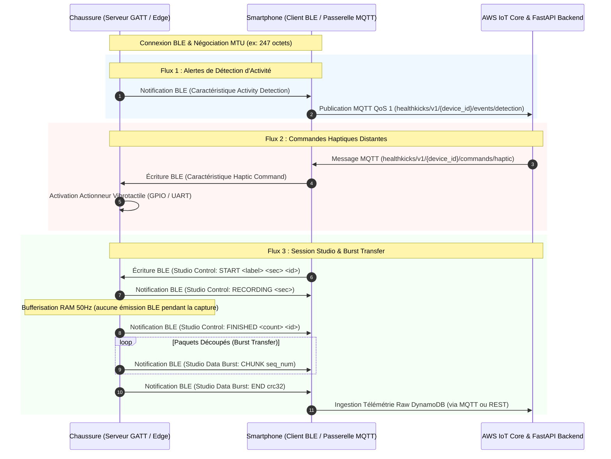

# Spécification du Profil BLE GATT - HealthKicks Footwear Service

Ce document constitue la **spécification contractuelle officielle** pour la communication Bluetooth Low Energy (BLE) entre la chaussure connectée **HealthKicks** (serveur GATT hébergé sur Raspberry Pi / ESP32-S3) et le smartphone (client GATT / passerelle BLE-to-MQTT vers AWS IoT Core).

---

## 1. Architecture & Rôle des Acteurs



---

## 2. Identifiants UUID du Service et des Caractéristiques

Le service utilise des UUIDs 128-bit dérivés de la base HealthKicks `7a5a0000-c529-4d64-8848-18e5904de22a` :

| Élément | UUID 128-bit | Propriétés | Description |
| :--- | :--- | :--- | :--- |
| **HealthKicks Service** | `7a5a0001-c529-4d64-8848-18e5904de22a` | Primary Service | Service principal de la chaussure connectée |
| **Activity Detection** | `7a5a0002-c529-4d64-8848-18e5904de22a` | `READ`, `NOTIFY` | Événements d'activité et alertes de chute |
| **Haptic Command** | `7a5a0003-c529-4d64-8848-18e5904de22a` | `WRITE`, `WRITE WITHOUT RESPONSE` | Commande de vibration vibrotactile |
| **Studio Control** | `7a5a0004-c529-4d64-8848-18e5904de22a` | `WRITE`, `NOTIFY` | Contrôle d'état et protocole de session Studio |
| **Studio Data Burst** | `7a5a0005-c529-4d64-8848-18e5904de22a` | `NOTIFY` | Déversement binaire haute vitesse des trames IMU |

---

## 3. Spécification Détaillée des Caractéristiques

### A. Caractéristique 1 : Activity Detection (`7a5a0002-...`)
- **Propriétés** : `READ`, `NOTIFY`
- **Rôle** : Transmettre au smartphone les changements d'état d'activité et les alertes critiques de chute calculées par le moteur ML embarqué.
- **Règle d'anti-rebond (Debounce)** : Une fois une chute détectée (`fall_*`), un délai de cooldown de **5.0 secondes** est imposé avant toute nouvelle notification de chute.

#### Format Binaire Compact (7 octets)
Endianness : **Big-Endian** (réseau standard).

| Offset | Champ | Type | Plage / Valeurs | Description |
| :--- | :--- | :--- | :--- | :--- |
| 0 | `state_code` | uint8 | Table ci-dessous | Code de l'état ou de l'événement détecté |
| 1 | `confidence` | uint8 | `0` – `100` | Niveau de confiance du modèle en % |
| 2..5 | `timestamp` | uint32 | Epoch Unix (sec) | Horodatage UTC de détection |
| 6 | `flags` | uint8 | Bitfield | Bit 0 : Détection critique (chute)<br>Bit 1 : Déclenchement haptique local autonome effectué |

#### Table des `state_code` :
- `0x00` : `idle` (immobile / assis)
- `0x01` : `walk` (marche normale)
- `0x02` : `run` (course / foulée rapide)
- `0x10` : `fall_forward` (chute avant)
- `0x11` : `fall_backward` (chute arrière)
- `0x12` : `fall_lateral` (chute latérale)
- `0x1F` : `fall_generic` (chute non spécifiée)

---

### B. Caractéristique 2 : Haptic Command (`7a5a0003-...`)
- **Propriétés** : `WRITE`, `WRITE WITHOUT RESPONSE`
- **Rôle** : Piloter immédiatement le vibreur présent dans la semelle de la chaussure (relais d'une commande reçue depuis le Cloud ou déclenchée localement par l'application mobile).

#### Format Binaire (4 octets)
Endianness : **Big-Endian**.

| Offset | Champ | Type | Plage / Valeurs | Description |
| :--- | :--- | :--- | :--- | :--- |
| 0 | `pattern_id` | uint8 | `0` = impulsion continue<br>`1` = double pulse<br>`2` = pulsation d'alerte<br>`0x05` = déclenchement calibration assiette IMU | Profil vibratoire ou commande de contrôle |
| 1 | `intensity` | uint8 | `0` – `255` | Puissance PWM (`0` = stop, `255` = puissance max) |
| 2..3 | `duration_ms` | uint16 | `50` – `10000` | Durée totale de la stimulation en millisecondes |

*Exemple* : `[0x00, 0xC8, 0x01, 0xF4]` $\rightarrow$ Impulsion continue, intensité 200/255, durée 500 ms.  
*Exemple calibration* : `[0x05, 0x00, 0x00, 0x00]` $\rightarrow$ Déclenchement immédiat de la calibration d'assiette IMU (4s d'immobilité).

---

### C. Caractéristique 3 : Studio Control (`7a5a0004-...`)
- **Propriétés** : `WRITE`, `NOTIFY`
- **Rôle** : Orchestrer le cycle de vie d'une capture de données biomécaniques Studio et la calibration de l'IMU.

#### 1. Commandes Écrites par le Smartphone (`WRITE`)
Format textuel ASCII encodé en UTF-8 :

1. **Démarrage d'enregistrement** :
   ```text
   START <label> <duration_sec> <session_id>
   ```
   * *Exemple* : `START walk 5.0 7b8e9f01-2345-6789-abcd-ef0123456789`
   * Contraintes : `duration_sec` entre `1.0` et `30.0` secondes.

2. **Annulation** :
   ```text
   CANCEL
   ```

3. **Déclenchement de Calibration d'Assiette IMU** :
   ```text
   CALIBRATE
   ```

#### 2. Notifications Émises par la Chaussure (`NOTIFY`)
Format textuel ASCII encodé en UTF-8 :

| Notification | Déclencheur | Description |
| :--- | :--- | :--- |
| `COUNTDOWN <pulse>/<total>` | Début de session | Impulsion haptique de préparation sensorielle (ex: `COUNTDOWN 1/3`) |
| `RECORDING <duration_sec>` | Fin du compte à rebours | La capture démarre en RAM à 50 Hz |
| `FINISHED <sample_count> <session_id>` | Fenêtre expirée | Capture terminée, prête pour le déversement burst |
| `CALIBRATING <duration_sec>` | Commande `CALIBRATE` ou `0x05` | Début de l'échantillonnage d'immobilité pour réaligner l'assiette |
| `CALIBRATION_OK` | 4.0s immobiles atteintes | Calibration réussie, matrice de rotation persistée en NVS |
| `CALIBRATION_ERROR <reason>` | Mouvement / instabilité | Échec de calibration (ex: `CALIBRATION_ERROR motion_detected`) |
| `CANCELLED` | Commande reçue | Session interrompue |
| `ERROR <reason>` | Anomalie matérielle/RAM | Erreur (ex: `ERROR buffer_overflow`, `ERROR busy`) |

---

### D. Caractéristique 4 : Studio Data Burst (`7a5a0005-...`)
- **Propriétés** : `NOTIFY`
- **Rôle** : Transférer l'ensemble des trames IMU acquises pendant la session Studio à vitesse maximale vers le smartphone.

#### Protocole de Tramage par Paquets (Burst Transfer)
Dès que `FINISHED` est notifié sur Studio Control, le serveur GATT commence l'émission des paquets de données sur cette caractéristique.

#### Structure de l'En-Tête de Paquet (4 octets)

| Offset | Champ | Type | Description |
| :--- | :--- | :--- | :--- |
| 0 | `packet_type` | uint8 | `0x01` = START_OF_BURST<br>`0x02` = DATA_CHUNK<br>`0x03` = END_OF_BURST |
| 1..2 | `seq_num` | uint16 | Numéro de séquence séquentiel (0, 1, 2...) |
| 3 | `payload_len` | uint8 | Nombre de trames IMU contenues dans ce paquet |

#### Structure d'une Trame IMU Découpée (14 octets)
Chaque échantillon sensoriel à 50 Hz est encodé sous forme de 14 octets entiers signés pour optimiser la compacité :

| Offset Relatif | Grandeur | Type | Facteur d'Échelle | Unité Physique | Standard ISB (Wu & Cavanagh, 1995) |
| :--- | :--- | :--- | :--- | :--- | :--- |
| 0..1 | `delta_ms` | uint16 | 1 | Millisecondes écoulées depuis début session | Temps relatif |
| 2..3 | $a_x$ | int16 | $\times 1000$ | milli-$g$ ($1 g = 1000$) | **Antéro-postérieur** (Avant / Propulsion) |
| 4..5 | $a_y$ | int16 | $\times 1000$ | milli-$g$ ($1 g = 1000$) | **Médio-latéral** (Gauche / Appuis) |
| 6..7 | $a_z$ | int16 | $\times 1000$ | milli-$g$ ($1 g = 1000$) | **Longitudinal / Vertical** (Haut / $+1.0\,g$ au repos) |
| 8..9 | $g_x$ | int16 | $\times 10$ | dixièmes de deg/s ($1^\circ/s = 10$) | **Roulis** (Inversion / Éversion) |
| 10..11| $g_y$ | int16 | $\times 10$ | dixièmes de deg/s ($1^\circ/s = 10$) | **Tangage** (Flexion dorsale / plantaire) |
| 12..13| $g_z$ | int16 | $\times 10$ | dixièmes de deg/s ($1^\circ/s = 10$) | **Lacet** (Rotation interne / externe) |

#### Paquet Spécial `END_OF_BURST` (`packet_type = 0x03`)
Taille fixe : 12 octets :
- `header` (4 octets) : `[0x03, seq_num_hi, seq_num_lo, 0x00]`
- `total_samples` (4 octets uint32 big-endian) : Nombre total d'échantillons envoyés.
- `crc32` (4 octets uint32 big-endian) : Somme de contrôle CRC32 calculée sur l'ensemble des octets utiles de trames IMU transmises.

#### Dimensionnement & Négociation ATT MTU
- **MTU standard (23 octets, payload 20 octets)** : 1 trame par paquet (14 octets utiles + 4 octets header = 18 octets).
- **MTU négociée (247 octets, payload 244 octets)** : Jusqu'à **17 trames IMU par paquet** ($17 \times 14 + 4 = 242$ octets).
- **Performance** : Pour une session Studio de 5,0 secondes à 50 Hz (250 échantillons $\approx 3,5$ Ko de données brutes) :
  * Nombre de paquets BLE : $\approx 15$ paquets.
  * Durée de transmission : **inférieure à 250 millisecondes** à un intervalle de connexion BLE standard (15 ms).
