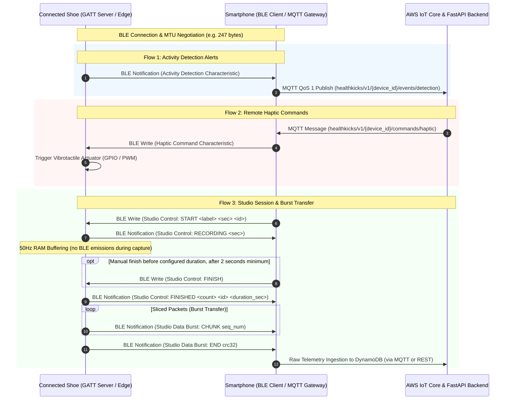

# BLE GATT Profile Specification - HealthKicks Footwear Service

This document constitutes the **official contractual specification** for Bluetooth Low Energy (BLE) communications between the **HealthKicks** connected shoe (GATT server running on ESP32-S3 / Raspberry Pi) and the smartphone (GATT client / BLE-to-MQTT gateway to AWS IoT Core).

---

## 1. Architecture & Actors



---

## 2. Service and Characteristic UUIDs

The service uses 128-bit UUIDs derived from the HealthKicks base `7a5a0000-c529-4d64-8848-18e5904de22a`:

| Element                        | 128-bit UUID                                      | Properties                        | Description                                                           |
| :----------------------------- | :------------------------------------------------ | :-------------------------------- | :-------------------------------------------------------------------- |
| **HealthKicks Service**        | `7a5a0001-c529-4d64-8848-18e5904de22a`            | Primary Service                   | Primary connected shoe service                                        |
| **Activity Detection**         | `7a5a0002-c529-4d64-8848-18e5904de22a`            | `READ`, `NOTIFY`                  | Activity events and fall alerts                                       |
| **Haptic Command**             | `7a5a0003-c529-4d64-8848-18e5904de22a`            | `WRITE`, `WRITE WITHOUT RESPONSE` | Vibrotactile feedback command                                         |
| **Device & Studio Control**    | `7a5a0004-c529-4d64-8848-18e5904de22a`            | `WRITE`, `NOTIFY`                 | State control, attitude calibration, settings, and Studio protocol    |
| **Studio Data Burst**          | `7a5a0005-c529-4d64-8848-18e5904de22a`            | `NOTIFY`                          | High-speed binary offloading of raw IMU frames                        |
| **Step Counter**               | `7a5a0006-c529-4d64-8848-18e5904de22a`            | `READ`, `NOTIFY`                  | Deterministic step counter, activity breakdown, and cadence           |
| **OTA Update Service**         | `7a5a0010-c529-4d64-8848-18e5904de22a`            | Secondary Service                 | Dedicated Over-The-Air firmware update service                        |
| **OTA Control**                | `7a5a0011-c529-4d64-8848-18e5904de22a`            | `WRITE`, `NOTIFY`                 | OTA flashing lifecycle control (start, end, abort, status)            |
| **OTA Data**                   | `7a5a0012-c529-4d64-8848-18e5904de22a`            | `WRITE`, `WRITE WITHOUT RESPONSE` | High-speed chunk transfer of the firmware binary (.bin)               |
| **Device Information Service** | `0000180a-0000-1000-8000-00805f9b34fb` (`0x180A`) | Standard Service                  | Standard Bluetooth SIG hardware identification service                |
| **Firmware Revision String**   | `00002a26-0000-1000-8000-00805f9b34fb` (`0x2A26`) | `READ`                            | Semantic version string of installed firmware (e.g. `v1.2.1-esp32s3`) |
| **Software Revision String**   | `00002a28-0000-1000-8000-00805f9b34fb` (`0x2A28`) | `READ`                            | Compilation date/time or build release date of embedded binary        |

---

## 3. Detailed Characteristic Specifications

### A. Characteristic 1: Activity Detection (`7a5a0002-...`)

- **Properties**: `READ`, `NOTIFY`
- **Role**: Transmits activity state changes and critical fall alerts calculated by the embedded ML engine to the smartphone.
- **Debounce Rule**: Once a fall is detected (`fall_*`), a configurable cooldown delay (default **3.0 seconds** / `3000 ms`, adjustable from `500` to `60000 ms` via `SET_FALL_COOLDOWN`) is enforced before any subsequent fall notification can be emitted.

#### Compact Binary Format (7 Bytes)

Endianness: **Big-Endian** (standard network byte order).

| Offset | Field        | Type   | Range / Values   | Description                                                                                                                         |
| :----- | :----------- | :----- | :--------------- | :---------------------------------------------------------------------------------------------------------------------------------- |
| 0      | `state_code` | uint8  | Table below      | Code of detected state or event                                                                                                     |
| 1      | `confidence` | uint8  | `0` – `100`      | Model confidence level in %                                                                                                         |
| 2..5   | `timestamp`  | uint32 | Unix Epoch (sec) | UTC timestamp of detection                                                                                                          |
| 6      | `flags`      | uint8  | Bitfield         | Bit 0: Critical detection (fall)<br>Bit 1: Autonomous local haptic trigger executed<br>Bit 2: Deferred / stored offline alert (NVS) |

#### `state_code` Table:

- `0x00`: `idle` (still / seated)
- `0x01`: `walk` (normal walking)
- `0x02`: `run` (running / fast stride)
- `0x03`: `stairs_up` (ascending stairs)
- `0x04`: `stairs_down` (descending stairs)
- `0x05`: `sit_down` (sitting transition / sitting down)
- `0x06`: `stand_up` (standing transition / standing up from chair)
- `0x07`: `lying_supine` (still posture lying on back / dorsal decubitus)
- `0x08`: `lying_prone` (still posture lying on stomach / ventral decubitus)
- `0x09`: `lying_lateral` (still posture lying on side / lateral decubitus)
- `0x0A`: `jump` (vertical jump / impulse)
- `0x0B`: `lie_down` (lying transition / lying down)
- `0x10`: `fall_forward` (forward fall)
- `0x11`: `fall_backward` (backward fall)
- `0x12`: `fall_lateral` (lateral fall)
- `0x13`: `fall_recovery` (recovery / standing back up after fall)
- `0x1E`: `stumble_recover` (stumble and recover)
- `0x1F`: `fall_generic` (unspecified fall)
- `0x20`: `inactivity_alert` (prolonged inactivity / sedentary reminder)

#### Current Capacity (256 Classes) & Evolution Roadmap

- **Current Capacity (`uint8`)**: The `state_code` field is encoded on 1 byte (`uint8`), enabling addressing up to **256 distinct classes** (`0x00` to `0xFF`). With 18 classes currently allocated, the system preserves a reserve of **238 unallocated identifiers (> 92% headroom)**.
- **Future Extension for > 256 Classes**:
  - **Option A (`uint16` Extension)**: If the catalogue of physical movements or rehabilitation exercises exceeds 256 classes, `state_code` can be expanded to 2 bytes (`uint16`, 65,536 classes). Payload size increases from 7 to 8 bytes, remaining **well below the 20-byte payload limit** of standard 23-byte ATT MTU without causing radio packet fragmentation.
  - **Option B (2-Byte Hierarchical Partitioning)**: Split into `category_id` (1 byte: 0x01 Locomotion, 0x02 Postures, 0x03 Falls, 0x04 Pathologies/Gait Disorders, 0x05 Sports...) + `sub_activity_id` (1 byte within category), enabling instant macro-level filtering on mobile and Cloud.

---

### B. Characteristic 2: Haptic Command (`7a5a0003-...`)

- **Properties**: `WRITE`, `WRITE WITHOUT RESPONSE`
- **Role**: Directly triggers the in-sole vibration motor or configures haptic/inactivity parameters.

#### 1. Direct Haptic Commands (4 Bytes)

Endianness: **Big-Endian**.

| Offset | Field         | Type   | Range / Values                                                                                                 | Description                                   |
| :----- | :------------ | :----- | :------------------------------------------------------------------------------------------------------------- | :-------------------------------------------- |
| 0      | `pattern_id`  | uint8  | `0` = continuous pulse<br>`1` = double pulse<br>`2` = alert pulse<br>`0x05` = trigger IMU attitude calibration | Vibration profile or control command          |
| 1      | `intensity`   | uint8  | `0` – `255`                                                                                                    | PWM power (`0` = stop, `255` = max power)     |
| 2..3   | `duration_ms` | uint16 | `50` – `10000`                                                                                                 | Total duration of stimulation in milliseconds |

_Example_: `[0x00, 0xC8, 0x01, 0xF4]` $\rightarrow$ Continuous pulse, intensity 200/255, duration 500 ms.
_Calibration Example_: `[0x05, 0x00, 0x00, 0x00]` $\rightarrow$ Immediate trigger of IMU attitude calibration (4s stillness).

#### 2. Prolonged Inactivity Reminder Configuration (Opcode `0x06` - 6 Bytes)

Endianness: **Big-Endian**.

| Offset | Field                      | Type   | Range / Values                                       | Description                                    |
| :----- | :------------------------- | :----- | :--------------------------------------------------- | :--------------------------------------------- |
| 0      | `opcode`                   | uint8  | `0x06`                                               | Inactivity reminder configuration opcode       |
| 1      | `is_enabled`               | uint8  | `0` = disabled, `1` = enabled                        | Enable / disable monitoring                    |
| 2..3   | `inactivity_threshold_sec` | uint16 | `600` – `7200` (10 to 120 min, def: `3000` / 50 min) | Continuous duration without steps before alert |
| 4..5   | `cooldown_duration_sec`    | uint16 | `300` – `1800` (5 to 30 min, def: `600` / 10 min)    | Repetition delay / cooldown after alert        |

---

### C. Characteristic 3: Device & Studio Control (`7a5a0004-...`)

- **Properties**: `WRITE`, `NOTIFY`
- **Role**: Centralizes application control, Studio recording lifecycle, IMU calibration, and functional device configuration using ASCII UTF-8 text strings.

#### 1. Commands Written by Smartphone (`WRITE`)

ASCII UTF-8 format:

1. **Start Recording**:

   ```text
   START <label> <duration_sec> <session_id>
   ```
   - _Example_: `START walk 5.0 7b8e9f01-2345-6789-abcd-ef0123456789`
   - Constraints: `duration_sec` between `2.0` and `30.0` seconds.

2. **Cancel**:

   ```text
   CANCEL
   ```

3. **Early Finish of Recording**:

   ```text
   FINISH
   ```
   - Valid only after at least 2.0 seconds of sampling; shoe emits `FINISHED` and transmits the burst.

4. **Trigger IMU Attitude Calibration**:

   ```text
   CALIBRATE
   ```

5. **Configure Inactivity Reminder**:

   ```text
   SET_INACTIVITY <enabled:0|1> <threshold_sec> <cooldown_sec>
   ```
   - _Example_: `SET_INACTIVITY 1 3000 600`

6. **Enable / Disable Human-in-the-Loop (HITL) Mode**:

   ```text
   SET_HITL <enabled:0|1>
   ```
   - _Parameter_: `0` to disable, `1` to enable.
   - _Default_: `0` (disabled).
   - _Example_: `SET_HITL 1`
   - _Behavior_:
     - Shoe continuously maintains a circular buffer of 76 raw IMU frames at 19 Hz (~4.0 seconds).
     - Upon an activity notification on `0002` (state change or fall detection) at time $T$, the shoe continues recording for 1.5 seconds (28 post-event frames).
     - At $T + 1.5\,\text{s}$, the shoe notifies `FINISHED 76 hitl-<timestamp> 4.0` on `0004` and transmits the 76 IMU frames (~2.5s pre-event and ~1.5s post-event) over Studio Data Burst `0005`.

7. **Configure Fall Confidence Threshold**:

   ```text
   SET_FALL_CONFIDENCE <threshold:0.30..0.90>
   ```
   - _Parameter_: Probabilistic confidence threshold for fall detections (float).
   - _Valid Range_: `0.30` (ultra-sensitive) to `0.90` (ultra-robust).
   - _Default_: `0.65`.
   - _Example_: `SET_FALL_CONFIDENCE 0.75`
   - _Return Notification_: `FALL_CONFIDENCE_OK <value>` or `FALL_CONFIDENCE_ERROR <reason>`.

8. **Configure Fall Detection Cooldown**:

   ```text
   SET_FALL_COOLDOWN <cooldown_ms:500..60000>
   ```
   - _Parameter_: Minimum debounce delay in milliseconds (uint32) between consecutive fall alerts (`_fallCooldownMs`).
   - _Valid Range_: `500` (0.5 s) to `60000` (60 s).
   - _Default_: `3000` (3 s).
   - _Example_: `SET_FALL_COOLDOWN 3000`
   - _Return Notification_: `FALL_COOLDOWN_OK <cooldown_ms>` or `FALL_COOLDOWN_ERROR <reason>`.

9. **Clock Synchronization (Time Sync & Clock Calibration)**:
   ```text
   SYNC_TIME <unix_epoch_sec>
   ```
   - _Parameter_: Current UTC Unix epoch timestamp from smartphone in seconds (`uint32`).
   - _Example_: `SYNC_TIME 1762354800`
   - _Behavior_:
     - The ESP32 computes its exact boot epoch: $\text{boot\_epoch\_sec} = \text{unix\_epoch\_sec} - \text{uptime\_sec}$.
     - This reference epoch is persisted in `RTC_DATA_ATTR` and preserved across Deep Sleep wakeups.
     - The ESP32 notifies `TIME_SYNC_OK <boot_count> <uptime_sec>`.
     - If offline hourly step buckets were recorded, the ESP32 transmits each resolved bucket via one or more `STEP_HIST <boot_count> <bucket_epoch_sec> <walk> <run> <stairs> <unclassified>` notifications.

#### 2. Notifications Emitted by Connected Shoe (`NOTIFY`)

ASCII UTF-8 format:

| Notification                                          | Trigger                             | Description                                                                |
| :---------------------------------------------------- | :---------------------------------- | :------------------------------------------------------------------------- |
| `COUNTDOWN <pulse>/<total>`                           | Session start                       | Sensory preparatory haptic pulse (e.g. `COUNTDOWN 1/3`)                    |
| `RECORDING <duration_sec>`                            | Countdown completion                | Capture starts in RAM at 50 Hz                                             |
| `FINISHED <sample_count> <session_id> <duration_sec>` | Window expired or `FINISH` command  | Capture complete, ready for burst offload; actual duration transmitted     |
| `CALIBRATING <duration_sec>`                          | `CALIBRATE` command or `0x05`       | Beginning of stillness sampling to realign attitude                        |
| `CALIBRATION_OK`                                      | 4.0s stillness achieved             | Calibration successful, rotation matrix persisted in NVS                   |
| `CALIBRATION_ERROR <reason>`                          | Movement / instability detected     | Calibration failed (e.g. `CALIBRATION_ERROR motion_detected`)              |
| `HITL_OK <0\|1>`                                      | `SET_HITL` command                  | HITL mode enabled (1) or disabled (0) successfully                         |
| `HITL_ERROR <reason>`                                 | `SET_HITL` command                  | Command rejected (e.g. invalid arguments)                                  |
| `FALL_CONFIDENCE_OK <value>`                          | `SET_FALL_CONFIDENCE` command       | Fall confidence threshold updated successfully                             |
| `FALL_CONFIDENCE_ERROR <reason>`                      | `SET_FALL_CONFIDENCE` command       | Command rejected (e.g. `out_of_range`, `invalid_params`)                   |
| `FALL_COOLDOWN_OK <cooldown_ms>`                      | `SET_FALL_COOLDOWN` command         | Fall detection cooldown updated successfully (in ms)                       |
| `FALL_COOLDOWN_ERROR <reason>`                        | `SET_FALL_COOLDOWN` command         | Command rejected (e.g. `out_of_range`, `invalid_params`)                   |
| `TIME_SYNC_OK <boot_count> <uptime_sec>`              | `SYNC_TIME` command                 | Clock calibrated, returns hardware boot count and current uptime           |
| `STEP_HIST <boot_count> <epoch_sec> <w> <r> <s> <u>`  | Post `SYNC_TIME` (if offline steps) | Transmission of offline recorded step bucket                               |
| `CANCELLED`                                           | Command received                    | Session aborted                                                            |
| `ERROR <reason>`                                      | Hardware/RAM fault or rejection     | Error (e.g. `ERROR buffer_overflow`, `ERROR busy`, `ERROR not_calibrated`) |

---

### D. Characteristic 4: Studio Data Burst (`7a5a0005-...`)

- **Properties**: `NOTIFY`
- **Role**: Transfers all raw IMU frames acquired during a Studio session at maximum throughput to the smartphone.

#### Burst Packet Framing Protocol

As soon as `FINISHED` is notified on Studio Control, the GATT server begins streaming data packets on this characteristic.

#### Packet Header Structure (4 Bytes)

| Offset | Field         | Type   | Description                                                                                                                                                                              |
| :----- | :------------ | :----- | :--------------------------------------------------------------------------------------------------------------------------------------------------------------------------------------- |
| 0      | `packet_type` | uint8  | `0x01` = START_OF_BURST<br>`0x02` = DATA_CHUNK<br>`0x03` = END_OF_BURST<br>`0x04` = DELTA_CHUNK (Lossless Delta Compression)<br>`0x05` = RLE_CHUNK (Lossless Static Run-Length Encoding) |
| 1..2   | `seq_num`     | uint16 | Sequential packet number (0, 1, 2...)                                                                                                                                                    |
| 3      | `payload_len` | uint8  | Byte count of payload contained in this packet                                                                                                                                           |

#### `DELTA_CHUNK` Packet Structure (`packet_type = 0x04`)

Doubles throughput during continuous kinematic variations.

- `header` (4 bytes): `[0x04, seq_num_hi, seq_num_lo, payload_len]`
- `total_frames` (1 byte uint8): Total number of frames in packet ($1 + \text{delta\_count}$).
- `keyframe` (14 bytes): First absolute IMU frame (standard 14 bytes).
- `deltas` ($K \times 7$ bytes): For each successive frame ($k \in [1, \text{delta\_count}]$):
  - `diff_ms` (1 byte uint8): Time difference from previous frame ($\le 255$ ms).
  - `diff_ax, diff_ay, diff_az` (3 bytes int8): Acceleration differences ($-127$ to $+127$ milli-$g$).
  - `diff_gx, diff_gy, diff_gz` (3 bytes int8): Angular velocity differences ($-127$ to $+127$ tenths of deg/s).

#### `RLE_CHUNK` Packet Structure (`packet_type = 0x05`)

Massively compresses stationary/static sequences (stillness, seated posture, resting) where IMU signals are constant or quasi-constant.
Fixed payload size: **16 bytes** (yielding a 20-byte BLE packet) capable of representing up to **255 consecutive frames** (up to $\times 178$ reduction in radio bandwidth).

- `header` (4 bytes): `[0x05, seq_num_hi, seq_num_lo, 0x10]` (`payload_len` = 16)
- `run_count` (1 byte uint8, offset 4): Number of successive repeated frames ($2 \le N \le 255$).
- `start_delta_ms` (2 bytes uint16 big-endian, offset 5..6): Relative timestamp of the first frame.
- `step_ms` (1 byte uint8, offset 7): Constant time step between frames (e.g. 20 ms at 50 Hz).
- $a_x, a_y, a_z$ (6 bytes int16 big-endian, offset 8..13): Constant accelerations (milli-$g$).
- $g_x, g_y, g_z$ (6 bytes int16 big-endian, offset 14..19): Constant angular velocities (tenths of deg/s).

_Client Reconstruction_: For each index $i \in [0, \text{run\_count} - 1]$:
$$\text{delta\_ms}_i = \text{start\_delta\_ms} + i \times \text{step\_ms}$$
with identical physical values $(a_x, a_y, a_z, g_x, g_y, g_z)$.

#### IMU Frame Structure (14 Bytes)

Each 50 Hz sensor sample is encoded as 14 signed integer bytes for maximum compactness:

| Relative Offset | Variable   | Type   | Scale Factor  | Physical Unit                      | ISB Standard (Wu & Cavanagh, 1995)                       |
| :-------------- | :--------- | :----- | :------------ | :--------------------------------- | :------------------------------------------------------- |
| 0..1            | `delta_ms` | uint16 | 1             | Elapsed ms since session start     | Relative time                                            |
| 2..3            | $a_x$      | int16  | $\times 1000$ | milli-$g$ ($1 g = 1000$)           | **Antero-posterior** (Forward / Propulsion)              |
| 4..5            | $a_y$      | int16  | $\times 1000$ | milli-$g$ ($1 g = 1000$)           | **Medio-lateral** (Lateral / Stride support)             |
| 6..7            | $a_z$      | int16  | $\times 1000$ | milli-$g$ ($1 g = 1000$)           | **Longitudinal / Vertical** (Upward / $+1.0\,g$ at rest) |
| 8..9            | $g_x$      | int16  | $\times 10$   | tenths of deg/s ($1^\circ/s = 10$) | **Roll** (Inversion / Eversion)                          |
| 10..11          | $g_y$      | int16  | $\times 10$   | tenths of deg/s ($1^\circ/s = 10$) | **Pitch** (Dorsiflexion / Plantarflexion)                |
| 12..13          | $g_z$      | int16  | $\times 10$   | tenths of deg/s ($1^\circ/s = 10$) | **Yaw** (Internal / External rotation)                   |

#### Special Packet `END_OF_BURST` (`packet_type = 0x03`)

Fixed size: 12 bytes:

- `header` (4 bytes): `[0x03, seq_num_hi, seq_num_lo, 0x00]`
- `total_samples` (4 bytes uint32 big-endian): Total count of transmitted samples.
- `crc32` (4 bytes uint32 big-endian): CRC32 checksum computed over all transmitted payload bytes of IMU frames.

#### ATT MTU Dimensioning & Negotiation

- **Standard MTU (23 bytes, payload 20 bytes)**: 1 frame per packet (14 payload bytes + 4 header bytes = 18 bytes).
- **Negotiated MTU (247 bytes, payload 244 bytes)**: Up to **17 IMU frames per packet** ($17 \times 14 + 4 = 242$ bytes).
- **Performance**: For a 5.0s Studio session at 50 Hz (250 samples $\approx 3.5$ KB raw data):
  - BLE packet count: $\approx 15$ packets.
  - Transmission duration: **under 250 milliseconds** at standard BLE connection interval (15 ms).

---

### E. Characteristic 5: Step Counter / Pedometer (`7a5a0006-...`)

- **Properties**: `READ`, `NOTIFY`
- **Role**: Transmits in real time the cumulative count of steps detected by the embedded algorithm, activity gating breakdown, and cadence.

#### Compact Binary Format (21 Bytes)

Endianness: **Big-Endian** (standard network byte order).

| Offset   | Field                | Type   | Range / Values        | Description                                                                |
| :------- | :------------------- | :----- | :-------------------- | :------------------------------------------------------------------------- |
| `0..3`   | `total_steps`        | uint32 | `0` – `4 294 967 295` | Total valid steps accumulated since boot or last reset                     |
| `4..5`   | `walk_steps`         | uint16 | `0` – `65 535`        | Steps validated under Walking activity (`0x01`)                            |
| `6..7`   | `run_steps`          | uint16 | `0` – `65 535`        | Steps validated under Running activity (`0x02`)                            |
| `8..9`   | `stairs_steps`       | uint16 | `0` – `65 535`        | Steps validated under Stairs activity (`0x03`)                             |
| `10..11` | `unclassified_steps` | uint16 | `0` – `65 535`        | Steps validated under other unclassified activities                        |
| `12`     | `cadence_spm`        | uint8  | `0` – `255`           | Instantaneous cadence in steps/minute (computed over 5s sliding window)    |
| `13..14` | `current_gct_ms`     | uint16 | `0` – `65 535`        | Recent average ground contact time (GCT) in ms (smoothed EMA over 5 steps) |
| `15..16` | `boot_count`         | uint16 | `0` – `65 535`        | Hardware boot cycle count (NVS persistence)                                |
| `17..20` | `uptime_sec`         | uint32 | `0` – `4 294 967 295` | Elapsed seconds since hardware boot (cumulative uptime)                    |

#### Notification Rules

- Immediate notification upon every new validated step (if a BLE client subscribed with CCCD descriptor `BLE2902`).
- Periodic notification (1 Hz heartbeat) to refresh cadence and guarantee synchronization even during rest phases.

---

### F. OTA Firmware Update Service (`7a5a0010-...`)

The OTA service enables wireless ESP32-S3 firmware updates across a dual-slot partition layout (`ota_0`, `ota_1`) managed by the native ESP-IDF OTA subsystem.

#### 1. OTA Control Characteristic (`7a5a0011-...`)

- **Properties**: `WRITE`, `NOTIFY`
- **Role**: Drives the update protocol, validates flashing state, and switches the active boot partition.

##### Client Commands (`WRITE`):

- `0x01` (`OTA_BEGIN`): Start OTA transfer. Followed immediately by 4 Big-Endian bytes representing total binary file size in bytes:
  `[0x01, size_b3, size_b2, size_b1, size_b0]` (5 bytes total).
- `0x02` (`OTA_END`): Finalize transfer. Requests integrity validation, SHA-256 cryptographic check, and boot slot switch:
  - Mandatory format (33 bytes): `[0x02, sha256_0, ..., sha256_31]` (opcode `0x02` followed by 32 bytes of the binary SHA-256 hash).
  - Any `OTA_END` packet shorter than 33 bytes is **immediately rejected** with `OTA_ERROR` (`0x07`: `OTA_ERR_CHECKSUM_MISMATCH`) and aborted (`Update.abort()`).
  - Furthermore, the very first chunk received on `OTA Data` must begin with the ESP-IDF magic byte `0xE9` (otherwise immediately rejected with `0x05`: `OTA_ERR_VALIDATION_FAILED`).
- `0x03` (`OTA_ABORT`): Emergency abort. Cancels current OTA transaction, clears flash handles, and restores nominal services (IMU/Edge AI):
  `[0x03]` (1 byte).

##### ESP32 Responses & Notifications (`NOTIFY`):

- `0x10` (`OTA_READY`): ESP32 is ready to receive data blocks on `OTA Data`:
  `[0x10]`.
- `0x11` (`OTA_CHUNK_ACK`): Periodic or optional block acknowledgment:
  `[0x11, bytes_written_b3, bytes_written_b2, bytes_written_b1, bytes_written_b0]`.
- `0x12` (`OTA_SUCCESS`): Image validated successfully, active partition switched. Automatic reboot scheduled within 500 ms:
  `[0x12]`.
- `0xFF` (`OTA_ERROR`): Failure notification followed by error code (2 bytes):
  `[0xFF, error_code]`
  Error codes:
  - `0x01`: `OTA_ERR_PARTITION_NOT_FOUND` (no inactive OTA partition available).
  - `0x02`: `OTA_ERR_BEGIN_FAILED` (descriptor initialization failure `esp_ota_begin`).
  - `0x03`: `OTA_ERR_WRITE_FAILED` (flash memory write failure `esp_ota_write`).
  - `0x04`: `OTA_ERR_SIZE_MISMATCH` (written byte count does not match declared size).
  - `0x05`: `OTA_ERR_VALIDATION_FAILED` (invalid binary image, missing magic byte `0xE9` or bad signature/CRC at `esp_ota_end`).
  - `0x06`: `OTA_ERR_SET_BOOT_FAILED` (cannot set target partition as bootable).
  - `0x07`: `OTA_ERR_CHECKSUM_MISMATCH` (missing or mismatched SHA-256 hash).

#### 2. OTA Data Characteristic (`7a5a0012-...`)

- **Properties**: `WRITE`, `WRITE WITHOUT RESPONSE`
- **Role**: Continuous streaming transmission of raw binary chunks comprising the firmware `.bin`.
- **Payload Sizing**: Maximum chunk size is set to `ATT_MTU - 3` bytes (e.g. 244 bytes for a 247 MTU).
- **Throughput Parameters**: The mobile app requests an MTU of 247 and writes up to 244 bytes per packet based on negotiated MTU. During transfer, the server requests a 15–20 ms connection interval, reverting to the nominal 100–125 ms interval on completion or cancellation.
- **Pacing**: Mobile waits for each `WRITE WITHOUT RESPONSE` write completion without adding artificial delay. The BLE transport stack maintains pacing; configurable delay can be introduced for devices that overflow local buffers.
- **System Priority**: As soon as `OTA_BEGIN` is issued, IMU sampling and Edge AI inferences are suspended to dedicate 100% CPU time and Flash bus bandwidth to OTA flashing.

#### 3. BLE GATT Security (LE Secure Connections & Hardware Button Pairing) & Anti-Bricking Safety

- **LE Secure Connections BLE Encryption & Physical Button Pairing Lock (`GPIO 14`)**:
  - The NimBLE server initializes the Security Manager with `Bonding = true`, `MITM = false`, `SC (Secure Connections) = true`, and `IOCap = BLE_HS_IO_NO_INPUT_OUTPUT`.
  - **Nominal Mode (Locked to bonded devices)**:
    - When at least one smartphone is bonded in NVS (`NimBLEDevice::getNumBonds() > 0`) and the pairing window is closed, **only bonded smartphones (`NimBLEDevice::isBonded`)** are permitted to connect and interact.
    - Any unknown device attempting to connect without prior push of the physical button is **immediately rejected and disconnected**, and existing keys are never deleted.
  - **Physical Button Pairing Mode (`GPIO 14` - 60-Second Window)**:
    - A short press on the physical button (`GPIO 14`) opens a **60-second pairing window** (`openPairingWindow(60000)`).
    - Only during these 60 seconds (or on first boot if `getNumBonds() == 0`), the shoe accepts pairing a new phone (`startSecurity`) or refreshing an obsolete bond key (`deleteBond` then re-pair).
- **Initial Boot State & Automatic Rollback**:
  - Upon successful OTA update, the ESP-IDF bootloader marks the target partition as `ESP_OTA_IMG_PENDING_VERIFY`.
  - At startup in `setup()`, the firmware checks `esp_ota_get_state_partition()`.
  - If `ESP_OTA_IMG_PENDING_VERIFY` is detected, it runs hardware diagnostics (MPU-6050 I2C `WHO_AM_I`, memory integrity, BLE server).
  - If the ESP32 panics, crashes, or the IMU fails before 15 seconds elapse, the ESP-IDF bootloader automatically rolls back to the previous operational partition (`ota_0` $\leftrightarrow$ `ota_1`).
  - If the ESP32 maintains continuous nominal operation for 15 seconds with active IMU sampling and initialized BLE stack, it marks the firmware permanently valid via `esp_ota_mark_app_valid_cancel_rollback()`.

---

### G. Standard Device Information Service (DIS `0x180A`)

The standard Bluetooth SIG Device Information Service enables mobile clients to inspect hardware identity and active firmware version without proprietary protocols.

#### 1. Firmware Revision String (`0x2A26`)

- **Properties**: `READ`
- **Format**: ASCII UTF-8 string (e.g. `"v1.2.1-esp32s3"`).

#### 2. Software Revision String (`0x2A28`)

- **Properties**: `READ`
- **Format**: ASCII UTF-8 string containing build timestamp or ISO UTC release date (e.g. `"2026-10-11T10:24:36Z"` or `__DATE__ " " __TIME__`).
- **Mobile Usage**: Enables instant comparison between installed firmware date and Cloud release date (`release_date`) before triggering downloads.

---

### H. Dynamic BLE Connection Interval Management

To maximize battery lifetime during normal usage while guaranteeing optimal throughput during Studio calibration sessions, the shoe negotiates BLE connection parameters adaptively (`GAP Connection Parameters Update`):

#### 1. Nominal Mode (Active Idle & Continuous Step Counting)

- **Min Interval**: 100 ms (`min_conn_interval = 80` in 1.25 ms units).
- **Max Interval**: 125 ms (`max_conn_interval = 100` in 1.25 ms units).
- **Slave Latency**: 0 events (`latency = 0`).
- **Supervision Timeout**: 4000 ms (`supervision_timeout = 400` in 10 ms units).
- **Benefit**: Reduces periodic radio wakeups, maintaining idle power consumption below 15 mA while ensuring negligible latency for step counting (19 Hz) and fall alerts.

#### 2. High-Speed Burst Mode (Active Studio Session)

- **Min Interval**: 15 ms (`min_conn_interval = 12` in 1.25 ms units).
- **Max Interval**: 20 ms (`max_conn_interval = 16` in 1.25 ms units).
- **Slave Latency**: 0 events (`latency = 0`).
- **Supervision Timeout**: 4000 ms (`supervision_timeout = 400` in 10 ms units).
- **Trigger**: Automatic upon receiving Studio `START` command on `Studio Control` (`0004`).
- **Nominal Reset**: Automatic upon `END_OF_BURST`, cancellation (`CANCEL`), or disconnect.
- **Benefit**: Multiplies transfer speed by 6x to 8x, synchronizing 1500 IMU frames (30s at 50 Hz) in under 2.5 seconds.
