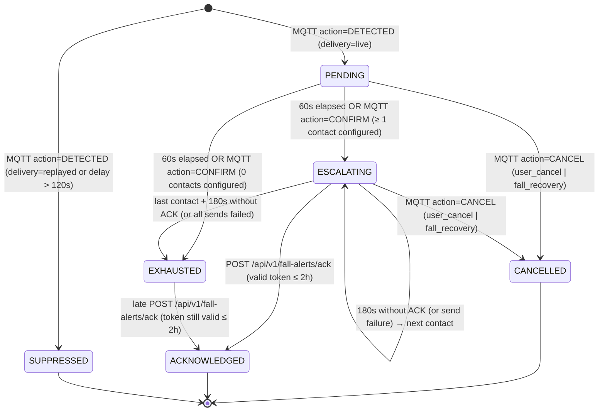

# Exchange Contract — Fall Alerting

> **Status**: `VALIDATED v1.1` — Specification validated with user (SMTP Email + Backend-directed SMS via Mobile GSM Relay).
> **Impacted Projects**:
>
> - `health-kicks` (FastAPI Backend, SQLAlchemy/Alembic, Escalation Worker, SMTP, Downlink MQTT SMS Commands, `SMS_STATUS` Tracking, IoT Webhook, HTML Acknowledgment Page)
> - `health-kicks-mobile` (Flutter Android Mobile, BLE Detection -> MQTT Uplink, GPS, 60s Alert Screen, Downlink MQTT Handling, Native `SmsManager` SMS Dispatch + `SMS_STATUS` Ack, 112 Dialing)
> - `health-kicks-frontend` (Angular 22, `/dashboard/fall-alerts` with two tabs: _Alert History_ with Email/SMS tracing and _Emergency Contacts_ with optional phone)
> - `health-kicks-esp32-s3`: **No changes** (relies on BLE characteristic `7a5a0002` defined in [`ble_gatt_specs.md`](./ble_gatt_specs.md)).

---

## 1. Scope & Guiding Principles

| Principle                     | Normative Rule                                                                                                                                                                                                                                                                                                                                                                                                                                                                                  |
| :---------------------------- | :---------------------------------------------------------------------------------------------------------------------------------------------------------------------------------------------------------------------------------------------------------------------------------------------------------------------------------------------------------------------------------------------------------------------------------------------------------------------------------------------- |
| **Alert Channels**            | **Email** (SMTP STARTTLS sent by backend) **+ Optional SMS** (orchestrated by backend via Downlink MQTT and sent by the user's Android phone via `SmsManager`, with future evolution path towards a Cloud SMS API like OVH SMS).                                                                                                                                                                                                                                                                |
| **Precondition**              | **Active Surveillance Mode** ([`docs/mobile_architecture.md`](../docs/mobile_architecture.md)): the Android mobile app maintains the Foreground Service connected to the footwear (BLE) **and** to the AWS IoT Core broker (MQTT). No email/SMS alert is emitted for deferred falls (`SUPPRESSED`).                                                                                                                                                                                             |
| **Recipients (Contacts)**     | Emergency contacts associated with the user account: `first_name`, `last_name`, `email` (mandatory), `phone` (**optional**, normalized international/local format), `priority` (`1..5`). **Managed exclusively from the web application** (_Emergency Contacts_ tab on `/dashboard/fall-alerts`). Maximum **5** contacts per user. No automatic message upon creation, but a **"Test"** button sends a test email and, if `phone` is set, a test SMS order to the mobile device.                |
| **Sequential Escalation**     | Exactly one contact is alerted at a time in ascending order of `priority` (`1`, then `2`, etc.). If the contact has a `phone` number, the backend simultaneously dispatches the email **and** the SMS command for that contact. Without acknowledgment within **180 seconds (3 min)**, the next contact is alerted. As soon as any contact confirms handling (via link in email or SMS), **escalation stops and subsequent contacts are never notified**.                                       |
| **Exhaustion (`EXHAUSTED`)**  | If the last contact on the list has not confirmed after **180 seconds** (or if the user configured no contacts by the end of the 60s window), the alert transitions to `EXHAUSTED`: **retries stop** and the patient's phone displays full-screen **"Call 112"**.                                                                                                                                                                                                                               |
| **Cancellation Window (60s)** | Upon receiving a fall event, the alert starts in `PENDING` for **60 seconds** (timer managed by backend) while the phone displays the "Are you okay?" screen. If the patient clicks "I'm okay" or if the footwear detects recovery (`fall_recovery`, code `0x13`), the alert transitions to `CANCELLED` and **no notification is sent**.                                                                                                                                                        |
| **Recovery Post-Dispatch**    | If `fall_recovery` (or manual user cancel) occurs during `ESCALATING`, the alert immediately transitions to `CANCELLED`, **escalation halts, and no further notifications are sent**.                                                                                                                                                                                                                                                                                                           |
| **Acknowledgment (ACK)**      | Via a **signed link valid for 2 hours (7,200 s)** in email and SMS: `f"{frontend_url}/fall-alerts/ack?token={token}"`. The link opens the Angular frontend page (`/fall-alerts/ack?token=...`) which fetches alert metadata via `GET /api/v1/fall-alerts/ack/info` (secure read-only), followed by an explicit button confirmation via `POST /api/v1/fall-alerts/ack` (JSON payload `{"token": "..."}`) to prevent accidental acknowledgments from SMS link preview crawlers or email scanners. |
| **Alert Concurrency**         | A user can have **only one active alert** (`PENDING` or `ESCALATING`) at a time. Any new `DETECTED` fall received while an alert is active is attached/ignored idempotently without triggering a parallel escalation chain.                                                                                                                                                                                                                                                                     |
| **History Visibility & RBAC** | Alert history is visible to the **concerned user** (role `user` or `clinician`, each seeing **only their own alerts**) and the **`admin`** role (who sees all alerts with GDPR pseudonymization by default for third-party accounts, aligned with Studio).                                                                                                                                                                                                                                      |

---

## 2. State Machine (`FallAlertState`)



| State (`FallAlertState`) | Terminal | Description                                                                                                                                                                                                              |
| :----------------------- | :------: | :----------------------------------------------------------------------------------------------------------------------------------------------------------------------------------------------------------------------- |
| `PENDING`                |    ❌    | Fall received live; 60s cancellation window active (`next_action_at = detected_at + 60s`). No notifications sent.                                                                                                        |
| `ESCALATING`             |    ❌    | Sequential alert dispatch in progress; `current_contact_rank` (`1..N`) indicates contact currently being solicited (`next_action_at = now + 180s`).                                                                      |
| `ACKNOWLEDGED`           |    ✅    | A contact confirmed acknowledgment via signed link (Email or SMS). Escalation stopped.                                                                                                                                   |
| `CANCELLED`              |    ✅    | Cancelled by patient (`user_cancel`) or recovery detection (`fall_recovery`). No notifications sent after this state.                                                                                                    |
| `EXHAUSTED`              | ⚠️ semi  | All contacts solicited without confirmation in allotted time (or no contacts configured). Mobile shows "Call 112". Only allowed next transition: `ACKNOWLEDGED` if a contact clicks their link before the 2h expiration. |
| `SUPPRESSED`             |    ✅    | Fall recorded outside active surveillance (`delivery="replayed"`, bit 2 `flags` NVS BLE, or delay > 120s). Saved for traceability without notifications.                                                                 |

---

## 3. IoT MQTT Contracts (Mobile ↔ AWS IoT Core ↔ Backend)

Topics use the user namespace `healthkicks/v1/users/{user_uuid}/...` based on the UUIDv4 of the user account, pre-authorized for `iot:Publish`, `iot:Subscribe`, and `iot:Receive` by the dynamic STS policy (`AWSSTSService.build_session_policy`).

### A. Uplink Topic (Mobile → Cloud): `healthkicks/v1/users/{user_uuid}/events/fall-alert`

Published by mobile application in **QoS 1**.

#### 1. Payload `action = "DETECTED"` (emitted upon BLE `0x10`, `0x11`, `0x12`, `0x1F`)

```json
{
  "event_id": "0b6f4b1e-6a51-4c1f-9a3e-2d7f1c9b8e10",
  "action": "DETECTED",
  "device_id": "HK-1",
  "event_type": "fall_forward",
  "confidence": 0.91,
  "detected_at": 1792745943123,
  "delivery": "live",
  "location": {
    "lat": 50.8466,
    "lon": 4.3528,
    "accuracy_m": 12.5,
    "captured_at": 1792745941000
  },
  "sent_at": 1792745943410
}
```

#### 2. Payload `action = "CONFIRM"` (if patient taps "I need help now" before 60s elapse)

```json
{
  "event_id": "0b6f4b1e-6a51-4c1f-9a3e-2d7f1c9b8e10",
  "action": "CONFIRM",
  "location": {
    "lat": 50.8466,
    "lon": 4.3528,
    "accuracy_m": 8.0,
    "captured_at": 1792745955000
  },
  "sent_at": 1792745955100
}
```

#### 3. Payload `action = "CANCEL"` (tap "I'm okay" or BLE `0x13` `fall_recovery` received)

```json
{
  "event_id": "0b6f4b1e-6a51-4c1f-9a3e-2d7f1c9b8e10",
  "action": "CANCEL",
  "cancel_reason": "fall_recovery",
  "sent_at": 1792745951000
}
```

#### 4. Payload `action = "SMS_STATUS"` (execution report from Android SMS relay to Backend via MQTT or REST `POST /api/v1/fall-alerts/sms-status`)

```json
{
  "event_id": "0b6f4b1e-6a51-4c1f-9a3e-2d7f1c9b8e10",
  "action": "SMS_STATUS",
  "notification_id": 102,
  "sms_status": "SENT",
  "error_message": null,
  "sent_at": 1792746005000
}
```

#### Uplink Validation Constraints

| Field             | Type             |    Required     | Constraints & Semantics                                                                                                                                        |
| :---------------- | :--------------- | :-------------: | :------------------------------------------------------------------------------------------------------------------------------------------------------------- |
| `event_id`        | `string`         |       ✅        | UUID v4 generated by mobile upon fall. **Idempotence key** shared across `DETECTED`, `CONFIRM`, `CANCEL`, and `SMS_STATUS`.                                    |
| `action`          | `enum`           |       ✅        | `"DETECTED"` \| `"CONFIRM"` \| `"CANCEL"` \| `"SMS_STATUS"`                                                                                                    |
| `device_id`       | `string`         |  if `DETECTED`  | Shoe identifier (`1..128` chars).                                                                                                                              |
| `event_type`      | `enum`           |  if `DETECTED`  | `"fall_forward"` \| `"fall_backward"` \| `"fall_lateral"` \| `"fall_generic"`                                                                                  |
| `confidence`      | `float`          |  if `DETECTED`  | ML confidence score between `0.0` and `1.0`.                                                                                                                   |
| `detected_at`     | `int`            |  if `DETECTED`  | UTC Epoch in milliseconds (`ms`) at fall detection.                                                                                                            |
| `delivery`        | `enum`           |  if `DETECTED`  | `"live"` if transmitted immediately in Active Surveillance mode; `"replayed"` if originating from offline shoe NVS cache (`flags` bit 2 = 1) or offline queue. |
| `location`        | `object \| null` |       ❌        | GPS location (`lat`: `[-90, 90]`, `lon`: `[-180, 180]`, `accuracy_m`: `≥ 0`, `captured_at`: epoch ms UTC).                                                     |
| `cancel_reason`   | `enum`           |   if `CANCEL`   | `"user_cancel"` ("I'm okay" button) \| `"fall_recovery"` (recovery `0x13` detected by shoe).                                                                   |
| `notification_id` | `int`            | if `SMS_STATUS` | Identifier of `fall_alert_notifications` row (`channel="sms"`) created by backend.                                                                             |
| `sms_status`      | `enum`           | if `SMS_STATUS` | `"SENT"` (SMS submitted to Android GSM modem) \| `"FAILED"` (permission denied or modem error).                                                                |
| `error_message`   | `string \| null` |       ❌        | Error detail if `sms_status == "FAILED"` (max 512 chars).                                                                                                      |
| `sent_at`         | `int`            |       ✅        | UTC Epoch in milliseconds (`ms`) when MQTT message was sent.                                                                                                   |

### B. Downlink Topic (Cloud → Mobile): `healthkicks/v1/users/{user_uuid}/fall-alert/status`

Published by backend via `AWSIoTPublishService` (`iot-data:Publish`, **QoS 1**) upon alert creation, state change, or test SMS request (`state = "TEST_SMS"`).

```json
{
  "event_id": "0b6f4b1e-6a51-4c1f-9a3e-2d7f1c9b8e10",
  "alert_id": 42,
  "state": "ESCALATING",
  "current_contact_rank": 1,
  "contacts_total": 3,
  "acknowledged_by": null,
  "cancel_reason": null,
  "next_action_at": "2026-10-23T08:43:03Z",
  "updated_at": "2026-10-23T08:40:03Z",
  "sms_command": {
    "notification_id": 102,
    "contact_id": 7,
    "contact_first_name": "Marie",
    "recipient_phone": "+32470123456",
    "message": "[HealthKicks EMERGENCY] Fall detected for Jean Martin (10:39). Location: https://maps.google.com/?q=50.8466,4.3528 Confirm handling: https://healthkicks.duckdns.org:8443/api/v1/fall-alerts/ack?token=...",
    "is_test": false
  }
}
```

| Received State (`state`)   | Android Mobile Application Action                                                                                                                                                                                                                                                                                                         |
| :------------------------- | :---------------------------------------------------------------------------------------------------------------------------------------------------------------------------------------------------------------------------------------------------------------------------------------------------------------------------------------- |
| `PENDING`                  | Displays full-screen alert ("Fall detected — Are you okay?") with countdown synchronized with `next_action_at`, **"I'm okay (Cancel)"** button, and **"I need help"** button.                                                                                                                                                             |
| `ESCALATING`               | Displays "Alert sent to contact #`current_contact_rank` of `contacts_total` — Waiting for reply..." + "I'm okay (Cancel alert)" button. If `sms_command` is present (and not yet processed for this `notification_id`), immediately sends SMS via `SmsManager` and publishes `action: "SMS_STATUS"` (`SENT` or `FAILED`) on uplink topic. |
| `ACKNOWLEDGED`             | Displays "Reassurance: **`acknowledged_by.first_name`** has acknowledged your alert" with a button to dismiss.                                                                                                                                                                                                                            |
| `EXHAUSTED`                | Displays high-visibility full-screen **"No contact could confirm — Call 112"** (button triggering phone dialer `tel:112`).                                                                                                                                                                                                                |
| `CANCELLED` / `SUPPRESSED` | Dismisses active alert screen if displayed.                                                                                                                                                                                                                                                                                               |
| `TEST_SMS`                 | **Does not open fall alert screen.** Immediately dispatches test SMS described in `sms_command` via `SmsManager`.                                                                                                                                                                                                                         |

### C. AWS IoT Core Rule & Lambda Relay

- **IoT Rule Name**: `healthkicks_fall_alert_rule`
- **Rule SQL**:
  ```sql
  SELECT *, topic(4) AS user_uuid FROM 'healthkicks/v1/users/+/events/fall-alert'
  ```
- **Target**: AWS Lambda function `healthkicks-fall-alert-relay` which executes `POST {BACKEND_URL}/api/v1/internal/fall-alerts` with header `X-Ingest-Token` (forwarding `DETECTED`, `CONFIRM`, `CANCEL`, and `SMS_STATUS`).

---

## 4. REST API Contracts (FastAPI Backend)

### A. Internal Ingestion Endpoint (Lambda → Backend)

#### `POST /api/v1/internal/fall-alerts`

- **Authentication**: Header `X-Ingest-Token` (`Depends(verify_ingest_token)`).
- **Business Rules for `action == "SMS_STATUS"`**:
  - Searches `FallAlertNotification` by `id == payload.notification_id`, verifying parent alert belongs to `user_id`.
  - If not found → `404 Not Found`.
  - If `notification.status != "ACKNOWLEDGED"`: updates `notification.status = payload.sms_status` (`"SENT"` or `"FAILED"`) and `notification.error_message = payload.error_message`.
  - Returns `200 OK` (`FallAlertIngestResponse` with current alert state).

---

### B. Emergency Contacts Management (Web Frontend ↔ Backend)

| Method & Route                                                 |   Success Code   | Description & Error Codes                                                                                                                                                                                           |
| :------------------------------------------------------------- | :--------------: | :------------------------------------------------------------------------------------------------------------------------------------------------------------------------------------------------------------------ |
| `GET /api/v1/users/me/alert-contacts`                          |     `200 OK`     | Returns `list[AlertContactResponse]` sorted by ascending `priority` (`1..N`).                                                                                                                                       |
| `POST /api/v1/users/me/alert-contacts`                         |  `201 Created`   | Adds a contact in last position (`priority = count + 1`). `email` mandatory, `phone` optional. `409 Conflict` if cap of **5 contacts** reached or `email` already exists for user.                                  |
| `PUT /api/v1/users/me/alert-contacts/order`                    |     `200 OK`     | Reorders priorities (`{"contact_ids": [int, ...]}`).                                                                                                                                                                |
| `PATCH /api/v1/users/me/alert-contacts/{contact_id}`           |     `200 OK`     | Updates `first_name`, `last_name`, `email`, and/or `phone` (passing `phone: null` or `""` clears phone).                                                                                                            |
| `DELETE /api/v1/users/me/alert-contacts/{contact_id}`          | `204 No Content` | Removes contact and recompacts remaining `priority` ranks (`1..N`).                                                                                                                                                 |
| `POST /api/v1/users/me/alert-contacts/{contact_id}/test-email` |  `202 Accepted`  | Sends verification email to contact **and**, if `contact.phone` is populated, publishes `state="TEST_SMS"` order on mobile MQTT topic. Updates `last_test_email_at`. Rate limit: **3 sends / hour / user** (`429`). |

#### JSON Schemas (`app/schemas/fall_alert.py`)

```json
// AlertContactCreate
{
  "first_name": "Marie",
  "last_name": "Dupont",
  "email": "marie.dupont@example.com",
  "phone": "+32470123456"
}

// AlertContactUpdate (all fields optional, at least one required)
{
  "first_name": "Marie",
  "last_name": "Dupont-Martin",
  "email": "marie.dupont@example.com",
  "phone": "+32470123456"
}

// AlertContactResponse
{
  "id": 7,
  "first_name": "Marie",
  "last_name": "Dupont",
  "email": "marie.dupont@example.com",
  "phone": "+32470123456",
  "priority": 1,
  "last_test_email_at": "2026-10-23T08:10:00Z",
  "created_at": "2026-10-23T08:00:00Z",
  "updated_at": "2026-10-23T08:10:00Z"
}

// AlertContactTestEmailResponse
{
  "status": "sent",
  "contact_id": 7,
  "sent_at": "2026-10-23T08:10:00Z",
  "sms_dispatched": true
}
```

_Validation constraints_:

- `first_name`, `last_name`: cleaned string (`strip()`), length `1..100` chars.
- `email`: valid email format, converted to lowercase, length `3..320` chars (mandatory).
- `phone`: optional (`null` or empty string converted to `null`). After removing spaces, dashes, dots, and parentheses, must match `^\+?[0-9]{6,20}$` (max length 32 chars).

---

### C. Fall Alert History (Web Frontend ↔ Backend)

#### Endpoint `GET /api/v1/fall-alerts`

- **User Filter `user_id`**: Optional string (`str | None`), reserved for administrators. Accepts:
  - A numeric user ID (e.g. `42` or `"42"`).
  - A full or partial subject pseudonym (e.g. `SUBJ-A8F19C2D` or `A8F19C2D`), case-insensitive.
  - Arbitrary search text does not trigger HTTP 422: if no user matches, returns empty list (`items: []`).
- **Systematic Pseudonymization**:
  - `user_display_name` systematically returns `Patient SUBJ-XXXXXXXX` (preventing PII leaks in alert interfaces and logs).
  - `subject_pseudonym` exposes the deterministic HMAC token `SUBJ-XXXXXXXX`.
  - The frontend systematically displays `Patient SUBJ-XXXXXXXX` and, for administrators, can show an unobtrusive `#<user_id>` badge.

In `FallAlertDetail.notifications[]`, each item exposes the channel (`channel: "email" | "sms"`) and contact phone (`contact_phone: string | null`):

```json
{
  "id": 102,
  "rank": 1,
  "channel": "sms",
  "contact_first_name": "Marie",
  "contact_last_name": "Dupont",
  "contact_email": "marie.dupont@example.com",
  "contact_phone": "+32470123456",
  "status": "SENT",
  "sent_at": "2026-10-23T08:40:04Z",
  "acknowledged_at": null,
  "error_message": null
}
```

- `notifications[].channel` ∈ `"email"` | `"sms"`
- `notifications[].status` ∈ `"SENT"` | `"PENDING_SMS"` | `"ACKNOWLEDGED"` | `"FAILED"`
- **GDPR Pseudonymization (`admin` on third-party accounts)**: `contact_phone` is masked (e.g. `+32*******56`).

---

## 5. Relational Data Model (PostgreSQL / Alembic)

Alembic migration (`20261023_0005_add_sms_support_to_fall_alerting.py`):

1. **`alert_contacts`**:
   - Added `phone` column (`String(32)`, nullable).
2. **`fall_alert_notifications`**:
   - Added `channel` column (`String(16)`, non-null, server_default `"email"`).
   - Added `contact_phone` column (`String(32)`, nullable).

---

## 6. Escalation Worker (`AlertService`)

When notifying contact of rank `k`:

1. **Email Channel**: sent via `SmtpEmailChannel` and creates row `FallAlertNotification(channel="email", status="SENT" | "FAILED")`.
2. **SMS Channel (if `contact.phone` is non-null)**:
   - Creates row `FallAlertNotification(channel="sms", contact_phone=contact.phone, status="PENDING_SMS")`.
   - Generates dedicated signed token `(alert.id, sms_notification.id)` and constructs concise SMS message with patient name, Google Maps link (if available), and acknowledgment link.
   - Includes `sms_command` in Downlink MQTT payload published to `healthkicks/v1/users/{user_uuid}/fall-alert/status`.
   - If MQTT publish fails backend-side, the SMS notification immediately transitions to `status="FAILED"`.
3. **Escalation Progression**:
   - If at least one channel succeeds (`email` sent **or** `sms_command` published to MQTT), 180s timer starts (`current_contact_rank = k`, `next_action_at_utc = now + 180s`).
   - If all channels for this contact fail immediately, worker proceeds immediately to contact `k + 1`.
