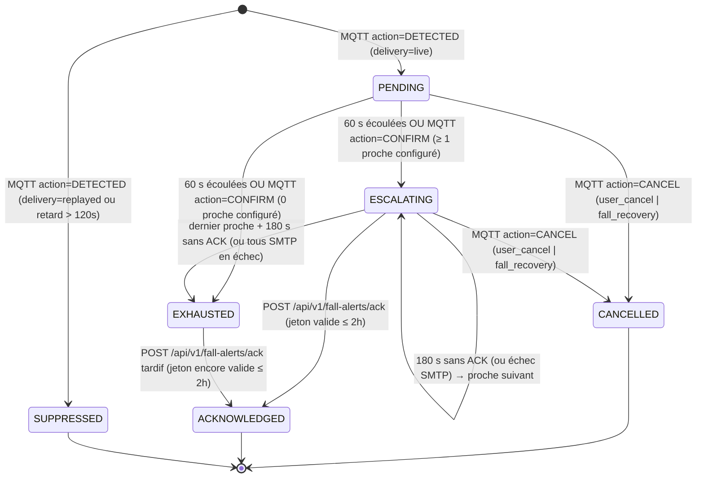

# Contrat d'Échange — Alerting en cas de Chute (Fall Alerting)

> **Statut** : `VALIDATED v1.0` — Spécification validée par l'utilisateur.
> **Projets impactés** :
> - `health-kicks` (Backend FastAPI, SQLAlchemy/Alembic, Worker d'escalade, SMTP, Webhook IoT, Page d'acquittement HTML)
> - `health-kicks-mobile` (Mobile Flutter Android, Détection BLE -> Uplink MQTT, GPS, Écran d'alerte 60 s, Réception Downlink MQTT, Appel 112)
> - `health-kicks-frontend` (Angular 22, Page `/dashboard/fall-alerts` à deux onglets : *Historique des alertes* et *Mes proches d'urgence*)
> - `health-kicks-esp32-s3` : **Aucun changement** (s'appuie sur la caractéristique BLE `7a5a0002` définie dans [`ble_gatt_specs.md`](./ble_gatt_specs.md)).

---

## 1. Périmètre & Principes Directeurs

| Principe | Règle Normative |
| :--- | :--- |
| **Canal d'alerte** | **Email uniquement** (Gmail SMTP avec mot de passe d'application), émis **exclusivement par le backend**. |
| **Pré-condition** | **Mode Surveillance Active** ([`docs/mobile_architecture.md`](../docs/mobile_architecture.md)) : l'application mobile Android maintient le Foreground Service connecté à la chaussure (BLE) **et** au broker AWS IoT Core (MQTT). Aucune alerte email n'est émise pour une chute remontée en différé (`SUPPRESSED`). |
| **Destinataires (Proches)** | Contacts d'urgence associés au compte utilisateur : `first_name`, `last_name`, `email`, `priority` (`1..5`). **Gérés exclusivement depuis l'application web** (onglet *Mes proches d'urgence* sur `/dashboard/fall-alerts`). Maximum **5** proches par utilisateur. Aucun email automatique lors de l'ajout, mais un bouton **« Envoyer un email de test »** est disponible. |
| **Escalade séquentielle** | Un seul proche est notifié à la fois par ordre de `priority` croissant (`1`, puis `2`, etc.). Sans prise en charge sous **180 secondes (3 min)**, le proche suivant est notifié. Dès qu'un proche confirme la prise en charge, **l'escalade s'arrête et les proches suivants ne sont jamais notifiés**. |
| **Épuisement (`EXHAUSTED`)** | Si le dernier proche de la liste n'a pas confirmé après **180 secondes** (ou si l'utilisateur n'a configuré aucun proche à la fin des 60 s), l'alerte passe à l'état `EXHAUSTED` : **on arrête les relances** et le téléphone du patient affiche en plein écran **« Appeler le 112 »**. |
| **Fenêtre d'annulation (60 s)** | À la réception d'une chute, l'alerte démarre en `PENDING` pour **60 secondes** (minuterie pilotée par le backend) pendant que le téléphone affiche l'écran « Ça va ? ». Si le patient clique sur « Je vais bien » ou si la chaussure détecte un relevage (`fall_recovery`, code `0x13`), l'alerte passe en `CANCELLED` et **aucun email n'est envoyé**. |
| **Relevage après envoi** | Si `fall_recovery` (ou annulation manuelle par le patient) survient pendant `ESCALATING`, l'alerte passe immédiatement en `CANCELLED`, **l'escalade s'arrête et aucun email supplémentaire (ni email de suivi) n'est envoyé**. |
| **Prise en charge (ACK)** | Via un **lien cliquable signé valable 2 heures (7 200 s)** dans l'email. Le clic ouvre une page web (`GET`) puis un bouton confirme la prise en charge (`POST`) afin d'éviter les faux acquittements par les scanners antivirus d'emails. |
| **Concurrence d'alertes** | Un utilisateur ne peut avoir **qu'une seule alerte active** (`PENDING` ou `ESCALATING`) à la fois. Toute nouvelle chute `DETECTED` reçue alors qu'une alerte est déjà active pour cet utilisateur est rattachée/ignorée de manière idempotente sans déclencher une seconde chaîne d'emails parallèle. |
| **Visibilité Historique & RBAC** | L'historique des alertes est visible par **l'utilisateur concerné** (rôle `user` ou `clinician`, chacun ne voyant **que ses propres alertes**) et par le rôle **`admin`** (qui voit toutes les alertes avec pseudonymisation RGPD par défaut pour les comptes tiers, aligné sur Studio). Par cohérence, la visibilité des activités/télémétrie/haptique de `clinician` sur les routes existantes est également restreinte à ses propres appareils (commit dédié). |

---

## 2. Machine à États (`FallAlertState`)



| État (`FallAlertState`) | Terminal | Description |
| :--- | :---: | :--- |
| `PENDING` | ❌ | Chute reçue en direct ; fenêtre d'annulation de 60 s en cours (`next_action_at = detected_at + 60s`). Aucun email envoyé. |
| `ESCALATING` | ❌ | Envoi séquentiel en cours ; `current_contact_rank` (`1..N`) indique le proche actuellement sollicité (`next_action_at = now + 180s`). |
| `ACKNOWLEDGED` | ✅ | Un proche a confirmé la prise en charge via le lien signé. Escalade stoppée. |
| `CANCELLED` | ✅ | Annulée par le patient (`user_cancel`) ou par détection de relevage (`fall_recovery`). Aucun email envoyé après cet état. |
| `EXHAUSTED` | ⚠️ semi | Tous les proches ont été sollicités sans confirmation dans le délai imparti (ou aucun proche configuré). Le mobile affiche « Appeler le 112 ». Seule transition encore autorisée : `ACKNOWLEDGED` si un proche clique sur son lien avant l'expiration des 2 h. |
| `SUPPRESSED` | ✅ | Chute remontée hors surveillance active (`delivery="replayed"`, bit 2 `flags` NVS BLE, ou retard > 120 s). Enregistrée pour traçabilité sans aucun email. |

---

## 3. Contrats MQTT IoT (Mobile ↔ AWS IoT Core ↔ Backend)

Les topics utilisent l'espace de noms utilisateur `healthkicks/v1/users/{user_id}/...` déjà autorisé en `iot:Publish`, `iot:Subscribe` et `iot:Receive` par la politique STS dynamique (`AWSSTSService.build_session_policy`).

### A. Topic Uplink (Mobile → Cloud) : `healthkicks/v1/users/{user_id}/events/fall-alert`

Publié par l'application mobile en **QoS 1**.
> **Note** : La publication existante sur `healthkicks/v1/{device_id}/events/detection` est **conservée à l'identique** pour les statistiques d'activité générales (`activity_events`). Ce nouveau topic pilote spécifiquement le cycle de vie d'une alerte de chute.

#### 1. Payload `action = "DETECTED"` (émis dès la réception BLE `0x10`, `0x11`, `0x12`, `0x1F`)

```json
{
  "event_id": "0b6f4b1e-6a51-4c1f-9a3e-2d7f1c9b8e10",
  "action": "DETECTED",
  "device_id": "HK-1",
  "event_type": "fall_forward",
  "confidence": 0.91,
  "detected_at": 1792745943123,
  "delivery": "live",
  "location": {
    "lat": 50.8466,
    "lon": 4.3528,
    "accuracy_m": 12.5,
    "captured_at": 1792745941000
  },
  "sent_at": 1792745943410
}
```

#### 2. Payload `action = "CONFIRM"` (si le patient appuie sur « J'ai besoin d'aide maintenant » avant la fin des 60 s)

```json
{
  "event_id": "0b6f4b1e-6a51-4c1f-9a3e-2d7f1c9b8e10",
  "action": "CONFIRM",
  "location": {
    "lat": 50.8466,
    "lon": 4.3528,
    "accuracy_m": 8.0,
    "captured_at": 1792745955000
  },
  "sent_at": 1792745955100
}
```

#### 3. Payload `action = "CANCEL"` (appui sur « Je vais bien » ou réception BLE `0x13` `fall_recovery`)

```json
{
  "event_id": "0b6f4b1e-6a51-4c1f-9a3e-2d7f1c9b8e10",
  "action": "CANCEL",
  "cancel_reason": "fall_recovery",
  "sent_at": 1792745951000
}
```

#### Contraintes de validation des champs Uplink

| Champ | Type | Requis | Contraintes & Sémantique |
| :--- | :--- | :---: | :--- |
| `event_id` | `UUID` (string) | ✅ | UUID v4 généré par le mobile lors de la chute. **Clé d'idempotence** partagée entre `DETECTED`, `CONFIRM` et `CANCEL`. |
| `action` | `enum` | ✅ | `"DETECTED"` \| `"CONFIRM"` \| `"CANCEL"` |
| `device_id` | `string` | si `DETECTED` | Identifiant de la chaussure (`1..128` car.). |
| `event_type` | `enum` | si `DETECTED` | `"fall_forward"` \| `"fall_backward"` \| `"fall_lateral"` \| `"fall_generic"` |
| `confidence` | `float` | si `DETECTED` | Score ML compris entre `0.0` et `1.0`. |
| `detected_at` | `int` | si `DETECTED` | Epoch UTC en millisecondes (`ms`) au moment de la chute. |
| `delivery` | `enum` | si `DETECTED` | `"live"` si transmis immédiatement en mode Surveillance Active ; `"replayed"` si issu du cache NVS hors-ligne de la chaussure (`flags` bit 2 = 1) ou d'une file hors-ligne. |
| `location` | `object \| null` | ❌ | Position GPS (`lat`: `[-90, 90]`, `lon`: `[-180, 180]`, `accuracy_m`: `≥ 0`, `captured_at`: epoch ms UTC). Peut être enrichie sur `CONFIRM` si le fix GPS s'est affiné pendant le compte à rebours. `null` si indisponible. |
| `cancel_reason` | `enum` | si `CANCEL` | `"user_cancel"` (bouton « Je vais bien ») \| `"fall_recovery"` (relevage `0x13` détecté par la chaussure). |
| `sent_at` | `int` | ✅ | Epoch UTC en millisecondes (`ms`) d'envoi du message MQTT. |

### B. Topic Downlink (Cloud → Mobile) : `healthkicks/v1/users/{user_id}/fall-alert/status`

Publié par le backend via `AWSIoTPublishService` (`iot-data:Publish`, **QoS 1**) à chaque création ou changement d'état d'une alerte.

```json
{
  "event_id": "0b6f4b1e-6a51-4c1f-9a3e-2d7f1c9b8e10",
  "alert_id": 42,
  "state": "ESCALATING",
  "current_contact_rank": 1,
  "contacts_total": 3,
  "acknowledged_by": null,
  "cancel_reason": null,
  "next_action_at": "2026-10-23T08:43:03Z",
  "updated_at": "2026-10-23T08:40:03Z"
}
```

| État reçu (`state`) | Action de l'application mobile (Android) |
| :--- | :--- |
| `PENDING` | Affiche l'écran d'alerte plein écran (« Chute détectée — Ça va ? ») avec compte à rebours synchronisé sur `next_action_at`, bouton **« Je vais bien (Annuler) »** et bouton **« J'ai besoin d'aide »**. |
| `ESCALATING` | Affiche « Alerte envoyée au proche n°`current_contact_rank` sur `contacts_total` — En attente de réponse… » + bouton « Je vais bien (Annuler l'alerte) ». |
| `ACKNOWLEDGED` | Affiche « Rassurez-vous : **`acknowledged_by.first_name`** a pris en charge votre alerte » avec un bouton pour fermer l'écran. |
| `EXHAUSTED` | Affiche en plein écran haute visibilité **« Aucun proche n'a pu confirmer — Appeler le 112 »** (bouton déclenchant le composeur téléphonique `tel:112`). |
| `CANCELLED` / `SUPPRESSED` | Ferme l'écran d'alerte actif s'il est affiché. |

> **Filet de sécurité local mobile** : Si le téléphone perd la connexion MQTT après avoir envoyé `DETECTED` (ou ne reçoit jamais le downlink), le mobile fait évoluer son affichage localement à la fin des 60 s vers « Alerte transmise » et propose en permanence un bouton d'accès rapide **« Appeler le 112 »**.

### C. Règle AWS IoT Core & Fonction Lambda Relais

- **IoT Rule Name** : `healthkicks_fall_alert_rule`
- **Rule SQL** :
  ```sql
  SELECT *, topic(4) AS user_id FROM 'healthkicks/v1/users/+/events/fall-alert'
  ```
- **Target** : Fonction AWS Lambda `healthkicks-fall-alert-relay` (même architecture sans dépendance externe que `healthkicks-device-presence` dans [`docs/aws-iot-lambdas.md`](../docs/aws-iot-lambdas.md)) qui effectue un `POST {BACKEND_URL}/api/v1/internal/fall-alerts` avec l'en-tête `X-Ingest-Token`.

---

## 4. Contrats REST API (Backend FastAPI)

Tous les schémas Pydantic v2 utilisent `ConfigDict(extra="forbid")`. Une fois les routes implémentées, `python scripts/verify_openapi_drift.py --write` puis `pnpm run generate:api` régénèrent `openapi.json` et `generated-api.types.ts`.

### A. Endpoint Interne d'Ingestion (Lambda → Backend)

#### `POST /api/v1/internal/fall-alerts`
- **Authentification** : Header `X-Ingest-Token` (`Depends(verify_ingest_token)`).
- **Request Body (`FallAlertIngestPayload`)** :

```json
{
  "user_id": "3",
  "event_id": "0b6f4b1e-6a51-4c1f-9a3e-2d7f1c9b8e10",
  "action": "DETECTED",
  "device_id": "HK-1",
  "event_type": "fall_forward",
  "confidence": 0.91,
  "detected_at": 1792745943123,
  "delivery": "live",
  "location": {
    "lat": 50.8466,
    "lon": 4.3528,
    "accuracy_m": 12.5,
    "captured_at": 1792745941000
  },
  "cancel_reason": null,
  "sent_at": 1792745943410
}
```

- **Response `200 OK` (`FallAlertIngestResponse`)** :
```json
{
  "status": "ok",
  "alert_id": 42,
  "event_id": "0b6f4b1e-6a51-4c1f-9a3e-2d7f1c9b8e10",
  "state": "PENDING",
  "duplicate": false
}
```

- **Règles métier d'ingestion** :
  1. Résolution de `user_id` selon la même logique que `internal.py` (ID entier ou identifiant SSO). Si l'utilisateur est introuvable → `404 Not Found`.
  2. Si `action == "DETECTED"` :
     - Si `event_id` existe déjà en base → retourne `200 OK` avec `duplicate=True` et l'état actuel.
     - Si une autre alerte du même `user_id` est déjà en état `PENDING` ou `ESCALATING` → met éventuellement à jour `location` si elle était absente, et retourne l'alerte active avec `duplicate=True`.
     - Si `delivery == "replayed"` ou `(now_utc - detected_at_utc) > FALL_ALERT_REPLAY_THRESHOLD_SEC` (120 s) → crée l'alerte directement en état `SUPPRESSED` (`closed_at = now_utc`, `next_action_at = null`).
     - Sinon → crée l'alerte en état `PENDING` avec `next_action_at = now_utc + 60s` et publie le statut MQTT Downlink.
  3. Si `action == "CONFIRM"` :
     - Recherche l'alerte par `(user_id, event_id)`. Si introuvable → `404`.
     - Si `state == "PENDING"` → met à jour `location` si fournie, et déclenche **immédiatement** la transition vers `ESCALATING` (notification du proche n°1) ou `EXHAUSTED` (si 0 proche configuré).
     - Si déjà en `ESCALATING` ou terminal → idempotent (`200 OK`).
  4. Si `action == "CANCEL"` :
     - Recherche l'alerte par `(user_id, event_id)`. Si introuvable (ex: `CANCEL` arrivé avant `DETECTED` ou pour une chute non enregistrée) → `200 OK` no-op (`alert_id=null, state="CANCELLED"`).
     - Si `state` ∈ `{"PENDING", "ESCALATING"}` → passe à `CANCELLED`, renseigne `cancel_reason` (`"user_cancel"` par défaut si omis), `closed_at = now_utc`, `next_action_at = null`, et publie le statut MQTT Downlink.
     - Si déjà en état terminal (`ACKNOWLEDGED`, `CANCELLED`, `EXHAUSTED`, `SUPPRESSED`) → idempotent (`200 OK`, état inchangé).

---

### B. Gestion des Proches / Contacts d'Urgence (Frontend Web ↔ Backend)

Tous ces endpoints opèrent sur le compte de l'utilisateur authentifié (`CurrentUser`, tout rôle : `user`, `clinician`, `admin`).

| Méthode & Route | Code Succès | Description & Codes d'Erreur |
| :--- | :---: | :--- |
| `GET /api/v1/users/me/alert-contacts` | `200 OK` | Retourne `list[AlertContactResponse]` triée par `priority` croissant (`1..N`). |
| `POST /api/v1/users/me/alert-contacts` | `201 Created` | Ajoute un proche en dernière position (`priority = count + 1`). `409 Conflict` si le plafond de **5 proches** est atteint ou si l'`email` (normalisé en minuscules) existe déjà pour cet utilisateur. |
| `PUT /api/v1/users/me/alert-contacts/order` | `200 OK` | Réordonne les priorités. Corps : `AlertContactsOrderPayload` (`{"contact_ids": [int, ...]}`). Doit contenir exactement l'ensemble des IDs de contacts de l'utilisateur (`422` sinon). Réattribue `priority = 1..N` dans l'ordre fourni et retourne `list[AlertContactResponse]`. |
| `PATCH /api/v1/users/me/alert-contacts/{contact_id}` | `200 OK` | Modifie `first_name`, `last_name` et/ou `email`. `404` si le contact n'appartient pas à l'utilisateur ; `409` si le nouvel email est déjà utilisé par un autre proche du même utilisateur. |
| `DELETE /api/v1/users/me/alert-contacts/{contact_id}` | `204 No Content` | Supprime le proche et **re-compacte automatiquement** les `priority` restantes (`1..N` sans trou). |
| `POST /api/v1/users/me/alert-contacts/{contact_id}/test-email` | `202 Accepted` | Envoie un email de vérification au proche et met à jour `last_test_email_at`. Rate-limit : **3 envois / heure / utilisateur** (`429 Too Many Requests`). Retourne `502 Bad Gateway` si le serveur SMTP échoue. |

#### Schémas JSON (`app/schemas/fall_alert.py`)

```json
// AlertContactCreate
{
  "first_name": "Marie",
  "last_name": "Dupont",
  "email": "marie.dupont@example.com"
}

// AlertContactUpdate (tous les champs sont optionnels, au moins un requis)
{
  "first_name": "Marie",
  "last_name": "Dupont-Martin",
  "email": "marie.dupont@example.com"
}

// AlertContactsOrderPayload
{
  "contact_ids": [9, 7, 12]
}

// AlertContactResponse
{
  "id": 7,
  "first_name": "Marie",
  "last_name": "Dupont",
  "email": "marie.dupont@example.com",
  "priority": 1,
  "last_test_email_at": "2026-10-23T08:10:00Z",
  "created_at": "2026-10-23T08:00:00Z",
  "updated_at": "2026-10-23T08:10:00Z"
}

// AlertContactTestEmailResponse
{
  "status": "sent",
  "contact_id": 7,
  "sent_at": "2026-10-23T08:10:00Z"
}
```

_Contraintes de validation_ :
- `first_name`, `last_name` : chaîne nettoyée (`strip()`), longueur `1..100` caractères.
- `email` : format email valide, converti en minuscules, longueur `3..320` caractères.

---

### C. Historique des Alertes de Chute (Frontend Web ↔ Backend)

| Méthode & Route | Code Succès | Paramètres & Description |
| :--- | :---: | :--- |
| `GET /api/v1/fall-alerts` | `200 OK` | Query params : `page` (déf: `1`, `≥ 1`), `page_size` (déf: `20`, `1..100`), `state` (optionnel : un état ou liste séparée par virgule ex. `ACKNOWLEDGED,EXHAUSTED`, ou `all`), `start_date` (ISO 8601, optionnel), `end_date` (ISO 8601, optionnel), `user_id` (optionnel, **pris en compte uniquement si `role == admin`**). |
| `GET /api/v1/fall-alerts/{alert_id}` | `200 OK` | Détail complet d'une alerte et journal des notifications envoyées. Retourne `404 Not Found` si l'alerte n'existe pas ou n'appartient pas à l'utilisateur (hors `admin`). |

#### Règles d'Autorisation (RBAC) & Confidentialité RGPD

1. **Rôles `user` et `clinician`** :
   - Ne voient **que leurs propres alertes** (`FallAlert.user_id == current_user.id`).
   - Le paramètre `user_id` passé en query est ignoré s'il diffère de `current_user.id`.
   - `is_pseudonymized = false` : l'utilisateur voit ses propres informations et les noms/emails de ses proches en clair.
2. **Rôle `admin`** :
   - Voit les alertes de tous les utilisateurs (filtrables par `user_id`).
   - Pour les alertes appartenant à un **autre utilisateur** (`alert.user_id != current_user.id`), la réponse applique la **pseudonymisation RGPD** (`app/core/pseudonymization.py`) :
     - `user_display_name` = `"Patient {get_subject_pseudonym(alert.user_id)}"` (ex: `"Patient SUBJ-A8F19C2D"`).
     - `subject_pseudonym` = `get_subject_pseudonym(alert.user_id)`.
     - `is_pseudonymized` = `true`.
     - Dans le détail des notifications : `contact_email` est masqué via `mask_email()` (`m***@e***.com`) et `contact_last_name` est masqué (`"D."`).

#### Schémas JSON de Réponse

```json
// FallAlertSummary
{
  "id": 42,
  "event_id": "0b6f4b1e-6a51-4c1f-9a3e-2d7f1c9b8e10",
  "user_id": 3,
  "user_display_name": "Jean Martin",
  "subject_pseudonym": "SUBJ-A8F19C2D",
  "is_pseudonymized": false,
  "device_id": "HK-1",
  "event_type": "fall_forward",
  "confidence": 0.91,
  "state": "ACKNOWLEDGED",
  "cancel_reason": null,
  "delivery": "live",
  "has_location": true,
  "detected_at": "2026-10-23T08:39:03Z",
  "escalation_started_at": "2026-10-23T08:40:03Z",
  "closed_at": "2026-10-23T08:44:51Z",
  "acknowledged_by": {
    "first_name": "Paul",
    "last_name": "Martin"
  },
  "notified_contacts_count": 2
}

// FallAlertDetail (hérite de FallAlertSummary + location & notifications)
{
  "id": 42,
  "event_id": "0b6f4b1e-6a51-4c1f-9a3e-2d7f1c9b8e10",
  "user_id": 3,
  "user_display_name": "Jean Martin",
  "subject_pseudonym": "SUBJ-A8F19C2D",
  "is_pseudonymized": false,
  "device_id": "HK-1",
  "event_type": "fall_forward",
  "confidence": 0.91,
  "state": "ACKNOWLEDGED",
  "cancel_reason": null,
  "delivery": "live",
  "has_location": true,
  "detected_at": "2026-10-23T08:39:03Z",
  "escalation_started_at": "2026-10-23T08:40:03Z",
  "closed_at": "2026-10-23T08:44:51Z",
  "acknowledged_by": {
    "first_name": "Paul",
    "last_name": "Martin"
  },
  "notified_contacts_count": 2,
  "location": {
    "lat": 50.8466,
    "lon": 4.3528,
    "accuracy_m": 12.5,
    "captured_at": "2026-10-23T08:39:01Z"
  },
  "notifications": [
    {
      "id": 101,
      "rank": 1,
      "contact_first_name": "Marie",
      "contact_last_name": "Dupont",
      "contact_email": "marie.dupont@example.com",
      "status": "SENT",
      "sent_at": "2026-10-23T08:40:04Z",
      "acknowledged_at": null,
      "error_message": null
    },
    {
      "id": 102,
      "rank": 2,
      "contact_first_name": "Paul",
      "contact_last_name": "Martin",
      "contact_email": "paul.martin@example.com",
      "status": "ACKNOWLEDGED",
      "sent_at": "2026-10-23T08:43:04Z",
      "acknowledged_at": "2026-10-23T08:44:51Z",
      "error_message": null
    }
  ]
}

// PaginatedFallAlertsResponse
{
  "items": [ /* FallAlertSummary[] */ ],
  "total": 1,
  "page": 1,
  "page_size": 20
}
```

`notifications[].status` ∈ `"SENT"` | `"ACKNOWLEDGED"` | `"FAILED"`.

---

### D. Prise en Charge par un Proche (Routes Publiques HTML sans Authentification)

Ces routes sont appelées directement depuis le navigateur du proche lorsqu'il clique sur le lien contenu dans l'email.

| Méthode & Route | Entrée | Réponse | Effet |
| :--- | :--- | :--- | :--- |
| `GET /api/v1/fall-alerts/ack?token=<str>` | Query param `token` | `200 text/html` (ou `400 text/html` si jeton invalide/expiré) | **Lecture seule (aucun changement d'état en base)** : affiche une page HTML responsive avec le résumé de l'alerte (prénom du patient, heure, lien Google Maps si présent) et un formulaire `<form method="post" action="/api/v1/fall-alerts/ack">` contenant un bouton **« Je confirme prendre en charge cette alerte »**. Si l'alerte est déjà prise en charge ou annulée, affiche directement l'état actuel. |
| `POST /api/v1/fall-alerts/ack` | `application/x-www-form-urlencoded` (`token=<str>`) ou JSON `{"token": "<str>"}` | `200 text/html` (ou `400 text/html` si jeton invalide/expiré) | Vérifie la signature et la fraîcheur du jeton (`max_age = 7200`). Si `alert.state` ∈ `{"ESCALATING", "EXHAUSTED"}` : passe l'alerte à `ACKNOWLEDGED`, enregistre `acknowledged_at` et l'identité du proche, annule `next_action_at`, publie le statut MQTT Downlink au mobile et retourne une page HTML de confirmation (« Merci, votre prise en charge est enregistrée. Les contacts suivants ne seront pas sollicités. »). |

#### Spécification du Jeton Signé
- **Implémentation** : `itsdangerous.URLSafeTimedSerializer(secret_key=settings.fall_alert_ack_secret, salt="healthkicks-fall-alert-ack-v1")`.
- **Contenu signé** : `{"a": alert.id, "n": notification.id}`.
- **Durée de validité (`max_age`)** : `settings.fall_alert_ack_token_ttl_sec` = **`7200` secondes (2 heures)** à compter de l'émission de l'email à ce proche.

---

## 5. Modèle de Données Relationnel (PostgreSQL / Alembic)

Trois nouvelles tables sont ajoutées dans [`health-kicks/app/db/models.py`](../health-kicks/app/db/models.py) via une migration Alembic atomique :

1. **`alert_contacts`** :
   - `id` (PK, Integer, autoincrement)
   - `user_id` (FK `users.id` `ON DELETE CASCADE`, indexé)
   - `first_name` (`String(100)`, non null)
   - `last_name` (`String(100)`, non null)
   - `email` (`String(320)`, non null)
   - `priority` (`Integer`, non null, `1..5`)
   - `last_test_email_at` (`DateTime(timezone=True)`, nullable)
   - `created_at`, `updated_at` (`DateTime(timezone=True)`)
   - Contraintes : `UniqueConstraint("user_id", "email")`.

2. **`fall_alerts`** :
   - `id` (PK, Integer, autoincrement)
   - `event_id` (`String(64)`, unique, indexé, non null)
   - `user_id` (FK `users.id` `ON DELETE CASCADE`, indexé, non null)
   - `device_id` (`String(128)`, indexé, non null)
   - `event_type` (`String(64)`, non null)
   - `confidence_score` (`Float`, non null)
   - `delivery` (`String(16)`, non null, `"live"` | `"replayed"`)
   - `state` (`String(32)`, indexé, non null — `FallAlertState`)
   - `cancel_reason` (`String(32)`, nullable — `"user_cancel"` | `"fall_recovery"`)
   - `lat` (`Float`, nullable), `lon` (`Float`, nullable), `accuracy_m` (`Float`, nullable), `location_captured_at_utc` (`DateTime(timezone=True)`, nullable)
   - `current_contact_rank` (`Integer`, non null, default `0`)
   - `contacts_snapshot_json` (`Text`, nullable — liste JSON figée `[{"contact_id", "first_name", "last_name", "email", "rank"}]` capturée à l'entrée en `ESCALATING`)
   - `acknowledged_by_first_name` (`String(100)`, nullable), `acknowledged_by_last_name` (`String(100)`, nullable), `acknowledged_by_contact_id` (`Integer`, nullable)
   - `detected_at_utc` (`DateTime(timezone=True)`, indexé, non null)
   - `escalation_started_at_utc` (`DateTime(timezone=True)`, nullable)
   - `next_action_at_utc` (`DateTime(timezone=True)`, indexé, nullable — utilisé par le worker d'escalade)
   - `closed_at_utc` (`DateTime(timezone=True)`, nullable)
   - `created_at_utc`, `updated_at_utc` (`DateTime(timezone=True)`)

3. **`fall_alert_notifications`** :
   - `id` (PK, Integer, autoincrement)
   - `alert_id` (FK `fall_alerts.id` `ON DELETE CASCADE`, indexé, non null)
   - `rank` (`Integer`, non null)
   - `contact_id` (`Integer`, nullable)
   - `contact_first_name` (`String(100)`, non null)
   - `contact_last_name` (`String(100)`, non null)
   - `contact_email` (`String(320)`, non null)
   - `status` (`String(32)`, non null — `"SENT"` | `"ACKNOWLEDGED"` | `"FAILED"`)
   - `sent_at_utc` (`DateTime(timezone=True)`, non null)
   - `acknowledged_at_utc` (`DateTime(timezone=True)`, nullable)
   - `error_message` (`String(512)`, nullable)

---

## 6. Worker d'Escalade & Envoi SMTP (`AlertService`)

1. **Boucle d'arrière-plan (`lifespan` FastAPI)** :
   - Une tâche asyncio s'exécute toutes les **`FALL_ALERT_WORKER_INTERVAL_SEC` (5 secondes)**.
   - Elle sélectionne les alertes où `state IN ('PENDING', 'ESCALATING') AND next_action_at_utc <= now_utc` (avec `with_for_update(skip_locked=True)` sur PostgreSQL).
   - **Transition `PENDING` → `ESCALATING`** :
     - Charge les contacts de `user_id` triés par `priority` ascendant et les fige dans `contacts_snapshot_json`.
     - S'il n'y a **aucun contact** : passe directement à `EXHAUSTED`, `closed_at_utc = now`, `next_action_at_utc = null`, publie le statut MQTT Downlink.
     - Sinon : passe à `ESCALATING`, `escalation_started_at_utc = now`, et notifie le contact de rang `1`.
   - **Avancement `ESCALATING`** :
     - Tente d'envoyer l'email au contact de rang `current_contact_rank + 1` via `SmtpEmailChannel` (jusqu'à 2 tentatives rapides en cas d'erreur réseau transitoire).
     - Si l'envoi **réussit** : crée une entrée `fall_alert_notifications(status="SENT")`, positionne `current_contact_rank = rank`, `next_action_at_utc = now + 180s`, et publie le statut MQTT Downlink.
     - Si l'envoi **échoue** (`SMTPException`) : crée une entrée `fall_alert_notifications(status="FAILED")` et **passe immédiatement au contact suivant** dans le même cycle sans attendre 3 minutes.
     - Si le dernier contact a déjà été notifié et que ses 180 s se sont écoulées sans ACK (ou si tous les envois ont échoué) : passe l'alerte à `EXHAUSTED`, `closed_at_utc = now`, `next_action_at_utc = null`, et publie le statut MQTT Downlink.

2. **Configuration Environnement Backend (`app/core/config.py`)** :

| Variable d'Environnement | Valeur par Défaut | Description |
| :--- | :--- | :--- |
| `SMTP_HOST` | `smtp.gmail.com` | Hôte SMTP (STARTTLS). |
| `SMTP_PORT` | `587` | Port SMTP STARTTLS. |
| `SMTP_USER` | `""` | Adresse Gmail émettrice (ex: `serckdavid@gmail.com`). |
| `SMTP_PASSWORD` | `""` | **Mot de passe d'application** Gmail (16 caractères, sans espaces). |
| `SMTP_FROM_NAME` | `"HealthKicks Alertes"` | Nom affiché de l'expéditeur. |
| `PUBLIC_BASE_URL` | `"https://healthkicks.duckdns.org:8443"` | URL publique utilisée pour construire le lien d'acquittement. |
| `FALL_ALERT_ACK_SECRET` | *(dérivé ou secret dédié)* | Clé secrète HMAC pour signer les jetons d'acquittement. |
| `FALL_ALERT_CANCEL_WINDOW_SEC` | `60` | Délai d'annulation initial en secondes. |
| `FALL_ALERT_ESCALATION_STEP_SEC` | `180` | Délai d'attente par proche en secondes (3 minutes). |
| `FALL_ALERT_ACK_TOKEN_TTL_SEC` | `7200` | Durée de validité du lien de prise en charge en secondes (2 heures). |
| `FALL_ALERT_REPLAY_THRESHOLD_SEC` | `120` | Retard maximal toléré pour considérer une chute comme `live`. |
| `FALL_ALERT_MAX_CONTACTS` | `5` | Nombre maximal de proches par utilisateur. |
| `FALL_ALERT_WORKER_INTERVAL_SEC` | `5` | Période de vérification du worker d'escalade en secondes. |

---

## 7. Interfaces Utilisateur (Mobile & Web)

### A. Application Web (`health-kicks-frontend`)
Une nouvelle page **Alertes de chute** (`/dashboard/fall-alerts`, accessible depuis le menu latéral pour tous les utilisateurs authentifiés) regroupe **deux onglets** :
1. **Onglet 1 — *Historique des alertes*** :
   - Tableau paginé avec filtres par état (`PENDING`, `ESCALATING`, `ACKNOWLEDGED`, `CANCELLED`, `EXHAUSTED`, `SUPPRESSED`), plage de dates, et (pour les `admin` uniquement) filtre par utilisateur.
   - Affichage pour chaque alerte : date/heure de la chute, équipement, badge d'état coloré, motif d'annulation ou prénom/nom du proche ayant pris en charge, nombre de proches sollicités, lien Google Maps (si position disponible), et modale/tiroir de détail montrant la chronologie exacte des emails envoyés (`fall_alert_notifications`).
2. **Onglet 2 — *Mes proches d'urgence*** :
   - Liste ordonnée des proches (`1` à `5`) avec prénom, nom, email, badge de rang de priorité.
   - Boutons **Monter / Descendre** pour changer l'ordre de priorité (`PUT /api/v1/users/me/alert-contacts/order`).
   - Formulaire d'ajout / édition et bouton de suppression.
   - Bouton **« Envoyer un email de test »** sur chaque proche avec affichage de la date du dernier test réussi.
   - Bandeau d'information : *« En cas de chute détectée en mode Surveillance Active, vos proches sont prévenus un par un par ordre de priorité toutes les 3 minutes jusqu'à ce que l'un d'eux confirme la prise en charge. »*

### B. Application Mobile (`health-kicks-mobile`)
1. Lorsqu'une notification BLE sur `7a5a0002` a le bit 0 de `flags` (`isFall == true`) :
   - Si le bit 2 de `flags` est à `1` (alerte différée NVS) ou si le MQTT n'est pas connecté : l'événement est envoyé avec `delivery: "replayed"` dès que possible sans déclencher l'écran d'urgence.
   - Si l'app est en **Surveillance Active** (connectée en direct) :
     - Récupère la position GPS courante (timeout court ~3 s, repli sur `getLastKnownPosition()`).
     - Génère un `event_id` (UUID v4) et publie immédiatement `action: "DETECTED"` sur `healthkicks/v1/users/{user_id}/events/fall-alert`.
     - Ouvre l'écran plein écran d'alerte de chute avec un compte à rebours de **60 secondes**, un bouton **« Je vais bien (Annuler l'alerte) »** (`action: "CANCEL", cancel_reason: "user_cancel"`) et un bouton **« J'ai besoin d'aide maintenant »** (`action: "CONFIRM"`).
2. Si la chaussure émet `fall_recovery` (`0x13`) alors qu'une alerte est en cours (`PENDING` ou `ESCALATING`), l'application publie immédiatement `action: "CANCEL", cancel_reason: "fall_recovery"` et ferme l'écran d'alerte.
3. L'application s'abonne au topic `healthkicks/v1/users/{user_id}/fall-alert/status` pour mettre à jour l'écran en temps réel (proche sollicité, prise en charge confirmée, ou bascule sur l'écran **« Appeler le 112 »** si `EXHAUSTED`).
