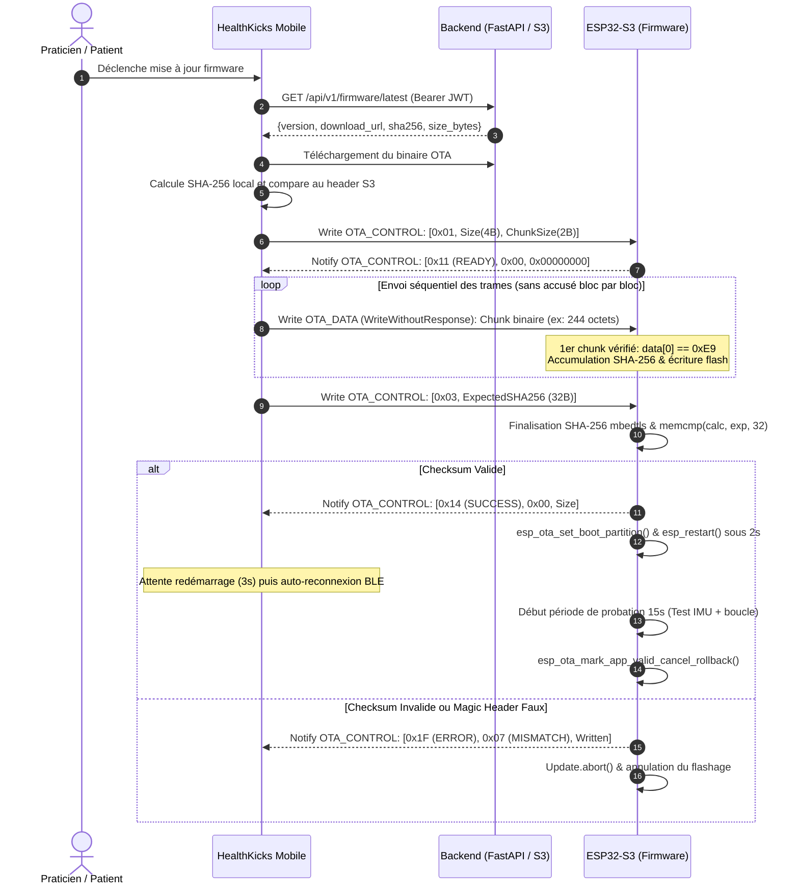

# Spécification Binaire du Protocole BLE OTA - HealthKicks Ecosystem

Ce document formalise le **protocole de mise à jour différentielle et intégrale sans fil (Over-The-Air - BLE OTA)** pour la chaussure connectée **ESP32-S3**, consommé par l'application mobile **HealthKicks Mobile** et orchestré via les binaires signés du **Backend FastAPI / AWS S3**.

---

## 1. Vue d'Ensemble & Invariants de Sécurité

La mise à jour du firmware ESP32-S3 s'effectue exclusivement par Bluetooth Low Energy (BLE GATT) via une connexion chiffrée **LESC (LE Secure Connections)** avec vérification cryptographique **SHA-256** obligatoire.

### Invariants Non Négociables
1. **Octet Magique ESP-IDF (Offset 0)** : Le premier octet du premier chunk de données doit obligatoirement être `0xE9` (signature d'image binaire ESP-IDF). Tout paquet initial dérogeant à cette valeur déclenche l'interruption immédiate (`Update.abort()`) et le rejet avec code d'erreur `0x05` (`OTA_ERR_VALIDATION_FAILED`).
2. **Digest Cryptographique SHA-256 Obligatoire** : La commande de fin (`OTA_CMD_END`, opcode `0x03`) doit obligatoirement contenir le hash SHA-256 de 32 octets du firmware complet (longueur totale du paquet : exactement 33 octets). Toute commande de fin sans hash ou de longueur inférieure est immédiatement rejetée avec le code d'erreur `0x07` (`OTA_ERR_SHA256_MISMATCH`).
3. **Période de Probation Matérielle (15 secondes)** : Au redémarrage sur la nouvelle partition, un timer matériel de 15 secondes vérifie l'initialisation nominale de l'IMU MPU-6050 et de la boucle de capture. En cas d'échec ou d'appui d'urgence sur le bouton matériel (`GPIO 14`), le firmware est marqué invalide et l'ESP32 bascule automatiquement sur la partition précédente via `esp_ota_mark_app_invalid_rollback_and_reboot()`.

---

## 2. Services et Caractéristiques GATT

| Service / Caractéristique | UUID | Propriétés | Rôle |
| :--- | :--- | :--- | :--- |
| **Service OTA** | `7a5a0010-c529-4d64-8848-18e5904de22a` | Primary Service | Conteneur des opérations de flashage OTA |
| **Contrôle OTA (`OTA_CONTROL`)** | `7a5a0011-c529-4d64-8848-18e5904de22a` | `WRITE`, `INDICATE` / `NOTIFY` | Envoi d'ordres (`START`, `END`, `ABORT`) et réception des accusés d'état |
| **Données OTA (`OTA_DATA`)** | `7a5a0012-c529-4d64-8848-18e5904de22a` | `WRITE_NO_RESP` | Flux binaire séquentiel de l'image firmware |

---

## 3. Opcodes de Commande & Structure Binaire

### A. Commandes Envoyées par le Client Mobile (`OTA_CONTROL`, Write)

#### 1. `OTA_CMD_START` (Opcode `0x01`)
Initialise la partition cible OTA et le moteur de hachage SHA-256.

```text
Offset (Octets) | Type     | Champ             | Description
00              | uint8_t  | Opcode (0x01)     | Commande START
01..04          | uint32_t | ImageSizeBytes    | Taille totale de l'image (Little-Endian)
05..06          | uint16_t | ChunkSizeBytes    | Taille maximale d'un chunk de données (<= MTU - 3)
```

#### 2. `OTA_CMD_END` (Opcode `0x03`)
Clôture l'écriture en flash, valide l'empreinte SHA-256 et programme le redémarrage.

```text
Offset (Octets) | Type     | Champ             | Description
00              | uint8_t  | Opcode (0x03)     | Commande END
01..32          | uint8_t[32] | ExpectedSHA256 | Empreinte SHA-256 calculée du fichier binaire complet
```

#### 3. `OTA_CMD_ABORT` (Opcode `0x04`)
Interrompt la mise à jour en cours et purge les buffers partiels.

```text
Offset (Octets) | Type     | Champ             | Description
00              | uint8_t  | Opcode (0x04)     | Commande ABORT (Longueur = 1 octet)
```

---

### B. Notifications d'État Émises par l'ESP32-S3 (`OTA_CONTROL`, Notify)

L'ESP32 notifie le client mobile à chaque étape clé ou erreur :

```text
Offset (Octets) | Type     | Champ             | Description
00              | uint8_t  | StatusOpcode      | Statut de l'opération
01              | uint8_t  | ErrorCode         | Code d'erreur (0x00 si nominal)
02..05          | uint32_t | BytesWritten      | Octets cumulés écrits en flash (Little-Endian)
```

#### Table des Codes de Statut (`StatusOpcode`)
* `0x10` : `OTA_STATUS_IDLE` — En attente de démarrage
* `0x11` : `OTA_STATUS_READY` — Partition préparée, prêt à recevoir les données
* `0x12` : `OTA_STATUS_RECEIVING` — Écriture des trames binaires en cours
* `0x13` : `OTA_STATUS_VERIFYING` — Calcul et comparaison finale du SHA-256
* `0x14` : `OTA_STATUS_SUCCESS` — Empreinte validée, redémarrage programmé sous 2s
* `0x1F` : `OTA_STATUS_ERROR` — Échec critique (détail dans `ErrorCode`)

#### Table des Codes d'Erreur (`ErrorCode`)
* `0x00` : `OTA_ERR_NONE` — Aucune erreur
* `0x01` : `OTA_ERR_FLASH_INIT_FAILED` — Échec `Update.begin()` (partition pleine ou non trouvée)
* `0x02` : `OTA_ERR_WRITE_FAILED` — Échec d'écriture flash secteur
* `0x03` : `OTA_ERR_UNAUTHORIZED` — Connexion non chiffrée ou appairage expiré
* `0x04` : `OTA_ERR_INVALID_LENGTH` — Longueur payload incohérente avec l'opcode
* `0x05` : `OTA_ERR_VALIDATION_FAILED` — Octet magique non conforme (`data[0] != 0xE9`)
* `0x06` : `OTA_ERR_TIMEOUT` — Aucun chunk reçu depuis plus de 10 secondes
* `0x07` : `OTA_ERR_SHA256_MISMATCH` — Checksum calculé différent du checksum attendu

---

## 4. Diagramme de Séquence du Cycle OTA



