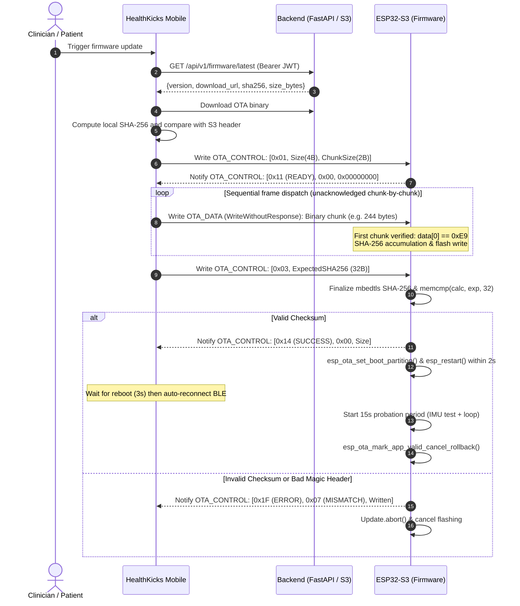

# BLE OTA Protocol Binary Specification - HealthKicks Ecosystem

This document formalizes the **Over-The-Air wireless firmware update protocol (BLE OTA)** for the **ESP32-S3** connected shoe, consumed by the **HealthKicks Mobile** companion application and orchestrated using signed binaries from the **FastAPI Backend / AWS S3**.

---

## 1. Overview & Security Invariants

Firmware updates for the ESP32-S3 occur exclusively via Bluetooth Low Energy (BLE GATT) over a **LE Secure Connections (LESC)** encrypted link with mandatory **SHA-256** cryptographic validation.

### Non-Negotiable Invariants

1. **ESP-IDF Magic Byte (Offset 0)**: The first byte of the first data chunk must strictly be `0xE9` (ESP-IDF binary image signature). Any initial packet departing from this value triggers an immediate abort (`Update.abort()`) and rejection with error code `0x05` (`OTA_ERR_VALIDATION_FAILED`).
2. **Mandatory SHA-256 Cryptographic Digest**: The completion command (`OTA_CMD_END`, opcode `0x03`) must contain the complete 32-byte SHA-256 hash of the full firmware file (total packet length: exactly 33 bytes). Any completion command missing the hash or of shorter length is immediately rejected with error code `0x07` (`OTA_ERR_SHA256_MISMATCH`).
3. **Hardware Probation Period (15 Seconds)**: Upon rebooting into the new partition, a 15-second hardware timer verifies nominal initialization of the MPU-6050 IMU and capture loop. In case of failure or emergency push of the hardware button (`GPIO 14`), the firmware is marked invalid and the ESP32 automatically rolls back to the previous partition via `esp_ota_mark_app_invalid_rollback_and_reboot()`.

---

## 2. GATT Services & Characteristics

| Service / Characteristic        | UUID                                   | Properties                     | Role                                                                  |
| :------------------------------ | :------------------------------------- | :----------------------------- | :-------------------------------------------------------------------- |
| **OTA Service**                 | `7a5a0010-c529-4d64-8848-18e5904de22a` | Primary Service                | Container for OTA flashing operations                                 |
| **OTA Control (`OTA_CONTROL`)** | `7a5a0011-c529-4d64-8848-18e5904de22a` | `WRITE`, `INDICATE` / `NOTIFY` | Command dispatch (`START`, `END`, `ABORT`) and status acknowledgments |
| **OTA Data (`OTA_DATA`)**       | `7a5a0012-c529-4d64-8848-18e5904de22a` | `WRITE_NO_RESP`                | Sequential binary stream of the firmware image                        |

---

## 3. Command Opcodes & Binary Structure

### A. Commands Sent by Mobile Client (`OTA_CONTROL`, Write)

#### 1. `OTA_CMD_START` (Opcode `0x01`)

Initializes target OTA partition and SHA-256 hashing engine.

```text
Offset (Bytes) | Type     | Field            | Description
00             | uint8_t  | Opcode (0x01)    | START command
01..04         | uint32_t | ImageSizeBytes   | Total image size in bytes (Little-Endian)
05..06         | uint16_t | ChunkSizeBytes   | Maximum data chunk size (<= MTU - 3)
```

#### 2. `OTA_CMD_END` (Opcode `0x03`)

Finalizes flash write, validates SHA-256 digest, and schedules reboot.

```text
Offset (Bytes) | Type        | Field          | Description
00             | uint8_t     | Opcode (0x03)  | END command
01..32         | uint8_t[32] | ExpectedSHA256 | Precomputed SHA-256 digest of the complete binary file
```

#### 3. `OTA_CMD_ABORT` (Opcode `0x04`)

Aborts current update and purges partial buffers.

```text
Offset (Bytes) | Type     | Field            | Description
00             | uint8_t  | Opcode (0x04)    | ABORT command (Length = 1 byte)
```

---

### B. Status Notifications Emitted by ESP32-S3 (`OTA_CONTROL`, Notify)

The ESP32 notifies the mobile client at each key step or failure:

```text
Offset (Bytes) | Type     | Field            | Description
00             | uint8_t  | StatusOpcode     | Operation status
01             | uint8_t  | ErrorCode        | Error code (0x00 if nominal)
02..05         | uint32_t | BytesWritten     | Cumulative bytes written to flash (Little-Endian)
```

#### Status Codes Table (`StatusOpcode`)

- `0x10`: `OTA_STATUS_IDLE` — Waiting for start
- `0x11`: `OTA_STATUS_READY` — Partition prepared, ready to receive data
- `0x12`: `OTA_STATUS_RECEIVING` — Binary packet flashing in progress
- `0x13`: `OTA_STATUS_VERIFYING` — Final SHA-256 computation and comparison
- `0x14`: `OTA_STATUS_SUCCESS` — Digest verified, reboot scheduled within 2s
- `0x1F`: `OTA_STATUS_ERROR` — Critical failure (details in `ErrorCode`)

#### Error Codes Table (`ErrorCode`)

- `0x00`: `OTA_ERR_NONE` — No error
- `0x01`: `OTA_ERR_FLASH_INIT_FAILED` — `Update.begin()` failure (partition full or not found)
- `0x02`: `OTA_ERR_WRITE_FAILED` — Flash sector write error
- `0x03`: `OTA_ERR_UNAUTHORIZED` — Unencrypted link or expired pairing
- `0x04`: `OTA_ERR_INVALID_LENGTH` — Payload length mismatch with opcode
- `0x05`: `OTA_ERR_VALIDATION_FAILED` — Invalid magic byte (`data[0] != 0xE9`)
- `0x06`: `OTA_ERR_TIMEOUT` — No chunk received for more than 10 seconds
- `0x07`: `OTA_ERR_SHA256_MISMATCH` — Calculated checksum does not match expected checksum

---

## 4. OTA Cycle Sequence Diagram


