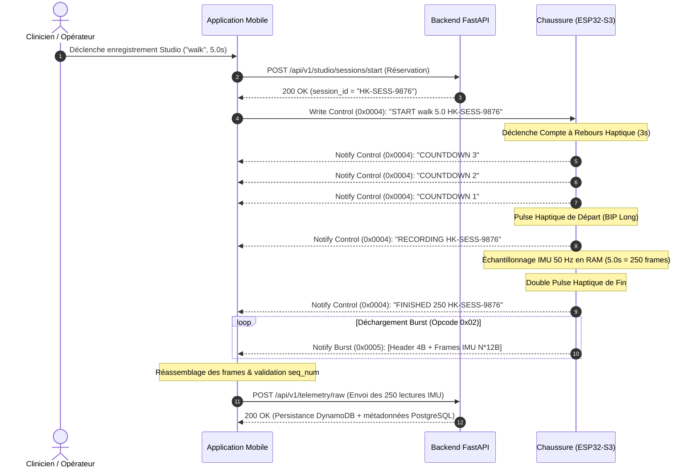

# Protocole Binaire de Télémétrie Studio (BLE Burst & Control)

Ce document spécifie formellement le protocole de communication bidirectionnel et de transfert de paquets binaires à haut débit (**Studio Burst**) utilisé entre la chaussure connectée (**Firmware ESP32-S3**), l'agent **Edge AI** et l'application **Mobile Flutter**.

---

## 1. Vue d'Ensemble & Objectifs

Le mode **Studio** est dédié à la capture haute fidélité de données brutes issues de la centrale inertielle (IMU MPU-6050 à $50\,\text{Hz}$ ou $100\,\text{Hz}$) pour la constitution de jeux de données d'entraînement biomécaniques et la requalification clinique.

### Contraintes d'Ingénierie

1. **Bande passante BLE contrainte** : Le débit utile Bluetooth Low Energy doit être maximisé sans surcharger la mémoire tampon de la pile radio (_NimBLE ring buffer_).
2. **Atomicité des sessions** : Une session Studio possède un cycle de vie strict : Réservation REST/Cloud $\to$ Compte à rebours haptique $\to$ Enregistrement $\to$ Déchargement binaire rapide (_Burst_) $\to$ Validation d'intégrité.
3. **Format compact sans flottant** : Les mesures d'accélération et de vitesse angulaire sont quantifiées en entiers signés 16-bit (_Fixed-point representation_) en ordre réseau (_Big-Endian_).

---

## 2. Diagramme de Séquence de Session Studio



---

## 3. Canal de Contrôle (`CHAR_STUDIO_CONTROL_UUID` : `0x0004`)

Le canal de contrôle gère la machine à états de la session. Les messages sont au format texte UTF-8.

### A. Commandes Maître $\to$ Esclave (Mobile $\to$ Chaussure)

| Commande     | Syntaxe                                     | Description                                                                              |
| :----------- | :------------------------------------------ | :--------------------------------------------------------------------------------------- |
| **`START`**  | `START <label> <duration_sec> <session_id>` | Initie une session avec étiquette, durée (1.0 à 30.0s) et UUID de session.               |
| **`CANCEL`** | `CANCEL`                                    | Interrompt immédiatement l'enregistrement ou le déchargement et repasse à l'état `IDLE`. |

### B. Notifications Esclave $\to$ Maître (Chaussure $\to$ Mobile)

| Notification    | Format                                  | Signification                                                              |
| :-------------- | :-------------------------------------- | :------------------------------------------------------------------------- |
| **`COUNTDOWN`** | `COUNTDOWN <seconds_remaining>`         | Décompte haptique préparatoire ($3$, $2$, $1$).                            |
| **`RECORDING`** | `RECORDING <session_id>`                | Début effectif de l'acquisition des données inertielles.                   |
| **`FINISHED`**  | `FINISHED <total_samples> <session_id>` | Fin de la capture physique ; annonce le nombre exact de frames à recevoir. |
| **`ERROR`**     | `ERROR <message>`                       | Erreur matérielle (IMU déconnectée, débordement mémoire RAM, etc.).        |

---

## 4. Canal de Données Burst (`CHAR_STUDIO_DATA_BURST_UUID` : `0x0005`)

Les données IMU sont transmises sous forme de paquets binaires compacts via notifications BLE.

### A. En-Tête de Paquet Burst (4 octets)

Chaque paquet binaire débute par un en-tête de synchronisation de 4 octets :

```text
 0                   1                   2                   3
 0 1 2 3 4 5 6 7 8 9 0 1 2 3 4 5 6 7 8 9 0 1 2 3 4 5 6 7 8 9 0 1
+-+-+-+-+-+-+-+-+-+-+-+-+-+-+-+-+-+-+-+-+-+-+-+-+-+-+-+-+-+-+-+-+
|  Opcode (0x02/4)|    Sequence Number (uint16_t MSB, LSB)      |
+-+-+-+-+-+-+-+-+-+-+-+-+-+-+-+-+-+-+-+-+-+-+-+-+-+-+-+-+-+-+-+-+
|  PayloadBytes |           Charge utile IMU ...                |
+-+-+-+-+-+-+-+-+-+-+-+-+-+-+-+-+-+-+-+-+-+-+-+-+-+-+-+-+-+-+-+-+
```

1. **`Opcode` (1 octet)** :
   - `0x01` : `BURST_PACKET_START_OF_BURST` (Optionnel, annonce d'échantillons).
   - `0x02` : `BURST_PACKET_DATA_CHUNK` (Trames brutes non compressées, 14 octets par frame).
   - `0x03` : `BURST_PACKET_END_OF_BURST` (Fin de burst avec total échantillons et CRC32).
   - `0x04` : `BURST_PACKET_DELTA_CHUNK` (Compression delta sans perte avec Keyframe).
2. **`Sequence Number` (2 octets)** : Entier non signé 16-bit en ordre _Big-Endian_, incrémenté de $1$ à chaque paquet ($0, 1, 2, \dots$). Permet la détection immédiate de perte de paquets.
3. **`PayloadBytes` (1 octet)** : Longueur en octets de la charge utile IMU contenue dans ce paquet.

---

### B. Format Binaire d'une Frame IMU Brute (14 octets)

Chaque mesure inertielle brute est représentée par 1 valeur temporelle `uint16_t` et 6 valeurs `int16_t` encodées en _Big-Endian_ (ordre réseau `htons`) :

| Offset | Champ      |   Type    |             Échelle & Unité              |     Formule de conversion      |
| :----: | :--------- | :-------: | :--------------------------------------: | :----------------------------: |
|  `+0`  | `delta_ms` | `uint16_t`| $1\,\text{LSB} = 1\,\text{ms}$           | Millisecondes depuis début     |
|  `+2`  | `ax`       | `int16_t` |   $1\,\text{LSB} = 0.001\,g$ ($1\,mg$)   | $a_x = \text{valeur} / 1000.0$ |
|  `+4`  | `ay`       | `int16_t` |   $1\,\text{LSB} = 0.001\,g$ ($1\,mg$)   | $a_y = \text{valeur} / 1000.0$ |
|  `+6`  | `az`       | `int16_t` |   $1\,\text{LSB} = 0.001\,g$ ($1\,mg$)   | $a_z = \text{valeur} / 1000.0$ |
|  `+8`  | `gx`       | `int16_t` | $1\,\text{LSB} = 0.1\,^{\circ}/\text{s}$ |  $g_x = \text{valeur} / 10.0$  |
| `+10`  | `gy`       | `int16_t` | $1\,\text{LSB} = 0.1\,^{\circ}/\text{s}$ |  $g_y = \text{valeur} / 10.0$  |
| `+12`  | `gz`       | `int16_t` | $1\,\text{LSB} = 0.1\,^{\circ}/\text{s}$ |  $g_z = \text{valeur} / 10.0$  |

_Taille totale par frame brute_ : $2 + (6 \times 2) = 14\,\text{octets}$.

---

### C. Format Binaire d'un Paquet Delta Compressé (`Opcode 0x04`)

Pour maximiser le débit sans perte de fidélité, le protocole supporte l'encodage différentiel (Delta-Encoding) :

#### Charge utile d'un paquet `0x04` :
1. **`frame_count` (1 octet)** : Nombre total de trames incluses dans le paquet ($1 + K$).
2. **Keyframe de référence (14 octets)** : Trame brute complète encodée selon la table 4.B ci-dessus.
3. **Trames Delta ($K \times 7$ octets)** : Pour chaque trame suivante ($i = 1 \dots K$), les différences par rapport à la trame précédente ($t_{i-1}$) sont quantifiées sur 1 octet signé :
   - `d_ms` (1 octet, `uint8_t`) : $\Delta \text{delta\_ms} = t_i - t_{i-1}$ (typiquement $20\,\text{ms}$ à $50\,\text{Hz}$, plage $0 \dots 255$).
   - `d_ax` (1 octet, `int8_t`) : $\Delta a_x \in [-127, +127]\,\text{mg}$.
   - `d_ay` (1 octet, `int8_t`) : $\Delta a_y \in [-127, +127]\,\text{mg}$.
   - `d_az` (1 octet, `int8_t`) : $\Delta a_z \in [-127, +127]\,\text{mg}$.
   - `d_gx` (1 octet, `int8_t`) : $\Delta g_x \in [-127, +127]\,(0.1^\circ/\text{s})$.
   - `d_gy` (1 octet, `int8_t`) : $\Delta g_y \in [-127, +127]\,(0.1^\circ/\text{s})$.
   - `d_gz` (1 octet, `int8_t`) : $\Delta g_z \in [-127, +127]\,(0.1^\circ/\text{s})$.

_Taille totale par trame delta_ : $7\,\text{octets}$ (gain de **$50\%$** par rapport aux 14 octets bruts).

#### Mécanisme de Repli Dynamique (Fallback) & Sécurité
- Si une variation dynamique ou un choc violent fait déborder un delta hors de $[-127, +127]$ ou $\Delta \text{ms} > 255$, le microcontrôleur coupe le paquet delta ou émet un paquet brut `0x02`.
- Les opcodes `0x02` et `0x04` sont parfaitement composables au sein d'une même session.
- **Vérification d'intégrité cryptographique** : Le CRC32 IEEE 802.3 transmis dans `BURST_PACKET_END_OF_BURST` (`0x03`) est systématiquement calculé sur les trames décompressées (14 octets $\times N$). Le client mobile valide ce même CRC32 après décompression, garantissant mathématiquement une intégrité à 100%.

---

## 5. Négociation MTU & Débit Adaptatif

Le protocole calcule dynamiquement la densité de paquets en fonction de la taille MTU négociée lors de la connexion BLE :

$$\text{Taille Utile} = \text{MTU} - 3\,(\text{En-tête ATT}) - 4\,(\text{En-tête Burst})$$

| Mode de Transfert | MTU Négocié | En-tête ATT + Burst | Taille Utile | Frames / Paquet | Octets Payload |
| :--- | :---: | :---: | :---: | :---: | :---: |
| **Brut (`0x02`)** | **185** (iOS) | 7 octets | 178 octets | **12 frames** | 168 octets |
| **Brut (`0x02`)** | **256** (HealthKicks) | 7 octets | 249 octets | **17 frames** | 238 octets |
| **Delta (`0x04`)** | **185** (iOS) | 7 octets | 178 octets | **24 frames** (1 Key + 23 Delta) | 176 octets |
| **Delta (`0x04`)** | **256** (HealthKicks) | 7 octets | 249 octets | **33 frames** (1 Key + 32 Delta) | 239 octets |

### Régulation de Flux & Anti-Saturation

- Un délai inter-paquet de **$5\,\text{ms}$** est appliqué sur le microcontrôleur entre deux envois consécutifs. Ce délai garantit que le contrôleur radio NimBLE ne sature pas sa file d'attente de transmission (évite les erreurs `BLE_HS_ENOMEM`).
- Grâce à la compression Delta (`0x04`), une session complète de $5\,\text{secondes}$ à $50\,\text{Hz}$ ($250\,\text{frames}$) est entièrement transmise en **$8\,\text{paquets}$** (contre 15 paquets auparavant), réduisant la durée d'occupation radio de moitié.
