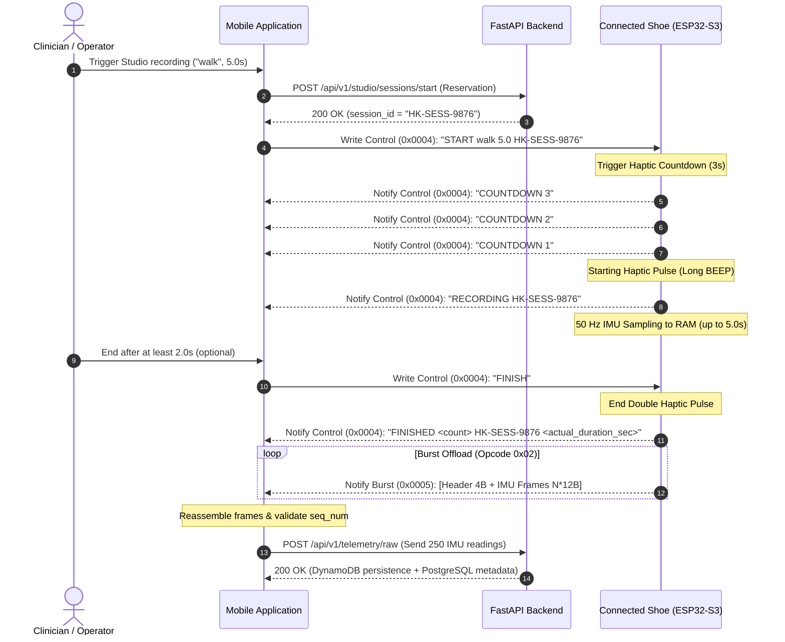

# Studio Telemetry Binary Protocol (BLE Burst & Control)

This document formally specifies the bidirectional communication and high-throughput binary packet transfer protocol (**Studio Burst**) used between the connected shoe (**ESP32-S3 Firmware**), the **Edge AI** agent, and the **Flutter Mobile** companion application.

---

## 1. Overview & Objectives

**Studio** mode is dedicated to high-fidelity capture of raw inertial measurement unit data (MPU-6050 IMU at $50\,\text{Hz}$ or $100\,\text{Hz}$) for constructing biomechanical training datasets and clinical relabeling.

### Engineering Constraints

1. **Constrained BLE Bandwidth**: Useful Bluetooth Low Energy throughput must be maximized without overflowing the radio stack ring buffer (_NimBLE ring buffer_).
2. **Session Atomicity**: A Studio session follows a strict lifecycle: REST/Cloud Reservation $\to$ Haptic Countdown $\to$ Recording $\to$ Fast Binary Offloading (_Burst_) $\to$ Integrity Validation.
3. **Compact Floating-Point-Free Format**: Acceleration and angular velocity measurements are quantized into 16-bit signed integers (_Fixed-point representation_) in network byte order (_Big-Endian_).

---

## 2. Studio Session Sequence Diagram



---

## 3. Control Channel (`CHAR_STUDIO_CONTROL_UUID`: `0x0004`)

The control channel manages session state machine transitions. Messages are formatted in UTF-8 text.

### A. Master $\to$ Slave Commands (Mobile $\to$ Shoe)

| Command | Syntax | Description |
| :--- | :--- | :--- |
| **`START`** | `START <label> <duration_sec> <session_id>` | Initiates a session with label, duration (2.0 to 30.0s), and session UUID. |
| **`CANCEL`** | `CANCEL` | Immediately aborts recording or offloading and resets state machine to `IDLE`. |
| **`FINISH`** | `FINISH` | Ends recording after at least 2.0s and transmits collected samples. |

### B. Slave $\to$ Master Notifications (Shoe $\to$ Mobile)

| Notification | Format | Meaning |
| :--- | :--- | :--- |
| **`COUNTDOWN`** | `COUNTDOWN <seconds_remaining>` | Preparatory haptic countdown ($3$, $2$, $1$). |
| **`RECORDING`** | `RECORDING <session_id>` | Effective start of inertial data acquisition. |
| **`FINISHED`** | `FINISHED <total_samples> <session_id> <actual_duration_sec>` | Capture complete; declares total frame count and actual duration to receive. |
| **`ERROR`** | `ERROR <message>` | Hardware fault (IMU disconnected, RAM buffer overflow, etc.). |

---

## 4. Burst Data Channel (`CHAR_STUDIO_DATA_BURST_UUID`: `0x0005`)

IMU data is transferred as compact binary packets via BLE notifications.

### A. Burst Packet Header (4 Bytes)

Each binary packet begins with a 4-byte synchronization header:

```text
 0                   1                   2                   3
 0 1 2 3 4 5 6 7 8 9 0 1 2 3 4 5 6 7 8 9 0 1 2 3 4 5 6 7 8 9 0 1
+-+-+-+-+-+-+-+-+-+-+-+-+-+-+-+-+-+-+-+-+-+-+-+-+-+-+-+-+-+-+-+-+
|  Opcode (0x02/4)|    Sequence Number (uint16_t MSB, LSB)      |
+-+-+-+-+-+-+-+-+-+-+-+-+-+-+-+-+-+-+-+-+-+-+-+-+-+-+-+-+-+-+-+-+
|  PayloadBytes |           IMU Payload ...                     |
+-+-+-+-+-+-+-+-+-+-+-+-+-+-+-+-+-+-+-+-+-+-+-+-+-+-+-+-+-+-+-+-+
```

1. **`Opcode` (1 Byte)**:
   - `0x01`: `BURST_PACKET_START_OF_BURST` (Optional, sample announcement).
   - `0x02`: `BURST_PACKET_DATA_CHUNK` (Uncompressed raw frames, 14 bytes per frame).
   - `0x03`: `BURST_PACKET_END_OF_BURST` (End of burst with total sample count and CRC32).
   - `0x04`: `BURST_PACKET_DELTA_CHUNK` (Lossless delta-compression with Keyframe).
2. **`Sequence Number` (2 Bytes)**: Unsigned 16-bit integer in _Big-Endian_ order, incremented by $1$ per packet ($0, 1, 2, \dots$). Enables instant packet loss detection.
3. **`PayloadBytes` (1 Byte)**: Byte length of the IMU payload in this packet.

---

### B. Raw IMU Frame Binary Format (14 Bytes)

Each raw inertial measurement is encoded as 1 `uint16_t` timestamp offset and 6 `int16_t` sensor values in _Big-Endian_ order (`htons`):

| Offset | Field | Type | Scale & Unit | Conversion Formula |
| :----: | :--- | :---: | :---: | :---: |
| `+0` | `delta_ms` | `uint16_t` | $1\,\text{LSB} = 1\,\text{ms}$ | Milliseconds since start |
| `+2` | `ax` | `int16_t` | $1\,\text{LSB} = 0.001\,g$ ($1\,mg$) | $a_x = \text{value} / 1000.0$ |
| `+4` | `ay` | `int16_t` | $1\,\text{LSB} = 0.001\,g$ ($1\,mg$) | $a_y = \text{value} / 1000.0$ |
| `+6` | `az` | `int16_t` | $1\,\text{LSB} = 0.001\,g$ ($1\,mg$) | $a_z = \text{value} / 1000.0$ |
| `+8` | `gx` | `int16_t` | $1\,\text{LSB} = 0.1\,^{\circ}/\text{s}$ | $g_x = \text{value} / 10.0$ |
| `+10` | `gy` | `int16_t` | $1\,\text{LSB} = 0.1\,^{\circ}/\text{s}$ | $g_y = \text{value} / 10.0$ |
| `+12` | `gz` | `int16_t` | $1\,\text{LSB} = 0.1\,^{\circ}/\text{s}$ | $g_z = \text{value} / 10.0$ |

_Total raw frame size_: $2 + (6 \times 2) = 14\,\text{bytes}$.

---

### C. Delta Compressed Packet Format (`Opcode 0x04`)

To maximize throughput without losing fidelity, the protocol supports differential encoding (Delta-Encoding):

#### Payload of an `0x04` Packet:

1. **`frame_count` (1 Byte)**: Total number of frames in packet ($1 + K$).
2. **Reference Keyframe (14 Bytes)**: Full raw frame encoded per table 4.B above.
3. **Delta Frames ($K \times 7$ Bytes)**: For each successive frame ($i = 1 \dots K$), differences relative to preceding frame ($t_{i-1}$) are quantized to 1 signed byte:
   - `d_ms` (1 Byte, `uint8_t`): $\Delta \text{delta\_ms} = t_i - t_{i-1}$ (typically $20\,\text{ms}$ at $50\,\text{Hz}$, range $0 \dots 255$).
   - `d_ax` (1 Byte, `int8_t`): $\Delta a_x \in [-127, +127]\,\text{mg}$.
   - `d_ay` (1 Byte, `int8_t`): $\Delta a_y \in [-127, +127]\,\text{mg}$.
   - `d_az` (1 Byte, `int8_t`): $\Delta a_z \in [-127, +127]\,\text{mg}$.
   - `d_gx` (1 Byte, `int8_t`): $\Delta g_x \in [-127, +127]\,(0.1^\circ/\text{s})$.
   - `d_gy` (1 Byte, `int8_t`): $\Delta g_y \in [-127, +127]\,(0.1^\circ/\text{s})$.
   - `d_gz` (1 Byte, `int8_t`): $\Delta g_z \in [-127, +127]\,(0.1^\circ/\text{s})$.

_Total size per delta frame_: $7\,\text{bytes}$ (**$50\%$ reduction** compared to 14 raw bytes).

#### Dynamic Fallback & Safety Mechanisms

- If rapid motion or a heavy impact causes a delta to exceed $[-127, +127]$ or $\Delta \text{ms} > 255$, the microcontroller terminates the delta packet or emits a raw `0x02` packet.
- Opcodes `0x02` and `0x04` can be mixed seamlessly within the same session.
- **Cryptographic Integrity Validation**: The IEEE 802.3 CRC32 transmitted in `BURST_PACKET_END_OF_BURST` (`0x03`) is systematically computed over decompressed frames (14 bytes $\times N$). The mobile client validates this CRC32 post-decompression, mathematically ensuring 100% data integrity.

---

## 5. MTU Negotiation & Adaptive Throughput

The protocol dynamically calculates packet density based on the negotiated BLE MTU:

$$\text{Usable Payload Size} = \text{MTU} - 3\,(\text{ATT Header}) - 4\,(\text{Burst Header})$$

| Transfer Mode | Negotiated MTU | ATT + Burst Header | Usable Payload | Frames / Packet | Payload Bytes |
| :--- | :---: | :---: | :---: | :---: | :---: |
| **Raw (`0x02`)** | **185** (iOS) | 7 bytes | 178 bytes | **12 frames** | 168 bytes |
| **Raw (`0x02`)** | **256** (HealthKicks) | 7 bytes | 249 bytes | **17 frames** | 238 bytes |
| **Delta (`0x04`)** | **185** (iOS) | 7 bytes | 178 bytes | **24 frames** (1 Key + 23 Delta) | 176 bytes |
| **Delta (`0x04`)** | **256** (HealthKicks) | 7 bytes | 249 bytes | **33 frames** (1 Key + 32 Delta) | 239 bytes |

### Flow Control & Anti-Saturation

- A **$5\,\text{ms}$** inter-packet transmission delay is enforced on the microcontroller between consecutive packets. This ensures the NimBLE radio controller TX queue does not starve or overflow (preventing `BLE_HS_ENOMEM` errors).
- Leveraging Delta compression (`0x04`), a complete $5\,\text{second}$ session at $50\,\text{Hz}$ ($250\,\text{frames}$) is transmitted in only **$8\,\text{packets}$** (down from 15 packets), halving radio channel airtime.
