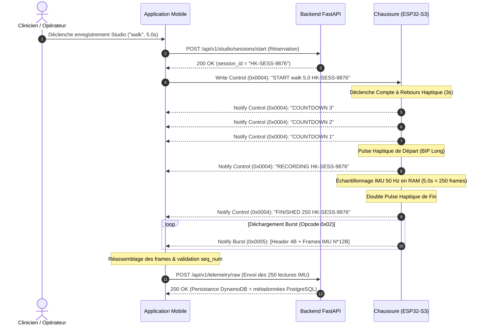

# Protocole Binaire de Télémétrie Studio (BLE Burst & Control)

Ce document spécifie formellement le protocole de communication bidirectionnel et de transfert de paquets binaires à haut débit (**Studio Burst**) utilisé entre la chaussure connectée (**Firmware ESP32-S3**), l'agent **Edge AI** et l'application **Mobile Flutter**.

---

## 1. Vue d'Ensemble & Objectifs

Le mode **Studio** est dédié à la capture haute fidélité de données brutes issues de la centrale inertielle (IMU MPU-6050 à $50\,\text{Hz}$ ou $100\,\text{Hz}$) pour la constitution de jeux de données d'entraînement biomécaniques et la requalification clinique.

### Contraintes d'Ingénierie

1. **Bande passante BLE contrainte** : Le débit utile Bluetooth Low Energy doit être maximisé sans surcharger la mémoire tampon de la pile radio (_NimBLE ring buffer_).
2. **Atomicité des sessions** : Une session Studio possède un cycle de vie strict : Réservation REST/Cloud $\to$ Compte à rebours haptique $\to$ Enregistrement $\to$ Déchargement binaire rapide (_Burst_) $\to$ Validation d'intégrité.
3. **Format compact sans flottant** : Les mesures d'accélération et de vitesse angulaire sont quantifiées en entiers signés 16-bit (_Fixed-point representation_) en ordre réseau (_Big-Endian_).

---

## 2. Diagramme de Séquence de Session Studio



---

## 3. Canal de Contrôle (`CHAR_STUDIO_CONTROL_UUID` : `0x0004`)

Le canal de contrôle gère la machine à états de la session. Les messages sont au format texte UTF-8.

### A. Commandes Maître $\to$ Esclave (Mobile $\to$ Chaussure)

| Commande     | Syntaxe                                     | Description                                                                              |
| :----------- | :------------------------------------------ | :--------------------------------------------------------------------------------------- |
| **`START`**  | `START <label> <duration_sec> <session_id>` | Initie une session avec étiquette, durée (1.0 à 30.0s) et UUID de session.               |
| **`CANCEL`** | `CANCEL`                                    | Interrompt immédiatement l'enregistrement ou le déchargement et repasse à l'état `IDLE`. |

### B. Notifications Esclave $\to$ Maître (Chaussure $\to$ Mobile)

| Notification    | Format                                  | Signification                                                              |
| :-------------- | :-------------------------------------- | :------------------------------------------------------------------------- |
| **`COUNTDOWN`** | `COUNTDOWN <seconds_remaining>`         | Décompte haptique préparatoire ($3$, $2$, $1$).                            |
| **`RECORDING`** | `RECORDING <session_id>`                | Début effectif de l'acquisition des données inertielles.                   |
| **`FINISHED`**  | `FINISHED <total_samples> <session_id>` | Fin de la capture physique ; annonce le nombre exact de frames à recevoir. |
| **`ERROR`**     | `ERROR <message>`                       | Erreur matérielle (IMU déconnectée, débordement mémoire RAM, etc.).        |

---

## 4. Canal de Données Burst (`CHAR_STUDIO_DATA_BURST_UUID` : `0x0005`)

Les données IMU sont transmises sous forme de paquets binaires compacts via notifications BLE.

### A. En-Tête de Paquet Burst (4 octets)

Chaque paquet binaire débute par un en-tête de synchronisation de 4 octets :

```text
 0                   1                   2                   3
 0 1 2 3 4 5 6 7 8 9 0 1 2 3 4 5 6 7 8 9 0 1 2 3 4 5 6 7 8 9 0 1
+-+-+-+-+-+-+-+-+-+-+-+-+-+-+-+-+-+-+-+-+-+-+-+-+-+-+-+-+-+-+-+-+
|  Opcode (0x02)|     Sequence Number (uint16_t MSB, LSB)      |
+-+-+-+-+-+-+-+-+-+-+-+-+-+-+-+-+-+-+-+-+-+-+-+-+-+-+-+-+-+-+-+-+
|  PayloadBytes |           Charge utile IMU ...                |
+-+-+-+-+-+-+-+-+-+-+-+-+-+-+-+-+-+-+-+-+-+-+-+-+-+-+-+-+-+-+-+-+
```

1. **`Opcode` (1 octet)** : `0x02` (`BURST_PACKET_DATA_CHUNK`).
2. **`Sequence Number` (2 octets)** : Entier non signé 16-bit en ordre _Big-Endian_, incrémenté de $1$ à chaque paquet ($0, 1, 2, \dots$). Permet la détection immédiate de perte de paquets.
3. **`PayloadBytes` (1 octet)** : Longueur en octets de la charge utile IMU contenue dans ce paquet (doit être un multiple exact de 12 octets).

### B. Format Binaire d'une Frame IMU (12 octets)

Chaque mesure inertielle est représentée par 6 valeurs `int16_t` encodées en _Big-Endian_ (ordre réseau `htons`) :

| Offset | Champ |   Type    |             Échelle & Unité              |     Formule de conversion      |
| :----: | :---: | :-------: | :--------------------------------------: | :----------------------------: |
|  `+0`  | `ax`  | `int16_t` |   $1\,\text{LSB} = 0.001\,g$ ($1\,mg$)   | $a_x = \text{valeur} / 1000.0$ |
|  `+2`  | `ay`  | `int16_t` |   $1\,\text{LSB} = 0.001\,g$ ($1\,mg$)   | $a_y = \text{valeur} / 1000.0$ |
|  `+4`  | `az`  | `int16_t` |   $1\,\text{LSB} = 0.001\,g$ ($1\,mg$)   | $a_z = \text{valeur} / 1000.0$ |
|  `+6`  | `gx`  | `int16_t` | $1\,\text{LSB} = 0.1\,^{\circ}/\text{s}$ |  $g_x = \text{valeur} / 10.0$  |
|  `+8`  | `gy`  | `int16_t` | $1\,\text{LSB} = 0.1\,^{\circ}/\text{s}$ |  $g_y = \text{valeur} / 10.0$  |
| `+10`  | `gz`  | `int16_t` | $1\,\text{LSB} = 0.1\,^{\circ}/\text{s}$ |  $g_z = \text{valeur} / 10.0$  |

_Taille totale par frame_ : $6 \times 2 = 12\,\text{octets}$.

---

## 5. Négociation MTU & Débit Adaptatif

Le protocole calcule dynamiquement la densité de paquets en fonction de la taille MTU négociée lors de la connexion BLE :

$$\text{Taille Utile} = \text{MTU} - 3\,(\text{En-tête ATT}) - 4\,(\text{En-tête Burst})$$
$$\text{Frames par Paquet} = \left\lfloor \frac{\text{Taille Utile}}{12} \right\rfloor$$

|           MTU Négocié           | En-tête ATT + Burst | Taille Utile |        Frames / Paquet         | Octets Payload |
| :-----------------------------: | :-----------------: | :----------: | :----------------------------: | :------------: |
|     **23** (Défaut BLE 4.0)     |      7 octets       |  16 octets   |          **1 frame**           |   12 octets    |
|     **185** (iOS Standard)      |      7 octets       |  178 octets  |         **14 frames**          |   168 octets   |
| **256** (HealthKicks Preferred) |      7 octets       |  249 octets  |    **17 frames** (Plafond)     |   204 octets   |
|      **512** (Android Max)      |      7 octets       |  505 octets  | **17 frames** (Plafond tampon) |   204 octets   |

### Régulation de Flux & Anti-Saturation

- Un délai inter-paquet de **$5\,\text{ms}$** est appliqué sur le microcontrôleur entre deux envois consécutifs. Ce délai garantit que le contrôleur radio NimBLE ne sature pas sa file d'attente de transmission (évite les erreurs `BLE_HS_ENOMEM`).
- À $17\,\text{frames/paquet}$, une session complète de $5\,\text{secondes}$ à $50\,\text{Hz}$ ($250\,\text{frames}$) est entièrement transmise en **$15\,\text{paquets}$**, soit moins de **$150\,\text{millisecondes}$** de transfert réseau.
