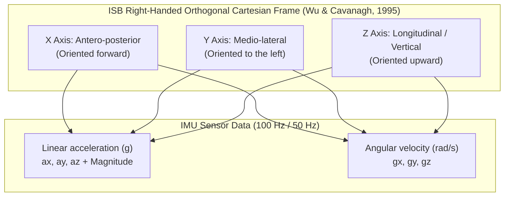

# Biomechanical Reference Frame & IMU Axis Standardization (ISB Standard)

## 1. Context & International ISB Standard

In the **HealthKicks** ecosystem, real-time biomechanical analysis (fall detection, activity classification, clinical gait monitoring) relies on strict spatial coordinate standardization.

To eliminate axis ambiguity across embedded inertial sensors (MPU-6050 / IMUs), Edge AI pipelines, cloud backend services, and clinician graphical dashboards, **the HealthKicks ecosystem strictly adheres to the recommendations of the International Society of Biomechanics (ISB)**.

### Bibliographic Reference

> **Wu, G., & Cavanagh, P. R. (1995).**
> _ISB recommendations for standardization in the reporting of kinematic data._
> **Journal of Biomechanics**, 28(10), 1257–1261.
> DOI: [10.1016/0021-9290(95)00017-C](https://doi.org/10.1016/0021-9290(95)00017-C)

---

## 2. Right-Handed Cartesian Frame Definition

The anatomical local frame attached to the footwear/foot is a **right-handed orthogonal Cartesian frame** ($\vec{X}, \vec{Y}, \vec{Z}$) oriented as follows:

```text
                  +Z (Longitudinal / Vertical: Upward)
                   ▲
                   │     +X (Antero-posterior: Forward / Travel)
                   │    ▲
                   │   /
                   │  /
                   │ /
                   └───────────► +Y (Medio-lateral: Left / Medial)
```



---

## 3. Axis Correspondence Matrix

### A. Linear Acceleration ($a_x, a_y, a_z$) in Units of $g$ ($1\,g \approx 9.81\,\text{m/s}^2$)

| Axis | ISB Name | Physical Orientation | Associated Biomechanical Movements | Static Rest Value |
| :--- | :--- | :--- | :--- | :--- |
| **AX ($a_x$)** | **Antero-posterior** | Pointing **Forward** (direction of travel) | Propulsion (+) / Braking (-) during stride | $\approx 0.0\,g$ |
| **AY ($a_y$)** | **Medio-lateral** | Pointing to the **Left** (medial for right foot) | Lateral shifts, weight transfers, stance stabilization | $\approx 0.0\,g$ |
| **AZ ($a_z$)** | **Longitudinal / Vertical** | Pointing **Upward** (cranial / proximal) | Ground impacts (+) / Flight phase or suspension (-) | **$+1.0\,g$** (Earth's gravity) |
| **Mag ($\|a\|$)** | **Magnitude / Norm** | $\|a\| = \sqrt{a_x^2 + a_y^2 + a_z^2}$ | Rotationally invariant scalar norm (impacts/falls) | $\approx 1.0\,g$ |

> [!IMPORTANT]
> **Static Rest Signature**: When the shoe rests flat on the ground at standstill, the accelerometer measures the reaction of the floor countering gravity: **$+1.0\,g$ on the $Z$ axis** and **$0.0\,g$ on the $X$ and $Y$ axes**.

---

### B. Gyroscope / Angular Velocities ($g_x, g_y, g_z$) in $\text{rad/s}$ (or $^\circ/\text{s}$)

Rotation velocities follow the **right-hand rule** around the ISB cardinal axes:

| Axis | Designation | ISB Rotation Axis | Physiological Foot Movements |
| :--- | :--- | :--- | :--- |
| **GX ($g_x$)** | **Roll** | Rotation around $X$ axis (Antero-posterior) | **Inversion** (+) / **Eversion** (-) (Pronation / Supination) |
| **GY ($g_y$)** | **Pitch** | Rotation around $Y$ axis (Medio-lateral) | **Dorsiflexion** (+) / **Plantarflexion** (-) |
| **GZ ($g_z$)** | **Yaw** | Rotation around $Z$ axis (Vertical) | **Internal rotation / Adduction** (+) / **External rotation / Abduction** (-) |

---

## 4. Hardware Alignment & Processing Pipeline

1. **Embedded Firmware (Arduino / ESP32-S3)**:
   - Reads MPU-6050 IMU configured for $\pm 8\,g$ full scale (4096 LSB/g) and $\pm 1000^\circ/\text{s}$ (32.8 LSB/dps).
   - Direct application of coordinate transformation matrix to provide native ISB aligned signals.

2. **BLE GATT & MQTT Communication Protocols**:
   - _Studio Data Burst_ characteristic (`0x7a5a0005-...`): Compact 14-byte binary frame ordered as $[a_x, a_y, a_z, g_x, g_y, g_z]$.

3. **Edge AI & Cloud Machine Learning Pipeline**:
   - Feature extraction and rotation-invariant norm computation ($SVM$, $Jerk$, $SMA$) preserving mathematical compatibility between trained models and real-time edge inference.

4. **Frontend Visualization (Angular / Chart.js)**:
   - Explicit curve labels and standardized color coding:
     - **Red**: $X$ Axis (Antero-posterior)
     - **Emerald / Green**: $Y$ Axis (Medio-lateral)
     - **Blue**: $Z$ Axis (Longitudinal / Vertical)
     - **Purple**: Magnitude $\|a\|$
