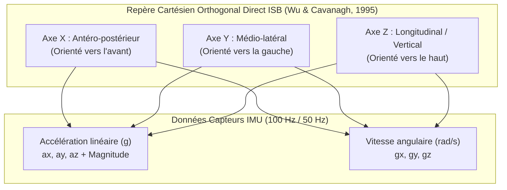

# Référentiel Biomécanique & Standardisation des Axes IMU (Standard ISB)

## 1. Contexte et Standard International ISB

Dans l'écosystème **HealthKicks**, l'analyse biomécanique en temps réel (détection de chute, classification de l'activité, suivi clinique de la marche) repose sur une standardisation rigoureuse des repères spatiaux.

Pour éliminer toute ambiguïté d'axes entre les capteurs inertiels embarqués (MPU-6050 / centrales inertielles), les pipelines Edge AI, le backend cloud et la restitution graphique aux praticiens, **l'écosystème HealthKicks adhère strictement aux recommandations de l'International Society of Biomechanics (ISB)**.

### Référence Bibliographique

> **Wu, G., & Cavanagh, P. R. (1995).**
> _ISB recommendations for standardization in the reporting of kinematic data._
> **Journal of Biomechanics**, 28(10), 1257–1261.
> DOI: [10.1016/0021-9290(95)00017-C](<https://doi.org/10.1016/0021-9290(95)00017-C>)

---

## 2. Définition du Repère Cartésien Direct (Dextrorsum)

Le repère anatomique local lié à la chaussure / au pied est un **repère cartésien orthogonal direct** ($\vec{X}, \vec{Y}, \vec{Z}$) orienté comme suit :

```text
                  +Z (Longitudinal / Vertical : Haut)
                   ▲
                   │     +X (Antéro-postérieur : Avant / Marche)
                   │    ▲
                   │   /
                   │  /
                   │ /
                   └───────────► +Y (Médio-latéral : Gauche / Interne)
```



---

## 3. Matrice de Correspondance des Axes

### A. Accélérométrie Linéaire ($a_x, a_y, a_z$) en unité $g$ ($1\,g \approx 9.81\,\text{m/s}^2$)

| Axe               | Dénomination ISB            | Orientation Physique                               | Mouvements Biomécaniques Associés                     | Valeur au Repos Statique          |
| :---------------- | :-------------------------- | :------------------------------------------------- | :---------------------------------------------------- | :-------------------------------- |
| **AX ($a_x$)**    | **Antéro-postérieur**       | Pointé vers l'**Avant** (sens de la marche)        | Propulsion (+) / Freinage (-) lors de la foulée       | $\approx 0.0\,g$                  |
| **AY ($a_y$)**    | **Médio-latéral**           | Pointé vers la **Gauche** (médial pour pied droit) | Déplacements latéraux, transferts de charge, appuis   | $\approx 0.0\,g$                  |
| **AZ ($a_z$)**    | **Longitudinal / Vertical** | Pointé vers le **Haut** (crânial / proximal)       | Impacts au sol (+) / Phase de vol ou suspension (-)   | **$+1.0\,g$** (gravité terrestre) |
| **Mag ($\|a\|$)** | **Magnitude / Norme**       | $\|a\| = \sqrt{a_x^2 + a_y^2 + a_z^2}$             | Norme scalaire invariante par rotation (chocs/chutes) | $\approx 1.0\,g$                  |

> [!IMPORTANT]
> **Signature Statique au Repos** : Lorsque la chaussure est posée à plat sur le sol au repos, l'accéléromètre mesure la réaction du sol face à l'attraction terrestre, soit **$+1.0\,g$ sur l'axe $Z$** et **$0.0\,g$ sur les axes $X$ et $Y$**.

---

### B. Gyroscope / Vitesses Angulaires ($g_x, g_y, g_z$) en $\text{rad/s}$ (ou $^\circ/\text{s}$)

Les vitesses de rotation suivent la **règle de la main droite** autour des axes directeurs ISB :

| Axe            | Dénomination        | Axe de Rotation ISB                              | Mouvements Physiologiques du Pied                                           |
| :------------- | :------------------ | :----------------------------------------------- | :-------------------------------------------------------------------------- |
| **GX ($g_x$)** | **Roulis (Roll)**   | Rotation autour de l'axe $X$ (Antéro-postérieur) | **Inversion** (+) / **Éversion** (-) (Pronation / Supination)               |
| **GY ($g_y$)** | **Tangage (Pitch)** | Rotation autour de l'axe $Y$ (Médio-latéral)     | **Flexion dorsale** (+) / **Flexion plantaire** (-)                         |
| **GZ ($g_z$)** | **Lacet (Yaw)**     | Rotation autour de l'axe $Z$ (Vertical)          | **Rotation interne / Adduction** (+) / **Rotation externe / Abduction** (-) |

---

## 4. Alignement Matériel & Chaîne de Traitement

1. **Firmware Embarqué (Arduino / ESP32-S3)** :
   - Lecture du capteur IMU MPU-6050 configuré en pleine échelle $\pm 8\,g$ (4096 LSB/g) et $\pm 1000^\circ/\text{s}$ (32.8 LSB/dps).
   - Application directe de la matrice de transformation géométrique pour délivrer des signaux nativement alignés sur le standard ISB.

2. **Protocole de Communication BLE GATT & MQTT** :
   - Caractéristique _Studio Data Burst_ (`0x7a5a0005-...`) : Trame binaire compacte 14 octets ordonnée en $[a_x, a_y, a_z, g_x, g_y, g_z]$.

3. **Pipeline Edge AI & Cloud Machine Learning** :
   - Extraction de features spatiales et calcul des normes invariantes ($SVM$, $Jerk$, $SMA$) préservant la compatibilité mathématique entre modèles entraînés et inférence temps réel.

4. **Visualisation Frontend (Angular / Chart.js)** :
   - Restitution explicite des légendes et courbes avec repérage couleur standardisé :
     - **Rouge** : Axe $X$ (Antéro-postérieur)
     - **Émeraude / Vert** : Axe $Y$ (Médio-latéral)
     - **Bleu** : Axe $Z$ (Longitudinal / Vertical)
     - **Violet** : Magnitude $\|a\|$
