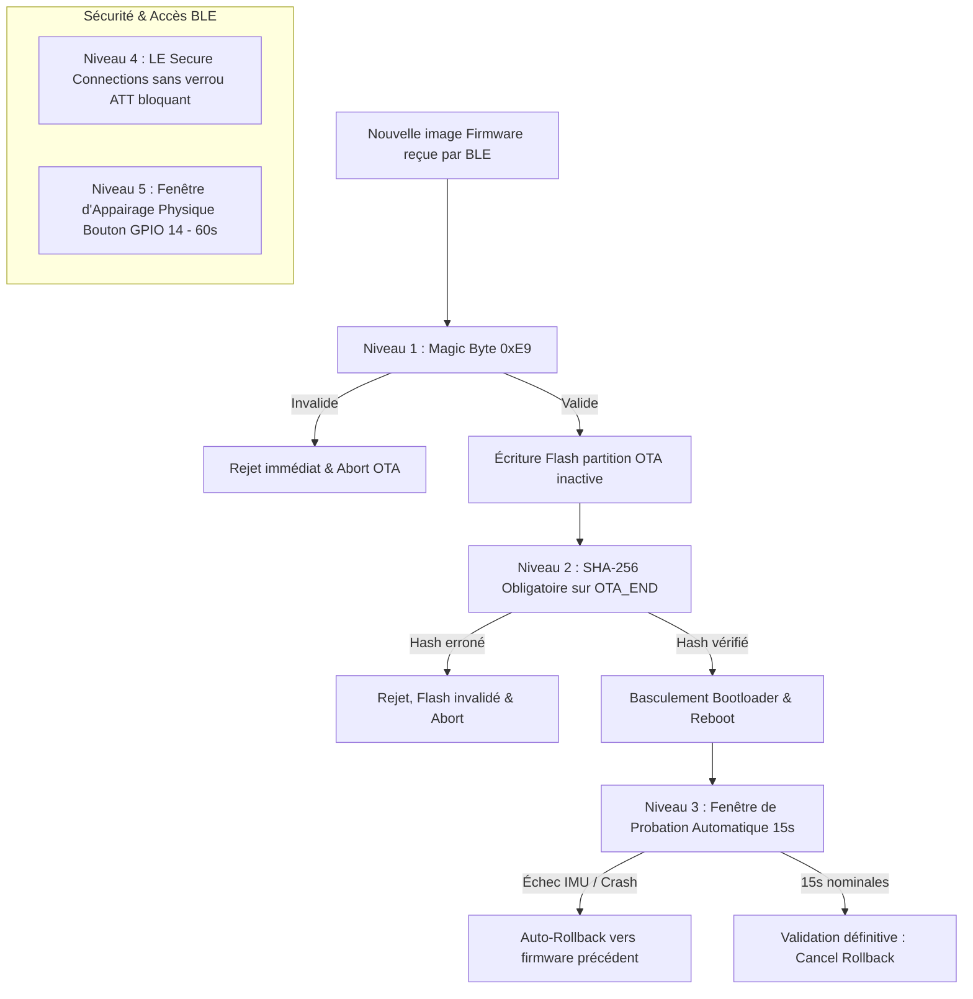

# Spécification de Sécurité Firmware & Protection Anti-Brique (BLE OTA)

Ce document décrit l'architecture de sûreté logicielle et matérielle de l'embarqué **HealthKicks** ([`health-kicks-esp32-s3`](file:///f:/Programmation/healthkicks-ecosystem/health-kicks-esp32-s3)), garantissant une résilience totale contre le brique du microcontrôleur ESP32-S3 lors des mises à jour par liaison radio (OTA).

---

## 1. Contexte Matériel & Contrainte Inviolable

> [!CAUTION]
> **Contrainte Matérielle Critique** :
> Les prototypes de chaussures connectées HealthKicks possèdent des ports USB défectueux ou scellés dans la semelle biomécanique. La liaison **Bluetooth Low Energy (BLE OTA)** constitue le **seul et unique vecteur de programmation et de maintenance logicielle**.
> Tout échec entraînant l'inaccessibilité du serveur GATT BLE ou le blocage du microcontrôleur rendrait le matériel définitivement inopérant (brique physique).

Pour éliminer ce risque, une stratégie de défense en profondeur à 5 niveaux est déployée.

---

## 2. Défense en Profondeur : Les 5 Niveaux de Protection

---

### Niveau 1 : Validation de l'En-tête Image ESP32 (`0xE9`)

- **Localisation** : `src/services/ota_ble_service.cpp` (`handleDataWrite`).
- **Fonctionnement** : Dès la réception du premier paquet binaire (`_bytesWritten == 0`), le premier octet est contrôlé : il doit valoir strictement `0xE9` (magic byte du binaire d'application compilé pour ESP-IDF).
- **Résultat en cas d'anomalie** : L'écriture en flash est avortée immédiatement sans toucher à la table de partitions (`OTA_ERR_VALIDATION_FAILED`).

---

### Niveau 2 : Contrôle d'Intégrité Cryptographique SHA-256 Obligatoire

- **Localisation** : `src/services/ota_ble_service.cpp` (`handleControlWrite` sur `OTA_CMD_END`).
- **Fonctionnement** :
  1. Au fur et à mesure du flux de données BLE, le contexte de hachage matériel `mbedtls_sha256` accumule l'empreinte de chaque chunk écrit.
  2. À la fin du transfert, la commande `OTA_CMD_END` doit **obligatoirement** comporter 33 octets (1 octet d'opcode + 32 octets du digest SHA-256 calculé par l'application cliente).
  3. L'ancien mécanisme permissif qui tolérait des commandes sans empreinte a été supprimé : si la longueur est inférieure à 33 octets ou si le hash ne concorde pas au bit près, l'opération est refusée (`OTA_ERR_CHECKSUM_MISMATCH`).

---

### Niveau 3 : Double Partitionnement OTA & Fenêtre de Probation Automatique

- **Configuration** : `partitions_ota.csv` (`ota_0`, `ota_1`), option ESP-IDF `CONFIG_BOOTLOADER_APP_ROLLBACK_ENABLE=1`.
- **Fonctionnement** :
  1. Au redémarrage sur la nouvelle version, le firmware démarre en mode probation (`otaPendingVerification = true`).
  2. Durant les **15 premières secondes** d'exécution (`OTA_VERIFY_PROBATION_PERIOD_MS = 15000`) :
     - Le firmware surveille la réactivité des capteurs critiques, notamment le bus I2C et l'IMU MPU-6050 (`imuReady`).
     - En cas d'anomalie sévère ou de crash en boucle, la fonction `esp_ota_mark_app_invalid_rollback_and_reboot()` est déclenchée, basculant automatiquement le bootloader sur la version précédente éprouvée.
  3. Si la probation s'écoule avec succès, la fonction `esp_ota_mark_app_valid_cancel_rollback()` fige la version comme partition active permanente et émet une double vibration haptique de confirmation.

> [!NOTE]
> **Point d'attention pour révision ultérieure** :
> La durée de 15 secondes a été retenue pour limiter le temps d'exposition d'un firmware potentiellement défaillant. Cependant, si des tests complémentaires de connexion réseau/BLE plus longs s'avèrent nécessaires avant de déclarer l'image stable, cette durée pourra être réévaluée et allongée (ex: 30s ou 45s).
> À noter : le déclencheur manuel de rollback sur appui court du bouton physique pendant ces 15 secondes a été retiré afin d'éviter les rollbacks intempestifs lors d'une tentative d'appairage.

---

### Niveau 4 : Sécurité BLE LE Secure Connections (Option 1A) Sans Lock-out ATT

- **Localisation** : `src/ble/ble_server.cpp`.
- **Principe** :
  - Authentification chiffrée moderne **LE Secure Connections (LESC)** avec Bonding persistant en NVS (`NimBLEDevice::setSecurityAuth(true, false, true)`).
  - **Aucun flag bloquant `WRITE_ENC` sur les caractéristiques ATT** : Si un smartphone perd ses clés de liaison (stale bond ou réinitialisation Bluetooth de l'OS), l'accès ATT n'est pas bloqué au niveau du contrôleur, ce qui permet toujours la récupération ou la reprogrammation de secours.

---

### Niveau 5 : Fenêtre d'Appairage Sécurisé sur Bouton Physique (`GPIO 14`)

- **Localisation** : `src/ble/ble_server.cpp`, `src/main.cpp`.
- **Fonctionnement** :
  1. Pour éviter qu'un tiers inconnu ne tente de s'appairer ou qu'un lien corrompu n'écrase les liaisons NVS, l'appairage de nouveaux appareils est strictement conditionné à l'ouverture d'une **fenêtre d'appairage de 60 secondes** (`openPairingWindow(60000)`).
  2. Cette fenêtre s'ouvre dans deux situations précises :
     - **Automatiquement au redémarrage post-OTA** (quand `otaPendingVerification == true` ou si NVS ne contient aucun bond enregistré).
     - **Manuellement via un appui court sur le bouton physique de la chaussure (`PIN_BTN_PAIRING` sur GPIO 14)**.
  3. En dehors de cette fenêtre, les périphériques non préalablement appairés sont immédiatement déconnectés avant toute commande d'actionneur ou d'OTA.

---

## 3. Matrice de Récapitulation des États et Protections

| Événement                                | Protection activée            | Comportement du système                             |
| :--------------------------------------- | :---------------------------- | :-------------------------------------------------- |
| Envoi d'un fichier corrompu ou non-ESP32 | Niveau 1 (Magic Byte)         | Rejet à l'octet 0, flash intact.                    |
| Coupure BLE ou altération de paquets     | Niveau 2 (SHA-256)            | Rejet en fin de transfert, partition invalidée.     |
| Firmware instable / Panique IMU au boot  | Niveau 3 (Probation 15s)      | Rollback automatique vers l'ancien slot.            |
| Smartphone désappairé / Stale bond       | Niveau 4 & 5 (Bouton GPIO 14) | Fenêtre 60s sur bouton pour renouveler les clés.    |
| Tentative d'intrusion BLE sans présence  | Niveau 5 (Bouton physique)    | Connexion rejetée si non appairé et fenêtre fermée. |
