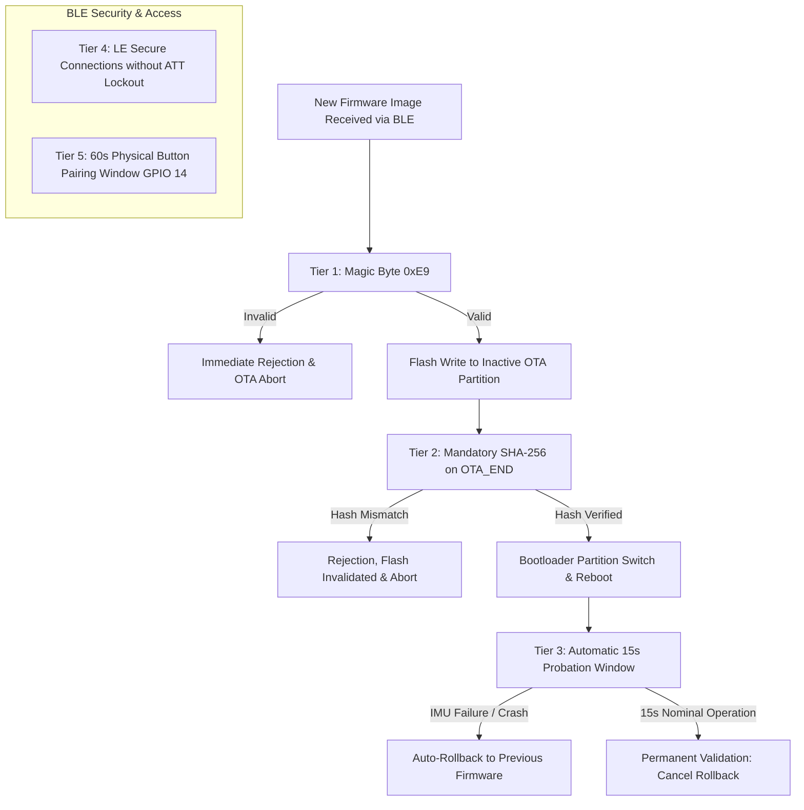

# Firmware Safety Specification & Anti-Bricking Protection (BLE OTA)

This document describes the software and hardware safety architecture of **HealthKicks** embedded firmware ([`health-kicks-esp32-s3`](file:///f:/Programmation/healthkicks-ecosystem/health-kicks-esp32-s3)), guaranteeing complete resilience against bricking the ESP32-S3 microcontroller during wireless Over-The-Air (OTA) updates.

---

## 1. Hardware Context & Inviolable Constraint

> [!CAUTION]
> **Critical Hardware Constraint**:
> Prototypes of HealthKicks connected shoes feature defective or sealed physical USB ports within the biomechanical sole. **Bluetooth Low Energy (BLE OTA)** serves as the **sole programming and software maintenance vector**.
> Any failure rendering the BLE GATT server unreachable or stalling the microcontroller would permanently brick the hardware device.

To eliminate this catastrophic risk, a 5-tier defense-in-depth strategy is implemented.

---

## 2. Defense-in-Depth: The 5 Protection Tiers

---

### Tier 1: ESP32 Image Header Validation (`0xE9`)

- **Location**: `src/services/ota_ble_service.cpp` (`handleDataWrite`).
- **Operation**: Upon receiving the first binary packet (`_bytesWritten == 0`), the first byte is checked: it must strictly be `0xE9` (ESP-IDF compiled application binary magic byte).
- **Behavior on Anomaly**: Flash write aborts immediately without touching partition tables (`OTA_ERR_VALIDATION_FAILED`).

---

### Tier 2: Mandatory SHA-256 Cryptographic Integrity Check

- **Location**: `src/services/ota_ble_service.cpp` (`handleControlWrite` on `OTA_CMD_END`).
- **Operation**:
  1. As binary chunks stream across BLE, the hardware `mbedtls_sha256` hashing context accumulates the digest of each written chunk.
  2. At transfer completion, the `OTA_CMD_END` command must **strictly** be 33 bytes in length (1 byte opcode + 32 bytes precomputed SHA-256 digest from client application).
  3. Commands lacking the digest or with length under 33 bytes are rejected immediately, preventing execution of corrupted firmware images (`OTA_ERR_CHECKSUM_MISMATCH`).

---

### Tier 3: Dual OTA Partitioning & Automatic Probation Window

- **Configuration**: `partitions_ota.csv` (`ota_0`, `ota_1`), ESP-IDF setting `CONFIG_BOOTLOADER_APP_ROLLBACK_ENABLE=1`.
- **Operation**:
  1. Upon rebooting into the new version, the firmware starts in probation mode (`otaPendingVerification = true`).
  2. During the **first 15 seconds** of execution (`OTA_VERIFY_PROBATION_PERIOD_MS = 15000`):
     - The firmware monitors responsiveness of critical sensors, notably the I2C bus and MPU-6050 IMU (`imuReady`).
     - In case of severe faults or crash loops, `esp_ota_mark_app_invalid_rollback_and_reboot()` triggers, automatically rolling back the bootloader to the previous verified slot.
  3. If probation elapses successfully, `esp_ota_mark_app_valid_cancel_rollback()` seals the version as permanently active and emits a double confirmation vibration.

> [!NOTE]
> **Future Consideration**:
> The 15-second duration was chosen to limit exposure time of potentially broken firmware. If extended network/BLE connectivity verification is needed before declaring an image stable, this window can be safely lengthened (e.g. 30s or 45s).
> Note: Manual rollback triggered by short-pressing the physical button during these 15s was removed to avoid inadvertent rollbacks during pairing attempts.

---

### Tier 4: BLE LE Secure Connections Without ATT Lockout

- **Location**: `src/ble/ble_server.cpp`.
- **Principle**:
  - Modern encrypted authentication with **LE Secure Connections (LESC)** and persistent NVS bonding (`NimBLEDevice::setSecurityAuth(true, false, true)`).
  - **No blocking `WRITE_ENC` flags on ATT characteristics**: If a phone loses its bonding keys (stale bond or OS Bluetooth reset), ATT access is not blocked at the controller layer, preserving recovery and rescue re-flashing capability.

---

### Tier 5: Secure Physical Button Pairing Window (`GPIO 14`)

- **Location**: `src/ble/ble_server.cpp`, `src/main.cpp`.
- **Operation**:
  1. To prevent unknown third parties from pairing or corrupted link keys from overwriting NVS bonds, pairing new devices is strictly restricted to an active **60-second pairing window** (`openPairingWindow(60000)`).
  2. This window opens in two specific conditions:
     - **Automatically upon post-OTA reboot** (when `otaPendingVerification == true` or if NVS contains zero bonded devices).
     - **Manually via a short press on the shoe's physical button (`PIN_BTN_PAIRING` on GPIO 14)**.
  3. Outside this window, unbonded devices are disconnected immediately before executing any actuator or OTA commands.

---

## 3. Summary Matrix of States & Protections

| Event                                     | Active Protection            | System Behavior                                     |
| :---------------------------------------- | :--------------------------- | :-------------------------------------------------- |
| Corrupted or non-ESP32 binary sent        | Tier 1 (Magic Byte)          | Rejected at byte 0, flash left intact.              |
| BLE interruption or packet corruption     | Tier 2 (SHA-256)             | Rejected at end of transfer, partition invalidated. |
| Unstable firmware / IMU boot panic        | Tier 3 (15s Probation)       | Automatic rollback to previous operational slot.    |
| Unpaired smartphone / Stale bond          | Tiers 4 & 5 (GPIO 14 Button) | 60s window on button press to renew bonding keys.   |
| Intrusion attempt without physical access | Tier 5 (Physical Button)     | Connection rejected if unbonded and window closed.  |
