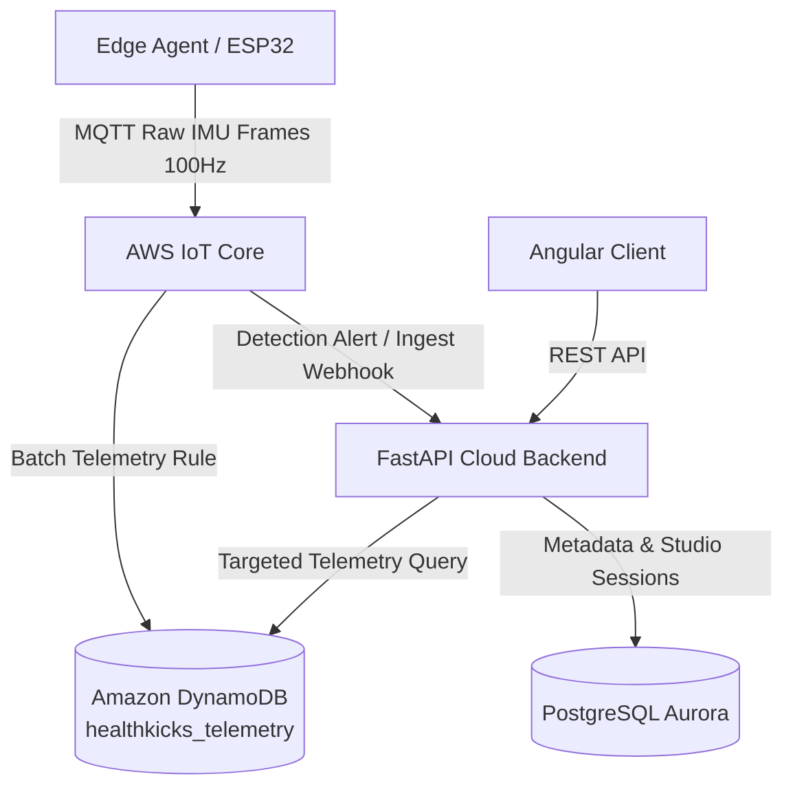
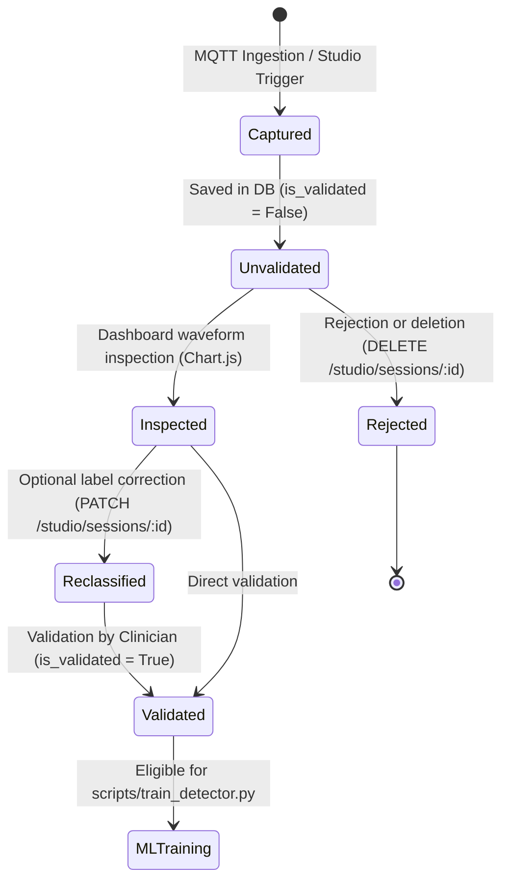

# Critical Architecture Invariants - HealthKicks Ecosystem

This document records the fundamental, non-negotiable architectural rules governing the **HealthKicks** ecosystem (`health-kicks`, `health-kicks-frontend`, `health-kicks-mobile`, `health-kicks-esp32-s3`).

---

## 1. Separation of Persistence Responsibilities (Dual-Store Pattern)

The ecosystem enforces a strict separation between relational transactional storage and high-frequency telemetry storage:



### A. Amazon DynamoDB (`healthkicks_telemetry`)

- **Scope**: High-frequency raw IMU frames (accelerometer $a_x, a_y, a_z$, gyroscope $g_x, g_y, g_z$), collected during Studio capture sessions or real-time streaming.
- **Rationale**: Prevents IOPS exhaustion and storage bloat of the relational database caused by bulky time series.
- **Keys & Indexes**: Partition Key `device_id`, temporal Sort Key or composite `session_id#timestamp`.
- **Retention**: Optimized for high-throughput batch ingestion and time-range scans for waveform charts (Chart.js) and ML training caches.

### B. PostgreSQL Aurora (`healthkicks`)

- **Scope**: Single relational source of truth (`StudioSession`, `Device`, `DeviceOwnership`, `ActivityEvent`, `HapticLog`, `User`, `IdempotencyKey`).
- **Rationale**: ACID referential integrity, identity management, relational joins, role-based access control (RBAC), and aggregated queries for the Dashboard (fall counts, event history, pagination).

---

## 2. Studio Session Validation Status (`is_validated`)

The lifecycle of a Studio recording follows a strict curation rule before any use in machine learning:



- **Default Value**: Every record in `studio_sessions` is initialized with `is_validated = False`.
- **ML Guard**: The local training and feature extraction pipeline ([`scripts/train_detector.py`](file:///f:/Programmation/healthkicks-ecosystem/health-kicks/scripts/train_detector.py)) **strictly** filters validated sessions:
  ```python
  db_sessions = db.query(StudioSession).filter(StudioSession.is_validated.is_(True)).all()
  ```
- **Objective**: Prevents model contamination from parasitic motions, truncated recordings, or incorrect labels.

---

## 3. Strict RBAC Security Policy (Role-Based Access Control)

Confidentiality of biomechanical and clinical data is enforced at the API layer:

### A. Clinician / Practitioner Role (`UserRole.USER`)

- **Session Isolation**: A clinician can list, inspect, modify, or delete **only their own sessions** (`StudioSession.user_id == user.id`).
- Unauthorized access to a third-party session immediately raises `HTTP 403 Forbidden`:
  ```python
  if not _is_admin(user) and sess.user_id != user.id:
      raise HTTPException(status_code=403, detail="Forbidden")
  ```
- Paginated endpoints automatically filter by the authenticated user's ID.

### B. Administrator Role (`UserRole.ADMIN`)

- Global visibility across all sessions in the ecosystem.
- Ability to filter by specific `user_id` or query across the entire fleet of devices.

---

## 4. ML Pipeline & Embedded C++ Transpilation (`health-kicks` ↔ `health-kicks-esp32-s3`)

Activity inference and fall detection run directly on the ESP32-S3 microcontroller using pure auto-generated C++:

- **Training Pipeline**: [`health-kicks/scripts/train_detector.py`](file:///f:/Programmation/healthkicks-ecosystem/health-kicks/scripts/train_detector.py) trains the Random Forest classifier (`scikit-learn==1.4.2`).
- **Embedded C++ Generation**: [`health-kicks/scripts/update_edge_model.py`](file:///f:/Programmation/healthkicks-ecosystem/health-kicks/scripts/update_edge_model.py) transpiles decision trees directly to C code with zero runtime dependencies (`health-kicks-esp32-s3/include/activity_detector_model.h`).
- **Absolute Feature Interoperability Rule**:
  - The 16 features computed during training (`compute_window_features`) and during embedded inference in `health-kicks-esp32-s3` (`activity_detector.cpp`) **must remain strictly identical** in order, mathematical formula, window size (5 seconds / ~94 samples at 19 Hz), and normalization.
  - Any modification to feature extraction requires re-generating and rebuilding the PlatformIO firmware.

---

## 5. Standardization of ISB Biomechanical Reference Frame (Wu & Cavanagh, 1995)

All capture, transport, and visualization subsystems follow the **International Society of Biomechanics (ISB)** standard:

- **Right-handed Cartesian frame attached to the foot/body**:
  - **$X$ Axis**: **Antero-posterior** (forward / direction of travel).
  - **$Y$ Axis**: **Medio-lateral** (oriented toward the left for whole body / medial aspect of right foot).
  - **$Z$ Axis**: **Longitudinal / Vertical** (oriented upward, measuring **$+1.0\,g$** at static rest under gravity).
- **Gyroscope Rules (Right-hand rule)**:
  - **$g_x$ (GX)**: Roll (Inversion / Eversion).
  - **$g_y$ (GY)**: Pitch (Dorsiflexion / Plantarflexion).
  - **$g_z$ (GZ)**: Yaw (Internal / External rotation).
- **Dedicated reference**: [`docs/architecture/biomechanical_reference_frame.md`](file:///f:/Programmation/healthkicks-ecosystem/docs/architecture/biomechanical_reference_frame.md).

---

## 6. Differential Odometry & Temporal Step Continuity on Mobile

Step counting and aggregation between the embedded hardware, the mobile app, and the cloud backend follow a strict differential algorithm:

### A. ESP32-S3 Hardware Constraints

1. **No Battery-Backed Calendar Clock (RTC)**: The embedded firmware lacks an RTC backup battery and autonomous internet access for NTP time synchronization.
2. **Monotonic Hardware Odometer**: The embedded counter (`StepDetector`) accumulates steps monotonically from initialization (`totalSteps`, `walkSteps`, `runSteps`, `stairsSteps`, `unclassifiedSteps`).
3. **Midnight & Reboot Behavior**:
   - The hardware odometer **never resets to zero at midnight**.
   - Upon battery depletion, hardware reboot, deep sleep, or OTA update, the hardware odometer **resets to zero**.

### B. Mobile SQLite State Table (`device_odometer_state`)

To ensure that steps from the previous day do not leak into the next, and that no steps are lost after a shoe reboot, the Flutter application maintains per-device odometer state:

```sql
CREATE TABLE IF NOT EXISTS device_odometer_state (
  device_id TEXT PRIMARY KEY,
  last_date TEXT NOT NULL,
  raw_walk INTEGER NOT NULL,
  raw_run INTEGER NOT NULL,
  raw_stairs INTEGER NOT NULL,
  raw_unclassified INTEGER NOT NULL,
  updated_at TEXT NOT NULL
);
```

### C. Differential Calculation Algorithm (`recordOdometerSnapshot`)

For every incoming BLE telemetry stream and for each activity category $k \in \{\text{walk, run, stairs, unclassified}\}$:

1. **Hardware Reboot Detection**:
   If the current raw reading $R_t$ is strictly less than the last stored reading $R_{t-1}$ ($R_t < R_{t-1}$), a microcontroller reboot occurred:
   $$\Delta_k = R_t$$
2. **Nominal Progression**:
   If $R_t \ge R_{t-1}$:
   $$\Delta_k = R_t - R_{t-1}$$
3. **Local Calendar Partitioning & Midnight Transition**:
   - The user's local calendar date (`YYYY-MM-DD`) dictates daily aggregation.
   - At midnight, the local date shifts to $D+1$:
     - Day $D$ totals remain frozen in `local_daily_steps`.
     - The increment $\Delta_k$ computed relative to the previous day's last reading is attributed to Day $D+1$.
     - The monotonic hardware odometer never contaminates subsequent days.
4. **Persistence & Cloud Synchronization**:
   - If $\Delta_k > 0$, the value is added to the daily total in `local_daily_steps` and marked `sync_status = 0` (pending synchronization).
   - `device_odometer_state` is updated with the new $R_t$ readings and the current UTC timestamp.
