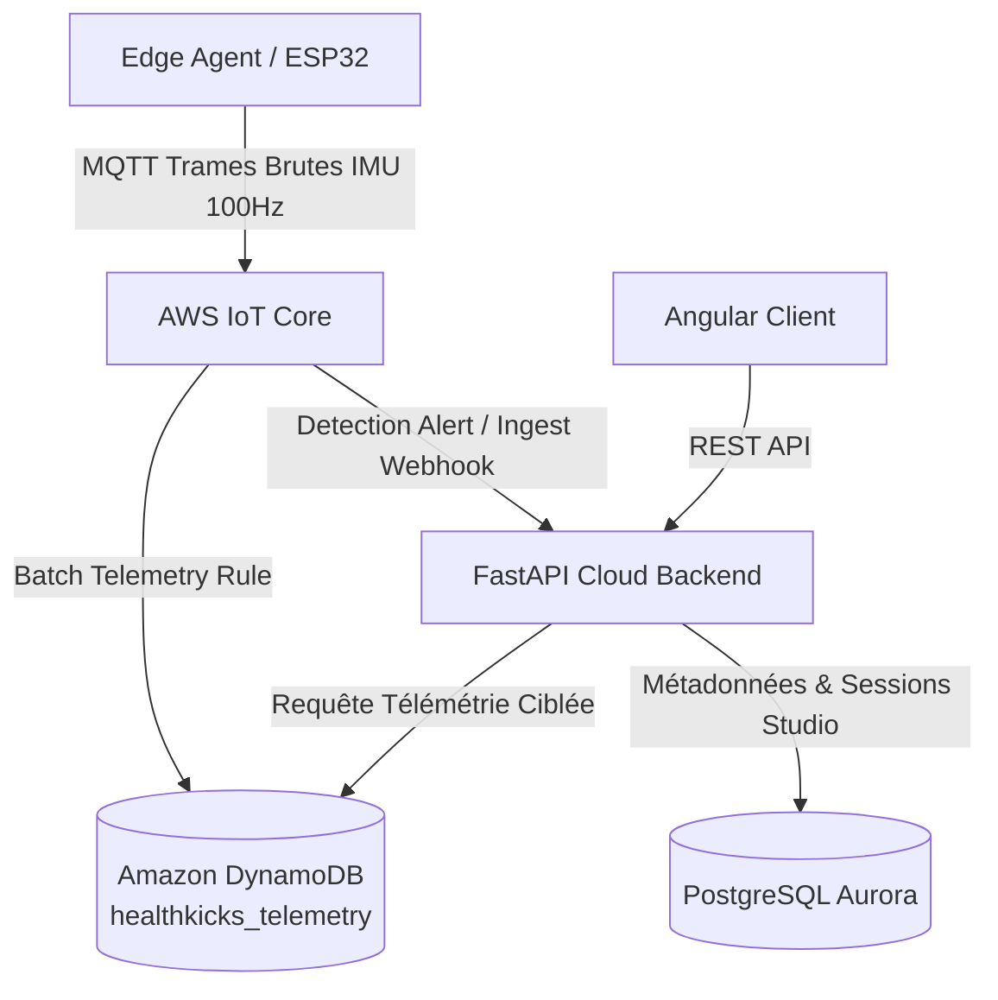
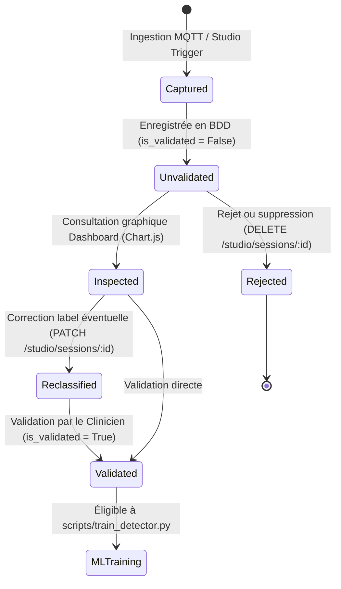

# Invariants d'Architecture Critiques - HealthKicks Ecosystem

Ce document consigne les règles fondamentales et non négociables régissant l'écosystème **HealthKicks** (`health-kicks`, `health-kicks-frontend`, `health-kicks-mobile`, `health-kicks-esp32-s3`).

---

## 1. Séparation des Responsabilités de Persistance (Dual-Store Pattern)

L'écosystème applique une stricte séparation entre le stockage relationnel transactionnel et le stockage télémétrique haute fréquence :



### A. Amazon DynamoDB (`healthkicks_telemetry`)

- **Périmètre** : Trames IMU brutes à haute fréquence (accéléromètre $a_x, a_y, a_z$, gyroscope $g_x, g_y, g_z$), collectées lors des sessions de capture Studio ou du streaming temps réel.
- **Raison d'être** : Éviter l'épuisement des IOPS et l'encombrement de la base relationnelle par des séries temporelles volumineuses.
- **Clés & Index** : Partition Key `device_id`, Sort Key temporelle ou composite `session_id#timestamp`.
- **Rétention** : Optimisé pour l'ingestion massive et la lecture par plage temporelle pour les graphiques de waveform (Chart.js) et le cache d'entraînement ML.

### B. PostgreSQL Aurora (`healthkicks`)

- **Périmètre** : Source unique de vérité relationnelle (`StudioSession`, `Device`, `DeviceOwnership`, `ActivityEvent`, `HapticLog`, `User`, `IdempotencyKey`).
- **Raison d'être** : Intégrité référentielle ACID, gestion des identités, jointures relationnelles, droits d'accès (RBAC) et requêtes agrégées pour le Dashboard (comptage de chutes, historique des événements, pagination).

---

## 2. Statut de Validation des Sessions Studio (`is_validated`)

Le cycle de vie d'une session de capture Studio suit une règle stricte de curation avant toute utilisation en intelligence artificielle :



- **Valeur par défaut** : Tout enregistrement dans la table `studio_sessions` possède `is_validated = False` à la création.
- **Garde-fou ML** : Le pipeline d'entraînement local et d'extraction de features ([`scripts/train_detector.py`](file:///f:/Programmation/healthkicks-ecosystem/health-kicks/scripts/train_detector.py)) filtre **exclusivement** les sessions validées :
  ```python
  db_sessions = db.query(StudioSession).filter(StudioSession.is_validated.is_(True)).all()
  ```
- **Objectif** : Empêcher la contamination du modèle d'inférence par des mouvements parasites, des captures avortées ou des étiquetages erronés.

---

## 3. Politique de Sécurité RBAC Stricte (Role-Based Access Control)

La confidentialité des données biomécaniques et cliniques est garantie par une séparation stricte au niveau de la couche API :

### A. Rôle Clinicien / Praticien (`UserRole.USER`)

- **Isolation des sessions** : Un clinicien ne peut lister, consulter, modifier ou supprimer **que ses propres sessions** (`StudioSession.user_id == user.id`).
- Tout accès à une session d'un tiers lève immédiatement un statut `HTTP 403 Forbidden` :
  ```python
  if not _is_admin(user) and sess.user_id != user.id:
      raise HTTPException(status_code=403, detail="Forbidden")
  ```
- Les listes paginées filtrent automatiquement sur l'identifiant de l'utilisateur authentifié.

### B. Rôle Administrateur (`UserRole.ADMIN`)

- Visibilité transverse et globale sur toutes les sessions de l'écosystème.
- Capacité de filtrer par `user_id` spécifique ou de requêter sur l'ensemble de la flotte de dispositifs.

---

## 4. Pipeline ML & Transpilation Embarquée C++ (`health-kicks` ↔ `health-kicks-esp32-s3`)

L'inférence d'activité et de détection de chute s'exécute directement sur le microcontrôleur ESP32-S3 via du code C++ pur auto-généré :

- **Pipeline d'entraînement** : [`health-kicks/scripts/train_detector.py`](file:///f:/Programmation/healthkicks-ecosystem/health-kicks/scripts/train_detector.py) entraîne le classifieur Random Forest (`scikit-learn==1.4.2`).
- **Génération C++ embarquée** : [`health-kicks/scripts/update_edge_model.py`](file:///f:/Programmation/healthkicks-ecosystem/health-kicks/scripts/update_edge_model.py) transpile les arbres de décision directement en code C sans dépendance runtime (`health-kicks-esp32-s3/include/activity_detector_model.h`).
- **Règle absolue d'interopérabilité des features** :
  - Les 16 features calculées à l'entraînement (`compute_window_features`) et à l'inférence embarquée dans `health-kicks-esp32-s3` (`activity_detector.cpp`) **doivent rester strictement identiques** en ordre, formule, fenêtre (5 secondes / ~94 échantillons à 19 Hz) et normalisation.
  - Tout changement dans le pipeline d'extraction de features impose une régénération et une compilation du firmware PlatformIO.

---

## 5. Standardisation du Repère Biomécanique ISB (Wu & Cavanagh, 1995)

L'ensemble des sous-systèmes de capture, de transport et de visualisation IMU respecte le standard international de la **Société Internationale de Biomécanique (ISB)** :

- **Repère cartésien direct (dextrorsum) lié au pied/corps** :
  - **Axe $X$** : **Antéro-postérieur** (orienté vers l'avant / sens de marche).
  - **Axe $Y$** : **Médio-latéral** (orienté vers la gauche pour le corps complet / face interne du pied droit).
  - **Axe $Z$** : **Longitudinal / Vertical** (orienté vers le haut, mesure **$+1.0\,g$** au repos statique sous gravité terrestre).
- **Règles gyroscopiques (Règle de la main droite)** :
  - **$g_x$ (GX)** : Roulis (Inversion / Éversion).
  - **$g_y$ (GY)** : Tangage (Flexion dorsale / plantaire).
  - **$g_z$ (GZ)** : Lacet (Rotation interne / externe).
- **Référence documentaire dédiée** : [`docs/architecture/biomechanical_reference_frame.md`](file:///f:/Programmation/healthkicks-ecosystem/docs/architecture/biomechanical_reference_frame.md).

---

## 6. Odomètre Différentiel et Continuité Temporelle des Pas Mobile

Le comptage et la consolidation des pas entre le matériel embarqué, l'application mobile et le backend cloud respectent un algorithme différentiel strict :

### A. Contrainte Matérielle de l'ESP32-S3

1. **Absence d'horloge calendaire sauvegardée (RTC)** : Le firmware embarqué ne dispose ni de pile de sauvegarde RTC ni d'accès Internet autonome pour synchroniser l'heure NTP.
2. **Odomètre monotone matériel** : Le compteur embarqué (`StepDetector`) accumule les pas de manière strictement croissante depuis son initialisation (`totalSteps`, `walkSteps`, `runSteps`, `stairsSteps`, `unclassifiedSteps`).
3. **Comportement à minuit et au reboot** :
   - L'odomètre matériel **ne se remet jamais à zéro à minuit**.
   - En cas de coupure batterie, reboot matériel, mise en veille profonde ou mise à jour OTA, l'odomètre matériel **retombe à zéro**.

### B. Table d'État SQLite Mobile (`device_odometer_state`)

Pour garantir qu'aucun pas de la veille ne vienne polluer le compteur du jour suivant, et qu'aucun pas ne soit perdu après un redémarrage de la chaussure, l'application Flutter maintient un état odométrique par dispositif :

```sql
CREATE TABLE IF NOT EXISTS device_odometer_state (
  device_id TEXT PRIMARY KEY,
  last_date TEXT NOT NULL,
  raw_walk INTEGER NOT NULL,
  raw_run INTEGER NOT NULL,
  raw_stairs INTEGER NOT NULL,
  raw_unclassified INTEGER NOT NULL,
  updated_at TEXT NOT NULL
);
```

### C. Algorithme de Calcul Différentiel (`recordOdometerSnapshot`)

Pour chaque flux de télémétrie BLE reçu et pour chaque catégorie d'activité $k \in \{\text{walk, run, stairs, unclassified}\}$ :

1. **Détection de Redémarrage Matériel** :
   Si la lecture brute courante $R_t$ est inférieure à la dernière lecture mémorisée $R_{t-1}$ ($R_t < R_{t-1}$), un reboot du microcontrôleur est avéré :
   $$\Delta_k = R_t$$
2. **Progression Nominale** :
   Si $R_t \ge R_{t-1}$ :
   $$\Delta_k = R_t - R_{t-1}$$
3. **Partitionnement Calendaire Local & Transition de Minuit** :
   - La date calendaire locale de l'utilisateur (`YYYY-MM-DD`) régit l'agrégation quotidienne.
   - Au franchissement de minuit, la date locale bascule à $J+1$ :
     - Les totaux du jour $J$ restent figés dans `local_daily_steps`.
     - L'incrément $\Delta_k$ calculé par rapport à la dernière lecture de la veille est imputé au jour $J+1$.
     - L'odomètre matériel continu ne "bave" ainsi jamais sur les jours suivants.
4. **Persistance et Synchronisation Cloud** :
   - Si $\Delta_k > 0$, la valeur est ajoutée au cumul de la journée dans `local_daily_steps` et l'enregistrement est marqué `sync_status = 0` (à synchroniser).
   - `device_odometer_state` est mis à jour avec les nouvelles valeurs $R_t$ et l'horodatage UTC courant.
