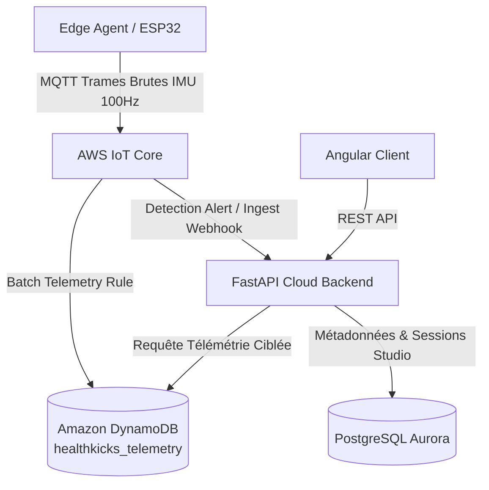
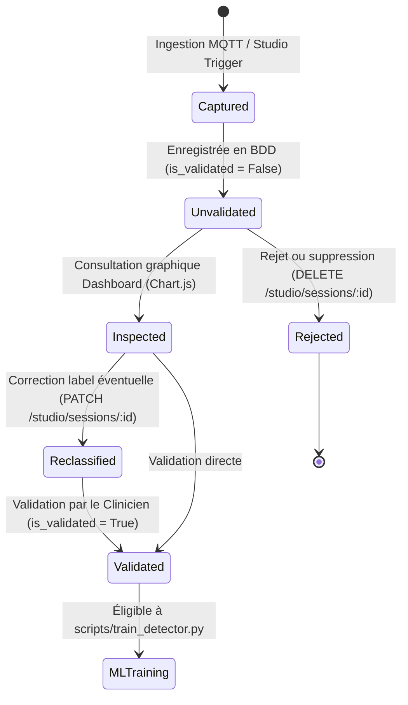

# Invariants d'Architecture Critiques - HealthKicks Ecosystem

Ce document consigne les règles fondamentales et non négociables régissant l'écosystème **HealthKicks** (`health-kicks`, `health-kicks-frontend`, `health-kicks-edge-script`).

---

## 1. Séparation des Responsabilités de Persistance (Dual-Store Pattern)

L'écosystème applique une stricte séparation entre le stockage relationnel transactionnel et le stockage télémétrique haute fréquence :



### A. Amazon DynamoDB (`healthkicks_telemetry`)
- **Périmètre** : Trames IMU brutes à haute fréquence (accéléromètre $a_x, a_y, a_z$, gyroscope $g_x, g_y, g_z$), collectées lors des sessions de capture Studio ou du streaming temps réel.
- **Raison d'être** : Éviter l'épuisement des IOPS et l'encombrement de la base relationnelle par des séries temporelles volumineuses.
- **Clés & Index** : Partition Key `device_id`, Sort Key temporelle ou composite `session_id#timestamp`.
- **Rétention** : Optimisé pour l'ingestion massive et la lecture par plage temporelle pour les graphiques de waveform (Chart.js) et le cache d'entraînement ML.

### B. PostgreSQL Aurora (`healthkicks`)
- **Périmètre** : Source unique de vérité relationnelle (`StudioSession`, `Device`, `DeviceOwnership`, `ActivityEvent`, `HapticLog`, `User`, `IdempotencyKey`).
- **Raison d'être** : Intégrité référentielle ACID, gestion des identités, jointures relationnelles, droits d'accès (RBAC) et requêtes agrégées pour le Dashboard (comptage de chutes, historique des événements, pagination).

---

## 2. Statut de Validation des Sessions Studio (`is_validated`)

Le cycle de vie d'une session de capture Studio suit une règle stricte de curation avant toute utilisation en intelligence artificielle :



- **Valeur par défaut** : Tout enregistrement dans la table `studio_sessions` possède `is_validated = False` à la création.
- **Garde-fou ML** : Le pipeline d'entraînement local et d'extraction de features ([`scripts/train_detector.py`](file:///f:/Programmation/healthkicks-ecosystem/health-kicks/scripts/train_detector.py)) filtre **exclusivement** les sessions validées :
  ```python
  db_sessions = db.query(StudioSession).filter(StudioSession.is_validated.is_(True)).all()
  ```
- **Objectif** : Empêcher la contamination du modèle d'inférence par des mouvements parasites, des captures avortées ou des étiquetages erronés.

---

## 3. Politique de Sécurité RBAC Stricte (Role-Based Access Control)

La confidentialité des données biomécaniques et cliniques est garantie par une séparation stricte au niveau de la couche API :

### A. Rôle Clinicien / Praticien (`UserRole.USER`)
- **Isolation des sessions** : Un clinicien ne peut lister, consulter, modifier ou supprimer **que ses propres sessions** (`StudioSession.user_id == user.id`).
- Tout accès à une session d'un tiers lève immédiatement un statut `HTTP 403 Forbidden` :
  ```python
  if not _is_admin(user) and sess.user_id != user.id:
      raise HTTPException(status_code=403, detail="Forbidden")
  ```
- Les listes paginées filtrent automatiquement sur l'identifiant de l'utilisateur authentifié.

### B. Rôle Administrateur (`UserRole.ADMIN`)
- Visibilité transverse et globale sur toutes les sessions de l'écosystème.
- Capacité de filtrer par `user_id` spécifique ou de requêter sur l'ensemble de la flotte de dispositifs.

---

## 4. Alignement Strict de Version ML sur le Runtime Edge (`scikit-learn==1.4.2`)

L'inférence s'exécute directement sur l'embarqué (Raspberry Pi / microcontrôleur) en chargeant un artefact sérialisé au format `joblib` :

- **Version cible commune** : `scikit-learn==1.4.2`
- **Dépendances associées** : `joblib>=1.3.0,<2.0`, `numpy>=1.26.0,<2.0`
- **Règle absolue d'interopérabilité** :
  * Le pipeline d'entraînement ([`health-kicks`](file:///f:/Programmation/healthkicks-ecosystem/health-kicks)) et le démon d'inférence temps réel ([`health-kicks-edge-script`](file:///f:/Programmation/healthkicks-ecosystem/health-kicks-edge-script)) **doivent utiliser la même version mineure et majeure de scikit-learn**.
  * Toute divergence de version brise la désérialisation pickle de `joblib` sur l'agent Edge (`InconsistentVersionWarning` ou crash lors du `predict_proba`).
  * Les 16 features calculées à l'entraînement ([`compute_window_features`](file:///f:/Programmation/healthkicks-ecosystem/health-kicks/scripts/train_detector.py)) et à l'inférence ([`extract_features_from_readings`](file:///f:/Programmation/healthkicks-ecosystem/health-kicks-edge-script/src/healthkicks_edge/inference/features.py)) doivent rester strictement identiques en ordre, formule et normalisation.

