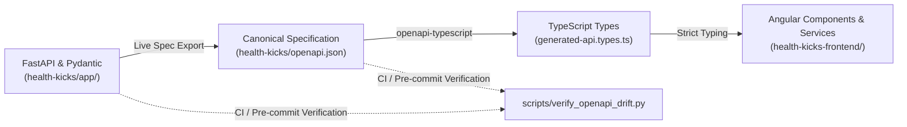
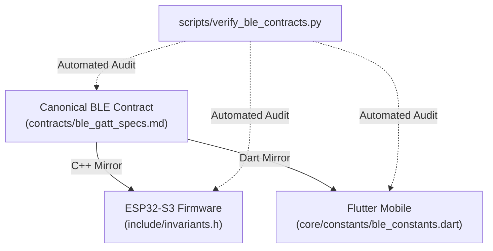

# Spec-First Synchronization & Contract Generation Guide

This guide describes the **Spec-First** operational protocol enforced across the entire **HealthKicks** ecosystem. It details the contract lifecycle, from formal definition to typed consumption in client and embedded applications.

---

## 1. Philosophy & Guiding Principles

In a distributed architecture combining **C++ Firmware (ESP32-S3)**, **Python Edge AI**, **FastAPI Backend**, **Flutter Mobile**, and **Angular 22 Frontend**, specification drift (_API / schema drift_) is the primary risk of system instability.

### Core Principles

1. **Single Canonical Contract**: Each communication interface (REST, BLE GATT, MQTT IoT Core) has a single source of truth, version-controlled in the repository.
2. **Deterministic Generation**: Client types are never rewritten manually; they are generated automatically from validated specifications.
3. **Automated CI Enforcement**: Any commit introducing divergence between source code and its specification is rejected by pre-commit hooks and GitHub Actions.

---

## 2. REST & OpenAPI Pipeline (Backend ↔ Frontend)



### Step 1: Modifying Backend Schemas or Endpoints

Exchange models are declared under [`health-kicks/app/schemas/`](file:///f:/Programmation/healthkicks-ecosystem/health-kicks/app/schemas) using Pydantic v2 (`StrictModel`). FastAPI routes under [`health-kicks/app/api/v1/`](file:///f:/Programmation/healthkicks-ecosystem/health-kicks/app/api/v1) explicitly declare `response_model`, HTTP status codes, and query parameters.

### Step 2: Canonical Specification Export

Whenever a schema or route signature changes, the OpenAPI export must be refreshed:

```bash
# From monorepo root:
python scripts/verify_openapi_drift.py --write
```

This command runs FastAPI in memory via `uv`, extracts `app.openapi()`, and formats [`health-kicks/openapi.json`](file:///f:/Programmation/healthkicks-ecosystem/health-kicks/openapi.json) deterministically (`indent=2, sort_keys=True`).

### Step 3: Frontend TypeScript Type Generation

The Angular frontend uses `openapi-typescript` to generate comprehensive TypeScript definitions:

```bash
# In health-kicks-frontend/ directory:
pnpm run generate:api
```

The generated file is located at [`health-kicks-frontend/src/app/models/generated-api.types.ts`](file:///f:/Programmation/healthkicks-ecosystem/health-kicks-frontend/src/app/models/generated-api.types.ts).

### Step 4: Consumption in Angular Models and Components

Angular models consume generated schemas directly rather than maintaining manual interfaces:

```typescript
import { components } from "./generated-api.types";

export type StudioSessionSummary =
  components["schemas"]["StudioSessionSummary"];
export type PaginatedSessionsResponse =
  components["schemas"]["PaginatedSessionsResponse"];
export type StudioAuthorSummary = components["schemas"]["StudioAuthorSummary"];
```

Any field renaming or deletion backend-side causes an immediate TypeScript compilation error (`TS2322` / `TS2339`) during `pnpm build` or `pnpm test:ci`.

### Step 5: Automated Drift Control (CI)

[`scripts/verify_openapi_drift.py`](file:///f:/Programmation/healthkicks-ecosystem/scripts/verify_openapi_drift.py) verifies that:

1. `health-kicks/openapi.json` matches the live FastAPI schema exactly.
2. All `paths` and `schemas` from the specification exist in `generated-api.types.ts`.

---

## 3. BLE GATT Pipeline (Firmware ↔ Mobile)



### BLE GATT Contract Rules

1. **Source of Truth**: [`contracts/ble_gatt_specs.md`](file:///f:/Programmation/healthkicks-ecosystem/contracts/ble_gatt_specs.md) defines all service UUIDs (`0x0001` to `0x0010`), characteristics (`0x0002` to `0x0012`), activity state codes (`0x00` Idle, `0x01` Walk, `0x02` Run, `0x10`-`0x12` Falls), and binary formats.
2. **Mandatory Alignment**:
   - C++: [`health-kicks-esp32-s3/include/invariants.h`](file:///f:/Programmation/healthkicks-ecosystem/health-kicks-esp32-s3/include/invariants.h)
   - Dart: [`health-kicks-mobile/lib/core/constants/ble_constants.dart`](file:///f:/Programmation/healthkicks-ecosystem/health-kicks-mobile/lib/core/constants/ble_constants.dart)
3. **Automated Verification**: [`scripts/verify_ble_contracts.py`](file:///f:/Programmation/healthkicks-ecosystem/scripts/verify_ble_contracts.py) runs in pre-commit and CI to certify strict constant equivalence.

---

## 4. AWS IoT Core & MQTT Telemetry Pipeline

1. **Topic Hierarchy**:
   - Haptic commands: `healthkicks/v1/{device_id}/haptic/command`
   - Studio recording start: `healthkicks/v1/{device_id}/studio/start`
   - Presence & Status: `healthkicks/v1/{device_id}/presence`
   - IMU Telemetry / Steps: `healthkicks/v1/{device_id}/telemetry`
2. **AWS STS Least Privilege**:
   - Mobile credentials are negotiated via [`app/services/aws_sts_service.py`](file:///f:/Programmation/healthkicks-ecosystem/health-kicks/app/services/aws_sts_service.py).
   - AWS IoT session policies strictly restrict `iot:Connect` to client ID pattern `healthkicks-mobile-{user_id}-*` and `iot:Subscribe` to authorized user topics.

---

## 5. Developer Command Reference

| Action                            | Command                                             | Scope    |
| :-------------------------------- | :-------------------------------------------------- | :------- |
| **Verify BLE contracts**          | `python scripts/verify_ble_contracts.py`            | Monorepo |
| **Verify OpenAPI & Type drift**   | `python scripts/verify_openapi_drift.py`            | Monorepo |
| **Export refreshed OpenAPI spec** | `python scripts/verify_openapi_drift.py --write`    | Backend  |
| **Regenerate TypeScript types**   | `pnpm --dir health-kicks-frontend run generate:api` | Frontend |
| **Run all Pre-commit checks**     | `uv tool run pre-commit run --all-files`            | Monorepo |
