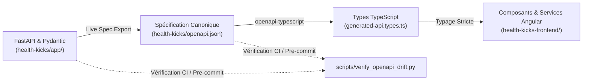
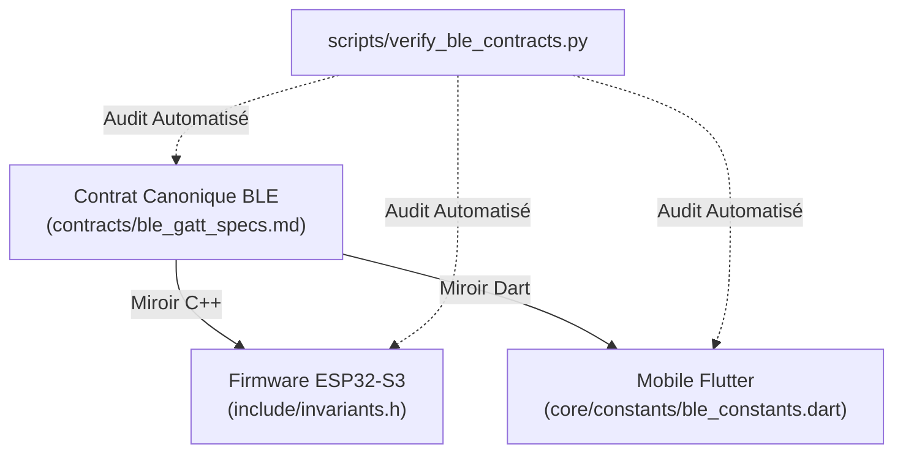

# Guide de Synchronisation Spec-First & Génération de Contrats

Ce guide décrit le protocole opérationnel **Spec-First** appliqué à l'ensemble de l'écosystème **HealthKicks**. Il détaille le cycle de vie des contrats, de leur définition formelle à leur consommation typée dans les applications clientes et embarquées.

---

## 1. Philosophie & Principes Directeurs

Dans une architecture distribuée combinant **Firmware C++ (ESP32-S3)**, **Edge AI Python**, **Backend FastAPI**, **Mobile Flutter** et **Frontend Angular 21**, la dérive de spécification (_API / schema drift_) constitue le risque majeur d'instabilité.

### Les 3 Principes Fondamentaux

1. **Contrat Unique et Canonique** : Chaque interface d'échange (REST, BLE GATT, MQTT IoT Core) dispose d'une source de vérité unique, versionnée dans le dépôt.
2. **Génération Déterministe** : Les types clients ne sont jamais réécrits manuellement ; ils sont générés automatiquement depuis la spécification validée.
3. **Contrôle Automatique en CI** : Tout commit introduisant une divergence entre le code et sa spécification est automatiquement rejeté par les hooks de pre-commit et le pipeline GitHub Actions.

---

## 2. Pipeline REST & OpenAPI (Backend ↔ Frontend)



### Étape 1 : Modification des Schémas ou Endpoints Backend

Les modèles d'échange sont déclarés sous [`health-kicks/app/schemas/`](file:///f:/Programmation/healthkicks-ecosystem/health-kicks/app/schemas) à l'aide de Pydantic v2 (`StrictModel`). Les routes FastAPI sous [`health-kicks/app/api/v1/`](file:///f:/Programmation/healthkicks-ecosystem/health-kicks/app/api/v1) déclarent explicitement `response_model`, les codes HTTP et les paramètres de requête.

### Étape 2 : Export de la Spécification Canonique

Dès qu'un schéma ou une signature de route est modifié, l'export OpenAPI doit être mis à jour :

```bash
# Depuis la racine du monorepo :
python scripts/verify_openapi_drift.py --write
```

Cette commande exécute l'application FastAPI en mémoire via `uv`, extrait `app.openapi()` et formate le fichier [`health-kicks/openapi.json`](file:///f:/Programmation/healthkicks-ecosystem/health-kicks/openapi.json) de manière déterministe (`indent=2, sort_keys=True`).

### Étape 3 : Génération des Types TypeScript Frontend

Le frontend Angular 21 utilise `openapi-typescript` pour générer un fichier de typage TypeScript complet :

```bash
# Dans le dossier health-kicks-frontend/ :
pnpm run generate:api
```

Le fichier généré est situé dans [`health-kicks-frontend/src/app/models/generated-api.types.ts`](file:///f:/Programmation/healthkicks-ecosystem/health-kicks-frontend/src/app/models/generated-api.types.ts).

### Étape 4 : Consommation dans les Modèles et Composants Angular

Les modèles Angular consomment directement les schémas générés au lieu de redéclarer des interfaces manuelles :

```typescript
import { components } from "./generated-api.types";

export type StudioSessionSummary =
  components["schemas"]["StudioSessionSummary"];
export type PaginatedSessionsResponse =
  components["schemas"]["PaginatedSessionsResponse"];
export type StudioAuthorSummary = components["schemas"]["StudioAuthorSummary"];
```

Tout renommage ou suppression de champ côté backend provoque une erreur de compilation TypeScript immédiate (`TS2322` / `TS2339`) lors du `pnpm build` ou `pnpm test:ci`.

### Étape 5 : Contrôle Automatique de Dérive (CI)

Le script [`scripts/verify_openapi_drift.py`](file:///f:/Programmation/healthkicks-ecosystem/scripts/verify_openapi_drift.py) s'assure que :

1. Le fichier `health-kicks/openapi.json` correspond exactement au schéma FastAPI en direct.
2. Tous les chemins (`paths`) et modèles (`schemas`) de la spécification sont présents dans `generated-api.types.ts`.

---

## 3. Pipeline BLE GATT (Firmware ↔ Mobile)



### Règles du Contrat BLE GATT

1. **Source de Vérité** : [`contracts/ble_gatt_specs.md`](file:///f:/Programmation/healthkicks-ecosystem/contracts/ble_gatt_specs.md) définit tous les UUIDs de services (`0x0001` à `0x0010`), caractéristiques (`0x0002` à `0x0012`), codes d'état d'activité (`0x00` Idle, `0x01` Walk, `0x02` Run, `0x10`-`0x12` Falls) et formats binaires.
2. **Alignement Obligatoire** :
   - C++ : [`health-kicks-esp32-s3/include/invariants.h`](file:///f:/Programmation/healthkicks-ecosystem/health-kicks-esp32-s3/include/invariants.h)
   - Dart : [`health-kicks-mobile/lib/core/constants/ble_constants.dart`](file:///f:/Programmation/healthkicks-ecosystem/health-kicks-mobile/lib/core/constants/ble_constants.dart)
3. **Vérification Automatique** : Le script [`scripts/verify_ble_contracts.py`](file:///f:/Programmation/healthkicks-ecosystem/scripts/verify_ble_contracts.py) s'exécute en pre-commit et en CI pour certifier l'égalité stricte des constantes.

---

## 4. Pipeline AWS IoT Core & Télémétrie MQTT

1. **Hiérarchie des Topics** :
   - Commandes haptiques : `healthkicks/v1/{device_id}/haptic/command`
   - Ordre d'enregistrement Studio : `healthkicks/v1/{device_id}/studio/start`
   - Présence & Statut : `healthkicks/v1/{device_id}/presence`
   - Télémétrie IMU / Pas : `healthkicks/v1/{device_id}/telemetry`
2. **Moindre Privilège AWS STS** :
   - Les identifiants mobiles sont négociés via [`app/services/aws_sts_service.py`](file:///f:/Programmation/healthkicks-ecosystem/health-kicks/app/services/aws_sts_service.py).
   - Les politiques de session AWS IoT restreignent strictement `iot:Connect` au format de client ID `healthkicks-mobile-{user_id}-*` et `iot:Subscribe` aux topics autorisés pour l'utilisateur.

---

## 5. Synthèse des Commandes Développeur

| Action                                    | Commande                                            | Portée   |
| :---------------------------------------- | :-------------------------------------------------- | :------- |
| **Vérifier les contrats BLE**             | `python scripts/verify_ble_contracts.py`            | Monorepo |
| **Vérifier la dérive OpenAPI & Types**    | `python scripts/verify_openapi_drift.py`            | Monorepo |
| **Exporter l'OpenAPI mis à jour**         | `python scripts/verify_openapi_drift.py --write`    | Backend  |
| **Régénérer les types TypeScript**        | `pnpm --dir health-kicks-frontend run generate:api` | Frontend |
| **Exécuter les vérifications Pre-commit** | `uv tool run pre-commit run --all-files`            | Monorepo |
