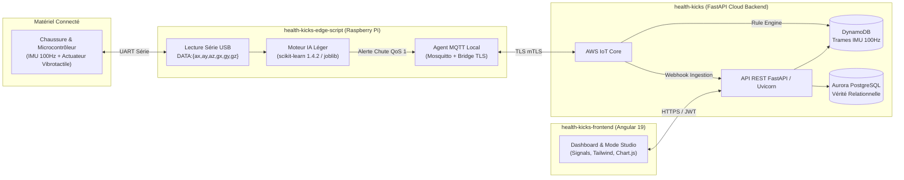

# Vue d'Ensemble du Système HealthKicks

L'écosystème **HealthKicks** est une solution complète de prévention des chutes et de stimulation plantaire connectée. Il combine une chaussure instrumentée (capteurs IMU + actionneurs haptiques), un agent d'inférence embarqué Edge AI, un backend cloud FastAPI élastique et un tableau de bord web médical sous Angular 19.

---

## 1. Cartographie des Composants

---

## 2. Rôles et Responsabilités des Sous-Projets

### A. Backend (`health-kicks/`)
- **Technologies** : Python 3.11, FastAPI, SQLAlchemy 2.0, Alembic, PostgreSQL 16 / Aurora, DynamoDB (Boto3), Docker.
- **Responsabilités** :
  * Point d'entrée sécurisé pour les clients web et les webhooks d'ingestion AWS IoT Core.
  * Gestion du cycle de vie des dispositifs, authentification SSO (Google & Azure Entra ID), tokens JWT.
  * Déclenchement des commandes haptiques distantes vers AWS IoT (`healthkicks/v1/{device_id}/commands/haptic`).
  * Persistance et pagination des sessions Studio, des logs haptiques et des événements de détection.
  * Entraînement local et benchmarking des classifieurs d'activité (`scripts/train_detector.py`).

### B. Frontend (`health-kicks-frontend/`)
- **Technologies** : Angular 19, TypeScript, Tailwind CSS, Angular Material, Chart.js, pnpm.
- **Responsabilités** :
  * Interface clinicien/utilisateur pour le suivi de la marche et des alertes de chute.
  * Gestionnaire de dispositifs (appairage, statut de connexion en ligne/hors-ligne via LWT).
  * Déclencheur haptique temps réel (vibrations réglables 0–255, 50–10000 ms).
  * **Module Studio** : Enregistrement de sessions calibrées avec compte à rebours sensoriel, visualisation en ondelettes des accélérations et vitesses angulaires, requalification et validation des étiquettes cliniques (`is_validated`).

### C. Inférence Edge (`health-kicks-edge-script/`)
- **Technologies** : Python 3.11, scikit-learn 1.4.2, NumPy, Pydantic, Paho-MQTT, PySerial, Debian packaging.
- **Responsabilités** :
  * Acquisition continue du flux série Arduino à haute fréquence.
  * Fenêtrage glissant (250 ms) et extraction de 16 features physiques invariantes par rotation.
  * Détection locale immédiate de chute (latence < 50 ms) avec déclenchement d'impulsion haptique d'urgence autonome sans dépendance réseau.
  * Publication d'alertes détection debouncées (cooldown de 5 secondes).
  * Mode Studio embarqué : compte à rebours haptique rythmé, bufferisation isolée et émission de paquets compressés vers le Cloud.

---

## 3. Référentiel Biomécanique ISB

L'écosystème aligne l'intégralité de ses flux IMU ($a_x, a_y, a_z$ et $g_x, g_y, g_z$) sur les recommandations de l'**International Society of Biomechanics** (*Wu & Cavanagh, 1995*) :
- **Axe X** : Antéro-postérieur (Avant / Propulsion).
- **Axe Y** : Médio-latéral (Gauche / Appuis).
- **Axe Z** : Longitudinal / Vertical (Haut / $+1.0\,g$ statique).
- Pour plus de détails, consulter [`docs/architecture/biomechanical_reference_frame.md`](file:///f:/Programmation/healthkicks-ecosystem/docs/architecture/biomechanical_reference_frame.md).

