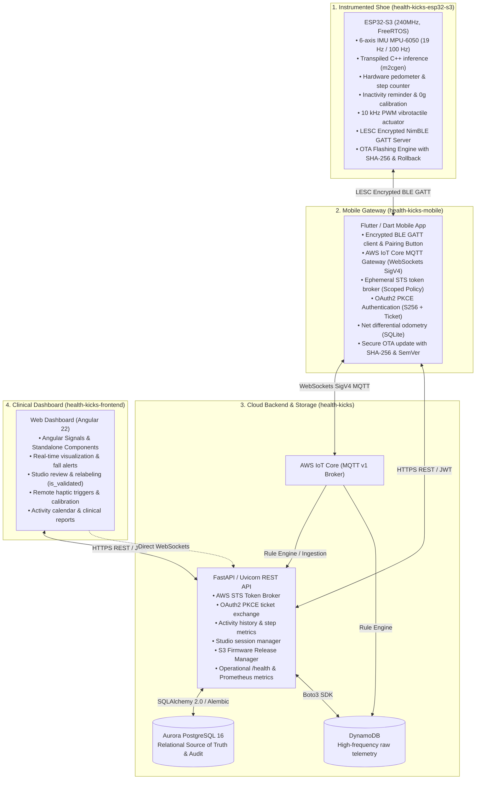
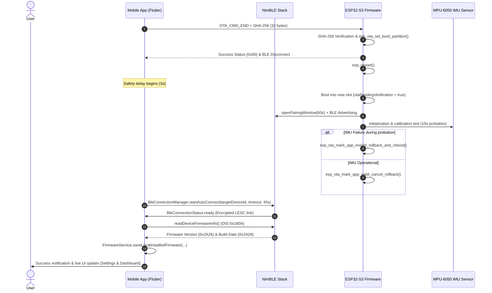

# HealthKicks System Overview

The **HealthKicks** ecosystem is a connected real-time solution for fall prevention, biomechanical gait analysis, and plantar haptic stimulation. It combines edge intelligence at the sensor source (_Edge AI_ on ESP32-S3 microcontroller or Raspberry Pi), a Flutter/Dart mobile companion gateway, an elastic FastAPI cloud API, and a reactive Angular 22 clinical dashboard.

---

## 1. Global Component Architecture

---

## 2. Roles & Subproject Responsibilities

### A. Embedded Firmware (`health-kicks-esp32-s3/`)

- **Technologies**: ESP32-S3-DevKitC-1 (Xtensa dual-core 240 MHz), Framework Arduino-ESP32 / PlatformIO, FreeRTOS, NimBLE-Arduino 1.4.3, MPU-6050 I2C (400 kHz).
- **Responsibilities**:
  - **Biomechanical Acquisition**: Sampling at 19 Hz (~94 samples over 5s rolling window) aligned with the ISB reference frame.
  - **On-Chip Edge AI Classifier**: Pure C++ inference without external runtime (transpiled via `m2cgen`), multiclass fall detection (`fall_forward`, `fall_backward`, `fall_lateral`), and biomechanical guard preventing seated false positives (`isSittingDownNominalPosture`).
  - **Secure BLE GATT Server**:
    - Pedometer Service (0006): Monotonic hardware odometer (walk, run, stairs, unclassified).
    - Haptic Service (0003): Vibration patterns (0–255, 50–10000 ms), inactivity reminder configuration (Opcode 0x06), zero calibration (Opcode 0x05).
    - Studio Service (0004 & 0005): Calibrated raw telemetry data bursts.
    - Device Information Service (0x180A): Firmware version string (0x2A26) and UTC build timestamp (0x2A28).
    - OTA Service (0010, 0011, 0012): Over-the-air firmware flashing.
  - **Security & Resilience**:
    - LESC (_LE Secure Connections_) Just Works + Bonding link encryption.
    - Physical 60-second pairing window triggered by hardware push-button (`GPIO 14`).
    - OTA integrity checks: ESP-IDF magic byte `0xE9`, mandatory 32-byte SHA-256 cryptographic digest.
    - 15-second probation window on reboot with automatic rollback on sensor failure.

### B. Mobile Companion Application (`health-kicks-mobile/`)

- **Technologies**: Flutter 3.x, Dart 3.x, Flutter Blue Plus, MQTT Client, SQLite (sqflite), SharedPreferences.
- **Responsibilities**:
  - **Field Gateway BLE $\leftrightarrow$ Cloud**: Maintains Bluetooth connection with shoe, automatic reconnection post-OTA reboot.
  - **Identity Broker & AWS STS**: Temporary AWS token negotiation (15 minutes) with scoped session policy based on `clean_user_id`.
  - **SigV4 MQTT Gateway**: Real-time connection to `healthkicks/v1/{device_id}/*` via AWS SigV4 signed WebSockets.
  - **SQLite Differential Odometry**: Computes net daily step deltas from the monotonic hardware odometer to prevent step leakage across calendar days or after reboot.
  - **Secure OTA Updates**: Downloads from S3/Cloud, verifies SHA-256 hash, compares Semantic Versioning and handles UTC time skew.

### C. Cloud Backend (`health-kicks/`)

- **Technologies**: Python 3.11, FastAPI, SQLAlchemy 2.0, PostgreSQL 16 (Aurora), DynamoDB, AWS IoT Core, Alembic, Docker.
- **Responsibilities**:
  - **Identity Management & SSO**: Google and Azure Entra ID OAuth2 authentication with strict support for **RFC 7636 PKCE (S256)** and one-time ephemeral ticket token exchange (`POST /api/v1/auth/token/exchange`).
  - **Access Control & RBAC**: Roles `user`, `clinician`, `admin`. Device ownership verification (`verify_device_ownership`).
  - **AWS IoT STS Broker**: Generates session policies strictly restricted to authenticated user client IDs (`client/healthkicks-mobile-{userId}-*`).
  - **Observability & Health**: Endpoints `/health` (with SQL latency and connection pool diagnostics), `/health/liveness`, `/health/readiness`, and `/metrics`.
  - **ML Pipeline & Transpilation**: Scripts `train_detector.py` and `update_edge_model.py` for retraining activity models and generating C++ headers for ESP32.

### D. Web Frontend (`health-kicks-frontend/`)

- **Technologies**: Angular 22 (Standalone Components, Signals), Tailwind CSS 4, Angular Material, Chart.js, pnpm.
- **Responsibilities**:
  - **Clinical Supervision**: Patient monitoring, live fall detection, gait cadence analysis.
  - **Studio & Annotation Module**: Calibrated session recording with visual/tactile countdown, 3-axis signal charts ($a_x, a_y, a_z, g_x, g_y, g_z$), clinical relabeling, and validation (`is_validated`).
  - **Remote Hardware Control**: Haptic stimulation trigger and inactivity threshold configuration.

---

## 3. Security Matrix & Protocols

| Layer | Protocol | Encryption / Integrity | Protection Mechanism |
| :--- | :--- | :--- | :--- |
| **Footwear BLE** | BLE 5.0 GATT | LESC (_Just Works_ + Bonding) | 60s physical pairing window (`GPIO 14`) + unencrypted write rejection |
| **Firmware OTA** | BLE OTA Service | SHA-256 + Magic Header `0xE9` | Validation of magic byte at offset 0, mandatory SHA-256 check, automatic rollback on IMU failure |
| **Mobile $\rightarrow$ Cloud REST** | HTTPS (TLS 1.3) | JWT Bearer (HS256 $\ge 256$ bits) | OAuth2 PKCE S256 + Ephemeral ticket (no tokens in GET URLs) |
| **Mobile $\rightarrow$ AWS IoT** | MQTT over WebSockets | AWS SigV4 (HMAC-SHA256) | Temporary AWS STS (15 min), Client ID strictly scoped per user |
| **Web $\rightarrow$ Cloud REST** | HTTPS (TLS 1.3) | JWT Bearer + Strict-Transport-Security | CSP, HSTS, X-Frame-Options DENY, Rate Limiting per IP/Token |
| **Sensitive Data** | PostgreSQL & DynamoDB | Encryption at rest (AES-256 KMS) | Deterministic pseudonymization via HMAC-SHA256 (`HEALTHKICKS_PSEUDONYMIZATION_PEPPER`) |

---

## 4. ISB Biomechanical Reference Frame

All components adhere to the **International Society of Biomechanics** standard (_Wu & Cavanagh, 1995_):

- **X Axis (Antero-posterior)**: Positive forward (stride propulsion).
- **Y Axis (Medio-lateral)**: Positive toward the shoe's left.
- **Z Axis (Longitudinal / Vertical)**: Positive upward ($+1.0\,g$ static at rest on flat ground).
- Additional details: [`docs/architecture/biomechanical_reference_frame.md`](file:///f:/Programmation/healthkicks-ecosystem/docs/architecture/biomechanical_reference_frame.md).

---

## 5. OTA Update Cycle & Automatic Reconnection

Firmware updates on the connected shoe occur exclusively over-the-air (BLE OTA), since the physical USB port is intended for charging or subjected to water resistance constraints.

### 5.1 Transfer Protocol & Integrity Validation

1. **Chunked Transfer**: The mobile app slices the firmware binary into 240-byte chunks (adjusted to negotiated MTU) and transmits them sequentially on `CHAR_OTA_DATA_UUID`.
2. **Magic Byte Check**: At offset 0, the ESP32 verifies the magic byte `0xE9` (ESP-IDF image header signature). Any non-compliant initial chunk triggers immediate abort (`Update.abort()`) with error `OTA_ERR_VALIDATION_FAILED` (0x05).
3. **SHA-256 Cryptographic Check**: At transfer completion, the `OTA_CMD_END` command carries the 32-byte SHA-256 hash. The ESP32 compares the hash calculated on-the-fly via mbedTLS with the declared hash. In case of mismatch or missing digest, the update is rejected (`OTA_ERR_CHECKSUM_MISMATCH`, 0x07).
4. **Partition Switch & Reboot**: The ESP32 validates the image in the inactive partition (`ota_0` or `ota_1`), instructs the bootloader to boot into that slot on next reboot, and invokes `esp_restart()`.

### 5.2 Post-Reboot Automatic Reconnection Sequence

### 5.3 Implementation Details (Mobile & Firmware)

- **Reboot Delay (3 Seconds)**: `FirmwareUpdateScreen._triggerAutoReconnectAfterReboot()` introduces a 3-second guard delay (`Future.delayed(const Duration(seconds: 3))`) to allow the ESP32 to restart its SoC, reinitialize the Bluetooth radio subsystem, and resume broadcasting BLE advertisements.
- **Rescue / Pairing Window (60 Seconds)**: Upon post-OTA reboot, the firmware detects the `otaPendingVerification` flag and automatically opens a 60-second pairing window (`bleServer.openPairingWindow(60000)`). Even if SMP keys were regenerated or OS Bluetooth caches cleared, reconnection and bonding re-negotiation proceed smoothly.
- **DIS (Device Information Service) Query**: Once reconnection is established (`BleConnectionStatus.ready`), the app reads standard characteristics `0x2A26` (_Firmware Revision String_) and `0x2A28` (_Hardware / Build Date_).
- **Persistence & Reactive Propagation**: The new version string is persisted to `SharedPreferences` and immediately updates the OTA modal, the "SYSTEM INFORMATION" card in Settings (`SettingsScreen`), and the device status widget on the Dashboard (`_GatewayDashboardScreenState`).
