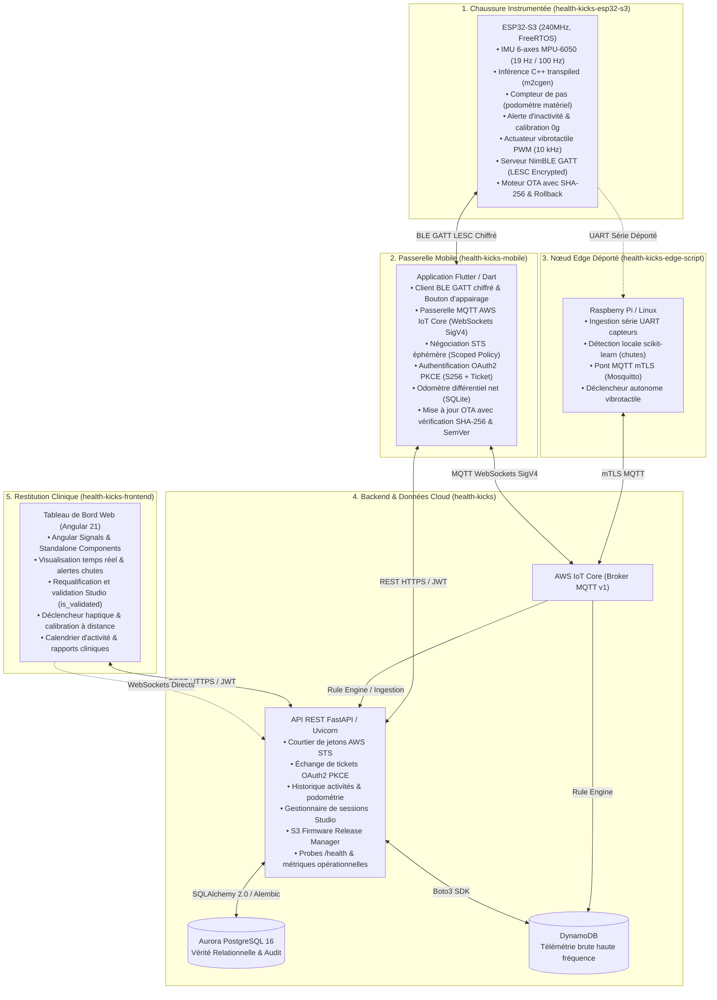

# Vue d'Ensemble du Système HealthKicks

L'écosystème **HealthKicks** est une solution connectée temps réel de prévention des chutes, d'analyse biomécanique de la marche et de stimulation haptique plantaire. Il intègre de l'intelligence embarquée à la source (_Edge AI_ sur microcontrôleur ESP32-S3 ou Raspberry Pi), une passerelle mobile Flutter/Dart, une API Cloud FastAPI élastique, et une interface clinique réactive sous Angular 21.

---

## 1. Cartographie Globale des Composants

---

## 2. Rôles et Responsabilités des Sous-Projets

### A. Firmware Embarqué (`health-kicks-esp32-s3/`)

- **Technologies** : ESP32-S3-DevKitC-1 (Xtensa dual-core 240 MHz), Framework Arduino-ESP32 / PlatformIO, FreeRTOS, NimBLE-Arduino 1.4.3, MPU-6050 I2C (400 kHz).
- **Responsabilités** :
  - **Acquisition biomécanique** : Échantillonnage à 19 Hz (~94 échantillons sur fenêtre glissante de 5 s) aligné sur le référentiel ISB.
  - **Classifieur Edge AI sur puce** : Inférence locale C++ pure (sans runtime externe, générée via `m2cgen`), détection de chute multiclasse (`fall_forward`, `fall_backward`, `fall_lateral`) et garde biomécanique anti-fausses alertes assises (`isSittingDownNominalPosture`).
  - **Serveur BLE GATT sécurisé** :
    - Service Podomètre (0005) : Odomètre matériel monotone (marche, course, escaliers, non-classifié).
    - Service Haptique (0003) : Patterns vibratoires (0–255, 50–10000 ms), configuration du rappel d'inactivité (Opcode 0x06), calibration zéro (Opcode 0x05).
    - Service Studio (0004 & 0005) : Burst de données télémétriques brutes calibrées.
    - Service Device Information (0x180A) : Version firmware (0x2A26) et date de compilation UTC (0x2A28).
    - Service OTA (0010, 0011, 0012) : Flashage différentiel over-the-air.
  - **Sécurité & Résilience** :
    - Chiffrement de liaison LESC (_LE Secure Connections_) Just Works + Bonding.
    - Fenêtre d'appairage physique de 60 secondes déclenchée par appui sur bouton matériel (`GPIO 14`).
    - Vérification d'intégrité OTA : En-tête magique ESP32 `0xE9`, empreinte cryptographique SHA-256 obligatoire de 32 octets.
    - Fenêtre de probation de 15 secondes au redémarrage avec rollback automatique en cas de défaillance capteur.

### B. Application Mobile (`health-kicks-mobile/`)

- **Technologies** : Flutter 3.x, Dart 3.x, Flutter Blue Plus, MQTT Client, SQLite (sqflite), SharedPreferences.
- **Responsabilités** :
  - **Passerelle de terrain BLE $\leftrightarrow$ Cloud** : Maintien de la connexion Bluetooth avec la chaussure, auto-reconnexion post-reboot OTA.
  - **Courtage d'identité & AWS STS** : Négociation de jetons AWS temporaires (15 minutes) avec politique de session restreinte par `clean_user_id`.
  - **Passerelle MQTT SigV4** : Connexion temps réel sur `healthkicks/v1/{device_id}/*` via WebSockets signés AWS SigV4.
  - **Odométrie différentielle SQLite** : Calcul du delta de pas journalier net à partir de l'odomètre matériel monotone pour éviter les fuites de pas entre jours calendaires ou lors de redémarrages.
  - **Mise à jour OTA sécurisée** : Téléchargement depuis S3/Cloud, contrôle cryptographique SHA-256, comparaison par Semantic Versioning et tolérance aux décalages horaires UTC.

### C. Backend Cloud (`health-kicks/`)

- **Technologies** : Python 3.11, FastAPI, SQLAlchemy 2.0, PostgreSQL 16 (Aurora), DynamoDB, AWS IoT Core, Alembic, Docker.
- **Responsabilités** :
  - **Gestion des identités & SSO** : Authentification OAuth2 Google et Azure Entra ID avec support strict de **PKCE RFC 7636 (S256)** et échange de jeton par ticket éphémère à usage unique (`POST /api/v1/auth/token/exchange`).
  - **Contrôle d'accès & Isolation RBAC** : Rôles `user`, `clinician`, `admin`. Vérification d'appartenance des dispositifs (`verify_device_ownership`).
  - **Courtage STS AWS IoT** : Génération de session policies strictement restreintes aux identifiants clients de l'utilisateur authentifié (`client/healthkicks-mobile-{userId}-*`).
  - **Observabilité & Santé** : Endpoints `/health` (avec mesure de latence SQL et diagnostic du pool de connexions), `/health/liveness`, `/health/readiness` et `/metrics`.
  - **Pipeline ML & Transpilation** : Scripts `train_detector.py` et `update_edge_model.py` pour réentraîner les modèles d'activité et générer le code C pour l'ESP32.

### D. Frontend Web (`health-kicks-frontend/`)

- **Technologies** : Angular 21 (Standalone Components, Signals), Tailwind CSS, Angular Material, Chart.js, pnpm.
- **Responsabilités** :
  - **Supervision clinique** : Suivi des patients, détection des chutes en direct, analyse des cadences de marche.
  - **Module Studio & Annotation** : Enregistrement de sessions calibrées avec compte à rebours visuel/sensoriel, visualisation des signaux 3-axes ($a_x, a_y, a_z, g_x, g_y, g_z$), requalification et validation des labels cliniques (`is_validated`).
  - **Contrôle matériel distant** : Déclenchement de stimulations haptiques et configuration des seuils d'inactivité.

### E. Agent Edge Déporté (`health-kicks-edge-script/`)

- **Technologies** : Python 3.11, scikit-learn 1.4.2, NumPy, Paho-MQTT, PySerial, Bluezero, packaging Debian.
- **Responsabilités** :
  - Nœud passerelle de secours pour installations fixes (ex: chambre d'hôpital, centre de rééducation) via Raspberry Pi.
  - Acquisition directe par câble USB/Série et inférence de secours sans dépendance au smartphone.

---

## 3. Matrice de Sécurité & Protocoles

| Couche                              | Protocole             | Chiffrement / Intégrité                | Mécanisme de Protection                                                                                        |
| :---------------------------------- | :-------------------- | :------------------------------------- | :------------------------------------------------------------------------------------------------------------- |
| **Footwear BLE**                    | BLE 5.0 GATT          | LESC (_Just Works_ + Bonding)          | Fenêtre d'appairage physique 60s (`GPIO 14`) + Rejet des écritures non chiffrées                               |
| **Firmware OTA**                    | BLE OTA Service       | SHA-256 + Magic Header `0xE9`          | Validation de l'octet magique à l'offset 0, contrôle SHA-256 obligatoire, rollback automatique si IMU en échec |
| **Mobile $\rightarrow$ Cloud REST** | HTTPS (TLS 1.3)       | JWT Bearer (HS256 $\ge 256$ bits)      | OAuth2 PKCE S256 + Ticket éphémère (aucun token en URL GET)                                                    |
| **Mobile $\rightarrow$ AWS IoT**    | MQTT over WebSockets  | AWS SigV4 (HMAC-SHA256)                | AWS STS temporaire (15 min), Client ID scopé strictly par utilisateur                                          |
| **Web $\rightarrow$ Cloud REST**    | HTTPS (TLS 1.3)       | JWT Bearer + Strict-Transport-Security | CSP, HSTS, X-Frame-Options DENY, Rate Limiting par IP/Token                                                    |
| **Données Sensibles**               | PostgreSQL & DynamoDB | Chiffrement au repos (AES-256 KMS)     | Pseudonymisation déterministe via HMAC-SHA256 (`HEALTHKICKS_PSEUDONYMIZATION_PEPPER`)                          |

---

## 4. Référentiel Biomécanique ISB

L'ensemble des composants respecte la norme de l'**International Society of Biomechanics** (_Wu & Cavanagh, 1995_) :

- **Axe X (Antéro-postérieur)** : Positif vers l'avant (propulsion de la foulée).
- **Axe Y (Médio-latéral)** : Positif vers la gauche de la chaussure.
- **Axe Z (Longitudinal / Vertical)** : Positif vers le haut ($+1.0\,g$ statique au repos sur sol plat).
- Plus d'informations : [`docs/architecture/biomechanical_reference_frame.md`](file:///f:/Programmation/healthkicks-ecosystem/docs/architecture/biomechanical_reference_frame.md).
