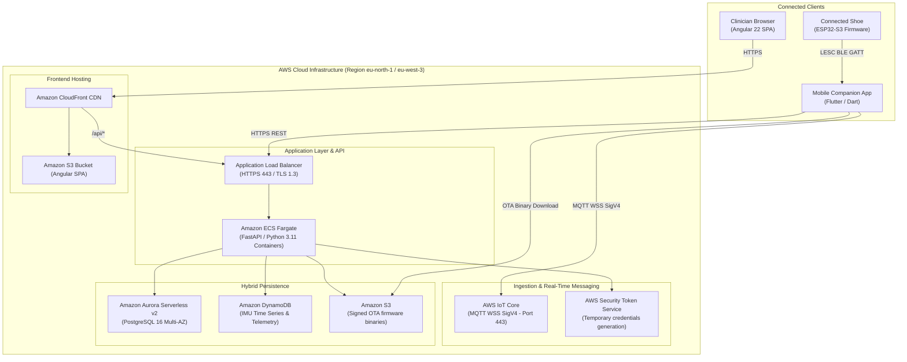

# Cloud Architecture & AWS Deployment Guide

This document describes the cloud deployment architecture of the **HealthKicks** ecosystem on **Amazon Web Services (AWS)**, ensuring high availability, elastic scalability, and compliance with biomechanical and clinical data security requirements.

---

## 1. Global Architecture Diagram

---

## 2. Infrastructure Components Description

### A. AWS IoT Core & Real-Time Messaging

- **Protocol**: MQTT over secure WebSockets (SigV4, port 443), traversing enterprise firewalls and mobile cellular carriers without port blocking.
- **STS Authorization**: Temporary connection credentials are negotiated via the FastAPI endpoint `/api/v1/auth/iot-credentials`.
- **Least Privilege Session Policy**:
  - `iot:Connect` strictly limited to client IDs matching `healthkicks-mobile-{user_id}-*`.
  - `iot:Subscribe` and `iot:Receive` confined to topics belonging to the authenticated user and paired footwear (`healthkicks/v1/{device_id}/*` and `healthkicks/v1/users/{user_id}/*`).

### B. Amazon ECS Fargate (FastAPI Backend)

- **Serverless Container Model**: No EC2 instances to manage, dynamic allocation of vCPU and RAM (0.5 vCPU, 1 GB per task nominally).
- **Auto-scaling**: Triggered on CPU utilization ($\ge 70\%$) and concurrent request counts per task.
- **Lifespan Execution & Migrations**:
  - Upon container boot, FastAPI automatically executes Alembic schema migrations (`alembic upgrade head`) with retry and exponential backoff (up to 3 attempts).
  - In multi-task mode, migration execution is protected by a PostgreSQL advisory lock (`pg_advisory_lock`).

### C. Amazon Aurora Serverless v2 (Relational Database)

- **Engine**: PostgreSQL 16 compatible.
- **Instant Elasticity**: Automatic scaling from 0.5 ACU (Aurora Capacity Units) up to 16 ACU according to workload without downtime.
- **Data Scope**:
  - User accounts, clinician profiles, and RBAC roles.
  - Paired device registry and calibration timestamps.
  - Daily step summaries partitioned by date and activity (`local_daily_steps`).
  - Studio recording session metadata (`studio_sessions`).

### D. Amazon DynamoDB (IMU Time Series)

- **Data Model**: Partition Key `device_id` (String) and Sort Key `timestamp_epoch_us` (Number).
- **On-Demand Mode**: Absorbs high-throughput ingestion spikes during high-frequency Studio Burst offloads (up to 100 Hz).
- **Automated TTL Expiration**: Raw telemetry readings can automatically expire after 90 days (with cold archiving to S3 via DynamoDB Streams).

### E. Amazon CloudFront & S3 (Angular 22 Frontend)

- **SPA Hosting**: Artifacts built by `pnpm build` (`dist/health-kicks-app/browser`) are deployed to a private S3 bucket with Origin Access Control (OAC).
- **Performance & Caching**:
  - Global edge caching on AWS CloudFront.
  - Automatic Brotli / Gzip compression for JavaScript bundles and Tailwind CSS v4 assets.
  - SPA fallback policy redirecting HTML5 client routes to `index.html`.

---

## 3. Security, Encryption & Compliance

1. **End-to-End Encryption**:
   - In transit: Mandatory TLS 1.3 on CloudFront and ALB; MQTT wrapped in WSS (TLS).
   - At rest: AWS KMS encryption (AES-256) on Aurora, DynamoDB, and S3.
2. **Authentication & PKCE**:
   - Google and Microsoft Azure Entra ID SSO flows hardened via RFC 7636 (PKCE S256).
   - JWT tokens never transit in redirect URLs: secure exchange via one-time ephemeral tickets (`POST /api/v1/auth/token/exchange`).
3. **Distributed Traceability**:
   - `X-Correlation-ID` header systematically forwarded from Mobile / Frontend to FastAPI and CloudWatch logs.

---

## 4. Continuous Deployment Strategy (CI/CD)

Production deployment is driven by GitHub Actions (`.github/workflows/deploy.yml`) utilizing a zero-downtime rolling update strategy:

1. **Build & Test Stage**: Strict validation of unit and integration test suites (100% pass required).
2. **Container Build**: Push of Docker image tagged with commit SHA to Amazon ECR.
3. **ECS Service Update**: Progressive rollout of new tasks with health verification (`GET /health`), followed by graceful termination of obsolete tasks.
4. **CDN Cache Invalidation**: Targeted CloudFront invalidation (`aws cloudfront create-invalidation --paths "/*"`).
