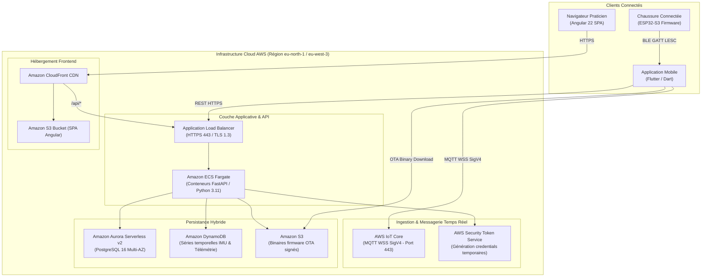

# Guide d'Architecture Cloud & Déploiement AWS

Ce document décrit l'architecture de déploiement cloud de l'écosystème **HealthKicks** sur **Amazon Web Services (AWS)**, assurant haute disponibilité, scalabilité élastique et conformité aux exigences de sécurité des données biomécaniques et cliniques.

---

## 1. Schéma d'Architecture Globale

---

## 2. Description des Composants d'Infrastructure

### A. AWS IoT Core & Messagerie Temps Réel

- **Protocole** : MQTT sur WebSockets sécurisés (SigV4, port 443), permettant de traverser les pare-feux d'entreprise et les réseaux cellulaires mobiles.
- **Autorisation STS** : Les identifiants temporaires de connexion sont négociés via l'endpoint API `/api/v1/auth/iot-credentials` de FastAPI.
- **Politique de Session à Moindre Privilège** :
  - `iot:Connect` restreint strictement aux identifiants clients `healthkicks-mobile-{user_id}-*`.
  - `iot:Subscribe` et `iot:Receive` confinés aux topics de l'utilisateur et de ses dispositifs appairés (`healthkicks/v1/{device_id}/*` et `healthkicks/v1/users/{user_id}/*`).

### B. Amazon ECS Fargate (Backend FastAPI)

- **Modèle serverless de conteneurs** : Pas de gestion de serveurs EC2, allocation dynamique de vCPU et RAM (0.5 vCPU, 1 GB par tâche en nominal).
- **Auto-scaling** : Basé sur l'utilisation CPU ($\ge 70\%$) et le nombre de requêtes concurrentes par tâche.
- **Exécution Lifespan & Migrations** :
  - Au démarrage du conteneur, FastAPI déclenche automatiquement les migrations de schéma Alembic (`alembic upgrade head`) avec un mécanisme de reprise sur panne (jusqu'à 3 tentatives avec backoff exponentiel).
  - En mode multi-tâches, l'exécution des migrations est protégée par un verrou d'avis PostgreSQL (`pg_advisory_lock`).

### C. Amazon Aurora Serverless v2 (Base de Données Relationnelle)

- **Moteur** : PostgreSQL 16 compatible.
- **Scalabilité instantanée** : Ajustement de 0.5 ACU (Aurora Capacity Units) à 16 ACU selon la charge sans interruption de service.
- **Périmètre des Données** :
  - Comptes utilisateurs, profils cliniciens et RBAC.
  - Registre des dispositifs appairés et dates de calibration.
  - Résumés quotidiens de pas partitionnés par date et activité (`local_daily_steps`).
  - Métadonnées des sessions d'enregistrement Studio (`studio_sessions`).

### D. Amazon DynamoDB (Séries Temporelles IMU)

- **Modèle de données** : Clé de partition `device_id` (String) et clé de tri `timestamp_epoch_us` (Number).
- **Mode On-Demand** : Tolère les pics d'ingestion massive lors des déchargements Burst Studio (jusqu'à 100 Hz).
- **Expiration Automatique (TTL)** : Les lectures brutes de télémétrie peuvent expirer automatiquement après 90 jours (sauvegarde froide S3 via DynamoDB Streams).

### E. Amazon CloudFront & S3 (Frontend Angular 22)

- **Hébergement SPA** : Les artefacts générés par `pnpm build` (`dist/health-kicks-app/browser`) sont déployés sur un bucket S3 privé avec accès restreint via Origin Access Control (OAC).
- **Performance & Cache** :
  - Mise en cache globale sur le réseau de bordure AWS CloudFront.
  - Compression Brotli / Gzip automatique des bundles JavaScript et CSS Tailwind v4.
  - Politique de fallback SPA : redirection des routes HTML5 vers `index.html`.

---

## 3. Sécurité, Chiffrement & Conformité

1. **Chiffrement de Bout en Bout** :
   - En transit : TLS 1.3 obligatoire sur CloudFront et l'ALB ; MQTT encapsulé dans WSS (TLS).
   - Au repos : Chiffrement AWS KMS (AES-256) sur Aurora, DynamoDB et S3.
2. **Authentification & PKCE** :
   - Flux SSO Google et Microsoft Azure Entra ID durcis par RFC 7636 (PKCE S256).
   - Les jetons JWT ne transitent jamais dans les URLs de redirection : échange sécurisé via ticket éphémère à usage unique (`POST /api/v1/auth/token/exchange`).
3. **Traçabilité Distribuée** :
   - En-tête `X-Correlation-ID` systématiquement propagé du client Mobile / Frontend vers l'API FastAPI et les logs CloudWatch.

---

## 4. Stratégie de Déploiement Continu (CI/CD)

Le déploiement en production s'appuie sur GitHub Actions (`.github/workflows/deploy.yml`) selon une stratégie zéro interruption (_Zero-Downtime Rolling Update_) :

1. **Étape de Build & Test** : Validation stricte des tests unitaires et intégration (100% de réussite requise).
2. **Construction de l'Image Conteneur** : Push de l'image Docker étiquetée avec le SHA du commit vers Amazon ECR.
3. **Mise à Jour du Service ECS** : Déploiement progressif des nouvelles tâches avec vérification de santé (`GET /health`), puis arrêt des anciens conteneurs.
4. **Invalidation du Cache CDN** : Invalidation ciblée sur CloudFront (`aws cloudfront create-invalidation --paths "/*"`).
