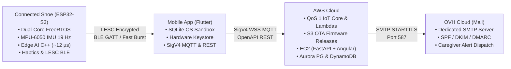

# **HealthKicks**

### Smart Footwear: High-Precision Step Tracking & Autonomous Fall Detection

**Embedded IoT (ESP32-S3)** | **Edge AI (TinyML)** | **Mobile Gateway & AWS IoT Core**

- **ACTIVITY & SPORTS**: Pedometer | Haptic inactivity reminder | Centered on foot kinematics

- **SAFETY & CAREGIVERS**: Fall detection | SMS & email alerting

- **EDGE AI & EFFICIENCY**: Consumer-grade components (cost-effective) | On-chip Edge AI

---

<!--

_backgroundColor: #f8fafc

_color: #0f172a

-->

# **About Me — Background**

### David Serck | Full-Stack, Cloud & IoT Developer

- **Background & Professional Experience (3 Companies)**:

  - **Bachelor's in Business Informatics** — Software engineering, relational databases, and product vision.

  - **Fiduciary / Accounting & Finance** — Strict domain modeling, processing critical data streams, and business automation.

  - **Telecom Operator / Networks** — Connectivity protocols, network fault tolerance, and distributed architectures.

  - **IT Consulting Firm** — Agile full-stack engineering, continuous integration, and product industrialization.

- **Key Competencies Applied to this Project**:

  - **Embedded & Edge AI**: C/C++, ESP32-S3, FreeRTOS, BLE GATT, TinyML (`scikit-learn` / `m2cgen`).

  - **Backend, Cloud & Frontend**: Python (FastAPI), AWS (IoT Core, DynamoDB, Aurora, STS), Angular & Flutter.

- **Online Portfolio & Resume**: [https://daverck.github.io/serck-david-portfolio](https://daverck.github.io/serck-david-portfolio) _(or scan the QR code alongside)_.

<!-- Speaker Notes:

Briefly introduce myself: background, passion for end-to-end projects combining hardware and software, and invite the jury/audience to visit the online portfolio via the link or QR code.

-->

---

<!--

_backgroundColor: #f8fafc

_color: #0f172a

-->

# **1. System Architecture: From Sensor to Multi-Cloud**

### Hybrid Real-Time Pipeline & Separation of Concerns

- **Footwear (ESP32-S3)**: Dual-core FreeRTOS (Core 0: Network/OTA/Power, Core 1: 19 Hz IMU/TinyML ~12 µs inference/Haptic PWM), encrypted LESC BLE GATT server.
- **Mobile Gateway (Flutter)**: Local SQLite database isolated within the private OS sandbox (offline step tracking), hardware encryption for OAuth2/STS tokens via Keystore/Keychain, hybrid gateway with SigV4 MQTT (real-time falls & sensor telemetry) and OpenAPI REST.
- **AWS Cloud**: IoT Core QoS 1 broker ingestion & Lambdas (DynamoDB NoSQL & Aurora PG 16), S3 OTA firmware release bucket (GitHub Actions OIDC), EC2 Docker host (FastAPI REST Backend & Angular 22 Signals Frontend).
- **OVH Cloud**: Dedicated mail server for asynchronous critical fall alerts dispatched to caregivers via secured SMTP (STARTTLS port 587, cryptographic DKIM, SPF, and DMARC enforcement).

<!-- Speaker Notes:
Highlight the strict separation: the sensor is autonomous for safety-critical tasks (fall detection in ~12 µs), mobile isolates keys in Keystore and bridges networks, AWS manages real-time ingestion, firmware OTA and web hosting, while OVH guarantees instant email deliverability to caregivers.
-->

---

<!--

_backgroundColor: #f8fafc

_color: #0f172a

-->

# **2. IoT Core: Instrumented Footwear & ESP32-S3**

### Hardware, Biomechanical Reference & Safe Firmware Maintenance

- **Hardware & Sensors**: ESP32-S3-N16R8 (240 MHz dual-core), MPU-6050 I2C Fast-Mode (400 kHz), 10 kHz PWM haptic motor (MOSFET power stage & flyback diode).

- **ISB Biomechanical Reference Frame**: Vertical Z axis (+1g at rest), X axis forward propulsion/braking, Y axis medio-lateral.

- **Security & OTA Rollback**: Dual A/B flash partitions with mandatory 32-byte SHA-256 digest, 15s probation period with automatic rollback on IMU boot failure.

- **LESC BLE Encryption**: Just Works secure pairing with ECDH key exchange.

<!-- Speaker Notes:

The ESP32-S3 offers vector DSP extensions ideal for computing euclidean vector magnitudes. Wireless OTA is hardened to avoid bricking footwear permanently sealed in the sole.

-->

---

<!--

_backgroundColor: #f8fafc

_color: #0f172a

-->

# **3. Edge Machine Learning: Classification & Safety**

### Canonical Features & Decision Forest (Random Forest)

- **Why Edge AI?** Immediate emergency reaction (< 1 ms), autonomous offline operation, complete raw data privacy.

- **Biomechanical & Temporal Features (19 Hz)**:

  - _Rotationally-invariant spatial magnitudes_: $\Vert a \Vert$, $\Vert \omega \Vert$, min, max, mean, standard deviation, peak-to-peak (P2P), kinetic energies.

  - _Axial distributions & posture_: means and standard deviations of $a_x, a_y, a_z, g_x, g_y, g_z$ (distinguishing still sitting vs lying down).

  - _Temporal directionality_: differential $\Delta a_y$ (end - start), energy asymmetry between 1st and 2nd half of window (distinguishing sitting $\leftrightarrow$ standing).

  - _Transition dynamics & Jerk_: maximum acceleration jerk (sharp fall impact shock vs gentle lying down) and window tail profile.

- **Balanced Random Forest Classifier**: Ensemble of 40 multiclass decision trees with dynamic weighting (`class_weight="balanced"`: proportionately penalizes errors on rare classes such as falls).

- **Temporal Debounce Filtering**: Direct ML inference without rigid physical impact lock-out + temporal debouncing (5000 ms).

---

<!--

_backgroundColor: #f8fafc

_color: #0f172a

-->

# **4. MLOps Loop: From Field to Embedded C Code**

### Studio Ingestion, Stratified 5-Fold CV & Runtime-Free Transpilation

1. **Studio Mode**: Raw IMU data recording (54/100 Hz), BLE burst offloading with CRC32 integrity check to DynamoDB.

2. **Stratified 5-Fold Evaluation**: Incremental local cache accelerating training. Strict balancing of rare classes (falls). Optimized on Macro F1 score.

3. **Pure C Transpilation (m2cgen)**: scikit-learn model converted directly to standard C (`activity_model_generated.h`). Zero dynamic RAM allocations.

4. **Automated Quality Gate & CI**: Strict gate requiring Macro F1 ≥ 85% prior to deployment. PlatformIO automated firmware build verification (`pio run`).

<!-- Speaker Notes:

Complete loop without heavy runtime inference engines (no TensorFlow Lite Micro). Pure, ultra-lightweight C code executing inference in microseconds.

-->

---

<!--

_backgroundColor: #f8fafc

_color: #0f172a

-->

# **5. Networking & Net Differential Step Tracking**

### SQLite Odometry, 100% Real Hourly Buckets & AWS IoT Core

- **Mobile Differential Step Tracking**:

  - Monotonic hardware odometer on ESP32 (without battery-backed RTC clock).

  - Local SQLite differential calculation: `delta = current - previous`.

  - Complete resilience to hardware reboots and clean midnight boundary rollover without step loss.

  - 100% real hourly breakdown (`hourly_steps`), zero artificial extrapolation.

- **Secured Cloud Gateway (AWS IoT Core)**:

  - WebSockets MQTT session cryptographically signed with SigV4 via temporary STS tokens.

  - Alerts published at QoS 1 to `healthkicks/v1/{deviceId}/events/detection`.

<!-- Speaker Notes:

Offline-first by design. If the smartphone loses cell reception, steps continue to accumulate locally and synchronize automatically once connectivity resumes.

-->

---

<!--

_backgroundColor: #f8fafc

_color: #0f172a

-->

# **6. Measured Performance & Validation**

### Key Runtime Metrics & Live Studio Tracking

| Key Metric | Measured Value | System Implication |
| :--- | :--- | :--- |
| **C Inference Time** | **~12 µs** | 0.02% of ESP32-S3 CPU |
| **ML Precision (Macro F1)** | **91.3%** | Reliable multi-activity detection |
| **Overall Accuracy** | **92.2%** | Robustness across all gaits |
| **Fall Recall** | **95.5%** | 95.8% F1 on backward falls |

- **Live Benchmark & Validation**: Detailed confusion matrix and class metrics available live on [https://healthkicks.duckdns.org/dashboard/studio/classes](https://healthkicks.duckdns.org/dashboard/studio/classes).

- **Configurable Inactivity Reminder**: Threshold adjustable from 10 to 120 min with periodic haptic vibration pulse.

- **Rigorous Automated Testing**: 324 FastAPI backend tests and 312 Flutter mobile tests validating SQLite odometry, auth, and synchronization.

---

<!--

_backgroundColor: #f8fafc

_color: #0f172a

-->

# **7. Conclusion & Roadmap**

### Pillars of a Connected & Autonomous Ecosystem

- **Key Achievements**:

  - Frugal & high-performance TinyML: pure C inference with zero runtime engine, 0 KB dynamic RAM allocation.

  - Secure IoT pipeline: LESC BLE encryption, safe OTA updates with rollback, OAuth2 PKCE auth, and temporary STS credentials.

  - Clean & verifiable pedometry: elimination of false steps and faithful hour-by-hour reporting.

  - Peace of mind for loved ones: reliable accident alerting via SMS and email.

- **Technological Roadmap & Next Steps**:

  - **MLOps Enhancement**: Systematic model versioning, artifact registry, and hyperparameter tracking.

  - **Continuous Adaptation**: Fine-tuning predictions to individual user gait signatures.

  - **Cellular Connectivity**: Optional NB-IoT module for full outdoor autonomy without a smartphone.

---

<!--

_class: lead

backgroundColor: #0f172a

color: #f8fafc

-->

# **Thank you for your attention!**

### Technical Q&A & Discussion

- **Portfolio & Profile**: [https://daverck.github.io/serck-david-portfolio](https://daverck.github.io/serck-david-portfolio)

- **Live Web Demonstrator**: [https://healthkicks.duckdns.org](https://healthkicks.duckdns.org)

- **Studio & Model Benchmarks**: [https://healthkicks.duckdns.org/dashboard/studio/classes](https://healthkicks.duckdns.org/dashboard/studio/classes)

- **Key Topics for Discussion**:

  - Net pedometry algorithms & SQLite differential odometry.

  - Zero Trust security, STS brokering, and SigV4 MQTT WebSockets.

  - MLOps lifecycle, C transpilation, and model retraining.
