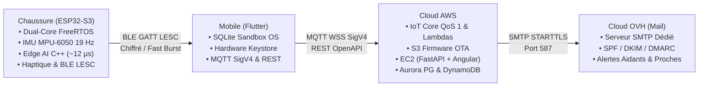

---

marp: true

theme: gaia

_class: lead

paginate: true

backgroundColor: #0f172a

color: #f8fafc

---

# **HealthKicks**

### Chaussure Intelligente : Podométrie Haute Précision & Détection de Chute Autonome

**IoT Embarqué (ESP32-S3)** | **Edge AI (TinyML)** | **Passerelle Mobile & AWS IoT Core**

- **ACTIVITÉ & SPORT** : Podomètre | Rappel d'inactivité haptique | Centré sur le mouvement des pieds

- **SÉCURITÉ & PROCHES** : Détection de chute | Alerte par SMS et email

- **EDGE AI & SOBRIÉTÉ** : Composants standard grand public (coût relativement faible) | Edge AI

---

<!--

_backgroundColor: #f8fafc

_color: #0f172a

-->

# **Qui suis-je ? — Mon Parcours**

### David Serck | Développeur Full-Stack, Cloud & IoT

- **Parcours & Expérience Professionnelle (3 Entreprises)** :

  - **Bachelier en Informatique de Gestion** — Conception logicielle, bases de données relationnelles et vision produit.

  - **Fiduciaire (Gestion & Finance)** — Rigueur de modélisation, traitement de flux critiques et automatisation métier.

  - **Opérateur Télécom (Réseaux)** — Protocoles de connectivité, tolérance aux coupures et architectures distribuées.

  - **ESN (Services Numériques)** — Développement agile full-stack, intégration continue et industrialisation.

- **Compétences Clés mobilisées sur ce projet** :

  - **Embarqué & Edge AI** : C/C++, ESP32-S3, FreeRTOS, BLE GATT, TinyML (`scikit-learn` / `m2cgen`).

  - **Backend, Cloud & Frontend** : Python (FastAPI), AWS (IoT Core, DynamoDB, Aurora, STS), Angular & Flutter.

- **Portfolio & CV en ligne** : [https://daverck.github.io/serck-david-portfolio](https://daverck.github.io/serck-david-portfolio) _(ou scannez le QR code ci-contre)_.

<!-- Notes orateur :

Me présenter brièvement : mon parcours, mon appétence pour les projets complets alliant matériel et logiciel, et inviter le jury/public à consulter mon portfolio en ligne via le lien ou le QR code.

-->

---

<!--

_backgroundColor: #f8fafc

_color: #0f172a

-->

# **1. Architecture Globale : Du Capteur au Multi-Cloud**

### Pipeline Hybride Temps Réel & Ségrégation des Responsabilités

- **Chaussure (ESP32-S3)** : Dual-core FreeRTOS (Cœur 0 Réseau/OTA/Power, Cœur 1 IMU 19 Hz/Inférence TinyML ~12 µs/PWM Haptique), serveur BLE GATT LESC chiffré.
- **Passerelle Mobile (Flutter)** : Base locale SQLite isolée dans la sandbox OS privée (podométrie locale hors-ligne), chiffrement matériel des tokens OAuth2/STS via Keystore/Keychain, passerelle hybride MQTT SigV4 (chutes en temps réel & télémétrie capteur) et REST OpenAPI.
- **Cloud AWS** : Ingestion broker IoT Core QoS 1 & Lambdas (DynamoDB NoSQL & Aurora PG 16), Bucket S3 de releases firmware OTA (GitHub Actions OIDC), serveur EC2 Docker (Backend FastAPI REST & Frontend Angular 22 Signals).
- **Cloud OVH** : Serveur de messagerie dédié pour l'envoi asynchrone des alertes de chute critiques aux proches par SMTP sécurisé (STARTTLS port 587, signatures cryptographiques DKIM, SPF et politique DMARC).

<!-- Notes orateur :
Souligner la séparation stricte : le capteur est autonome pour la sécurité critique (chute en ~12 µs), le mobile isole les clés en Keystore et fait le pont réseau, AWS assure l'ingestion temps réel, l'OTA firmware et l'hébergement web, et OVH garantit la délivrabilité immédiate des alertes email aux aidants.
-->

---

<!--
_backgroundColor: #f8fafc
_color: #0f172a
-->

# **2. Cœur IoT : Chaussure Instrumentée & ESP32-S3**

### Matériel, Référentiel Biomécanique & Maintenance Sécurisée

- **Hardware & Capteurs** : ESP32-S3-N16R8 (240 MHz dual-core), MPU-6050 I2C Fast-Mode (400 kHz), vibreur haptique PWM 10 kHz (étage MOSFET & diode de roue libre).

- **Référentiel Biomécanique ISB** : Axe Z vertical (+1g repos), Axe X propulsion/freinage, Axe Y médio-latéral.

- **Sécurité & Rollback OTA** : Double partition Flash A/B avec digest SHA-256 (32 octets), probation 15s avec rollback automatique en cas d'erreur IMU.

- **Chiffrement BLE LESC** : Appairage sécurisé Just Works avec échange de clés ECDH.

<!-- Notes orateur :

L'ESP32-S3 offre les extensions vectorielles DSP idéales pour le calcul de magnitude euclidienne. L'OTA est sécurisé pour éviter tout bricking d'un équipement scellé dans la semelle.

-->

---

<!--

_backgroundColor: #f8fafc

_color: #0f172a

-->

# **3. Edge Machine Learning : Classification & Sécurité**

### Indicateurs Canoniques & Forêt d'Arbres Décisionnels (Random Forest)

- **Pourquoi l'Edge AI ?** Réaction d'urgence immédiate (< 1 ms), fonctionnement autonome sans réseau, confidentialité totale des données brutes.

- **Features Biomécaniques & Temporelles (19 Hz)** :

  - _Magnitudes spatiales invariantes en rotation_ : $\Vert a \Vert$, $\Vert \omega \Vert$, min, max, moyenne, écart-type, pic-à-pic (P2P), énergies cinétiques.

  - _Dispersions axiales & posture_ : moyennes et écarts-types $a_x, a_y, a_z, g_x, g_y, g_z$ (distinction immobile assis vs couché).

  - _Directionnalité temporelle_ : différentiel $\Delta a_y$ (fin - début), asymétrie d'énergie 1ère/2nde moitié de fenêtre (distinction assis $\leftrightarrow$ debout).

  - _Dynamique de transition & Jerk_ : jerk maximal d'accélération (choc violent de chute vs allongement calme) et profil de queue de fenêtre.

- **Classifieur Random Forest Équilibré** : Ensemble de 40 arbres décisionnels multiclasse avec pondération dynamique (`class_weight="balanced"` : pénalise proportionnellement les erreurs sur les classes rares comme les chutes).

- **Filtrage Temporel Anti-Rebond** : Inférence ML directe sans verrou rigide d'impact physique + debouncing temporel (5000 ms).

---

<!--

_backgroundColor: #f8fafc

_color: #0f172a

-->

# **4. Boucle MLOps : Du Terrain au Code C Embarqué**

### Collecte Studio, Stratified 5-Fold & Transpilation sans Runtime

1. **Mode Studio** : Enregistrement de données IMU brutes (54/100 Hz), transfert burst BLE avec contrôle CRC32 vers DynamoDB.

2. **Évaluation Stratified 5-Fold** : Cache local incrémental pour accélérer l'entraînement. Équilibrage strict des classes rares (chutes). Optimisation sur le Macro F1.

3. **Transpilation C Pure (m2cgen)** : Modèle scikit-learn converti en C standard (`activity_model_generated.h`). 0 Ko d'allocation dynamique en RAM.

4. **Validation Automatique & CI** : Seuil éliminatoire Macro F1 ≥ 85% avant tout déploiement. Compilation de contrôle PlatformIO (`pio run`).

<!-- Notes orateur :

Cycle complet sans framework d'inférence lourd (pas de TensorFlow Lite Micro). Du code C pur, ultra-léger, inféré en quelques microsecondes.

-->

---

<!--

_backgroundColor: #f8fafc

_color: #0f172a

-->

# **5. Réseau & Podométrie Différentielle Nette**

### Odométrie SQLite, Ventilation Horaire Réelle & AWS IoT Core

- **Podométrie Différentielle Mobile** :

  - Odomètre matériel monotone sur ESP32 (sans horloge RTC).

  - Calcul différentiel SQLite local : `delta = current - previous`.

  - Résilience totale aux reboots matériels et bascule nette à minuit sans pertes.

  - Ventilation horaire 100% réelle (`hourly_steps`), aucune extrapolation artificielle.

- **Passerelle Cloud Sécurisée (AWS IoT Core)** :

  - Session WebSockets MQTT signée cryptographiquement en SigV4 via jetons STS temporaires.

  - Alertes transmises en QoS 1 vers `healthkicks/v1/{deviceId}/events/detection`.

<!-- Notes orateur :

Architecture hors-ligne par conception. Si le téléphone perd le réseau, la podométrie continue d'être accumulée localement et synchronisée dès reconnexion.

-->

---

<!--

_backgroundColor: #f8fafc

_color: #0f172a

-->

# **6. Performances Mesurées & Validation**

### Métriques Clés d'Exécution & Suivi Studio en Direct

| Métrique Clé                | Valeur Mesurée | Implication Système           |

| :-------------------------- | :------------- | :---------------------------- |

| **Temps d'inférence C**     | **~12 µs**     | 0.02% du CPU ESP32-S3         |

| **Précision ML (Macro F1)** | **91.3%**      | Détection multi-allure fiable |

| **Exactitude Globale**      | **92.2%**      | Robustesse toutes allures     |

| **Rappel des Chutes**       | **95.5%**      | 95.8% F1 sur chute arrière    |

- **Validation & Benchmark Live** : Matrice de confusion et métriques détaillées consultables en direct sur [https://healthkicks.duckdns.org/dashboard/studio/classes](https://healthkicks.duckdns.org/dashboard/studio/classes).

- **Rappel d'Inactivité Paramétrable** : Seuil configurable de 10 à 120 min avec impulsion haptique périodique.

- **Rigueur & Tests Automatisés** : 324 tests backend FastAPI et 312 tests mobile Flutter validant l'odométrie SQLite, l'auth et la synchronisation.

---

<!--

_backgroundColor: #f8fafc

_color: #0f172a

-->

# **7. Conclusion & Perspectives**

### Les Piliers d'un Écosystème Connecté et Autonome

- **Ce que nous avons démontré** :

  - TinyML frugal & performant : inférence en code C pur sans runtime lourd, 0 Ko d'allocation RAM dynamique.

  - Chaîne IoT sécurisée : chiffrement BLE LESC, mise à jour OTA avec rollback, auth OAuth2 PKCE et STS temporaire.

  - Podométrie nette & vérifiable : élimination des faux pas et restitution fidèle heure par heure.

  - Sérénité pour les proches : alerte fiable lors d'un accident par SMS et email.

- **Feuille de Route Technologique & Améliorations** :

  - **Amélioration MLOps** : Versioning systématique des modèles entraînés, registre d'artefacts et traçabilité des hyperparamètres.

  - **Adaptation continue** : Ajustement fin des prédictions à la foulée propre de l'utilisateur.

  - **Connectivité cellulaire** : Module NB-IoT optionnel pour une autonomie totale en extérieur sans smartphone.

---

<!--

_class: lead

backgroundColor: #0f172a

color: #f8fafc

-->

# **Merci pour votre attention !**

### Questions & Échanges Techniques

- **Portfolio & Profil** : [https://daverck.github.io/serck-david-portfolio](https://daverck.github.io/serck-david-portfolio)

- **Démonstrateur Web Live** : [https://healthkicks.duckdns.org](https://healthkicks.duckdns.org)

- **Studio & Benchmark des Modèles** : [https://healthkicks.duckdns.org/dashboard/studio/classes](https://healthkicks.duckdns.org/dashboard/studio/classes)

- **Thèmes d'échange** :

  - Algorithmes de podométrie nette & odométrie différentielle SQLite.

  - Sécurité Zero Trust, courtage STS et MQTT WebSockets SigV4.

  - Démarche MLOps, transpilation C et réentraînement de modèles.

